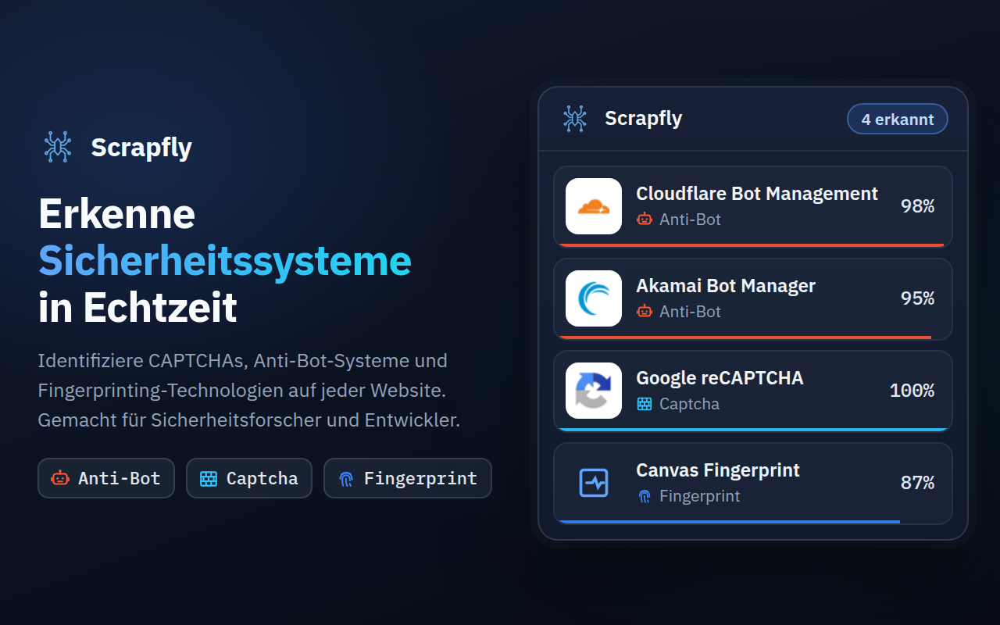
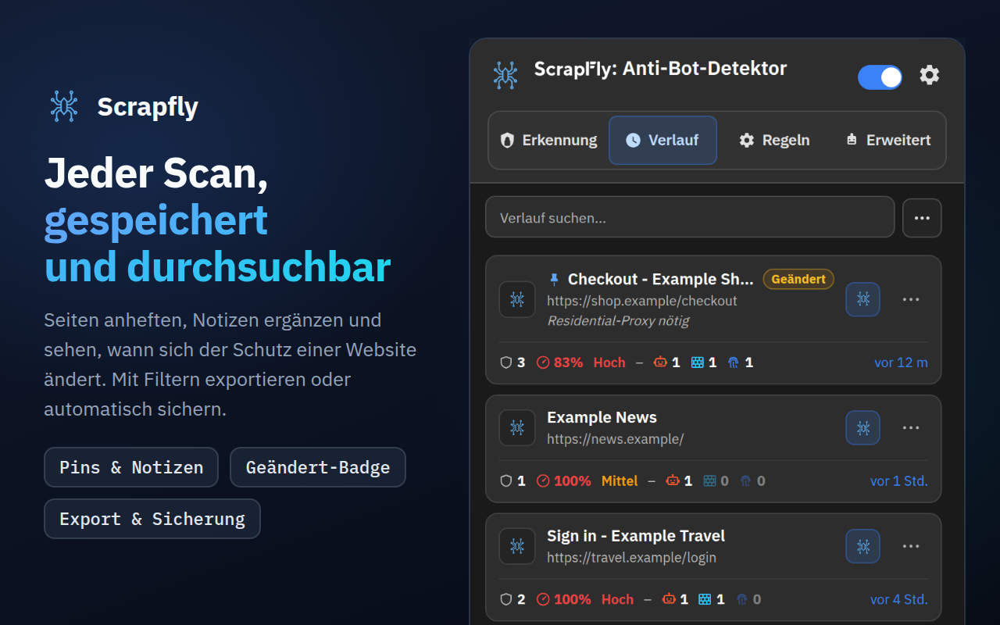
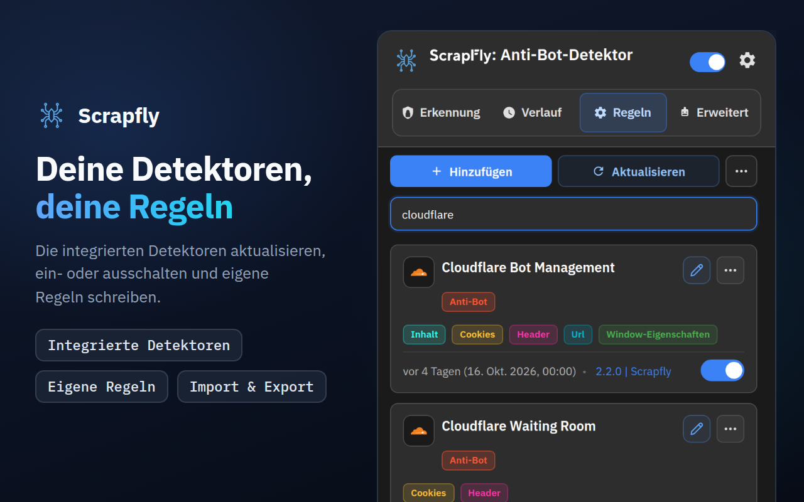
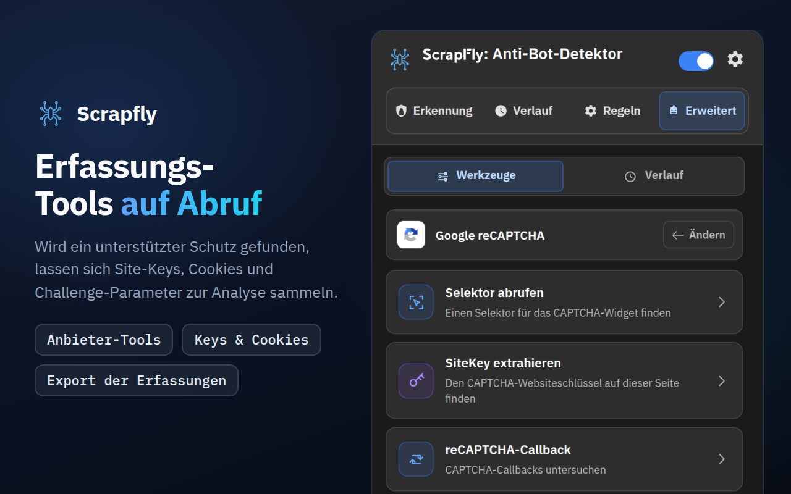
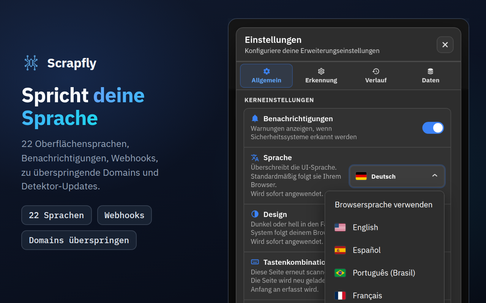

<div align="center">



# Scrapfly Anti-bot Detector

**Sehen Sie, wie sich eine Website gegen Bots verteidigt: welches Anti-Bot-System, welches CAPTCHA, welche Fingerprinting-Skripte und wie sicher jeder Treffer ist.**

[](https://chromewebstore.google.com/detail/scrapfly-anti-bot-detecto/pdpakdgmjhkfimgaihlgaaiijlbilkca)
[](https://chromewebstore.google.com/detail/scrapfly-anti-bot-detecto/pdpakdgmjhkfimgaihlgaaiijlbilkca)
[](https://chromewebstore.google.com/detail/scrapfly-anti-bot-detecto/pdpakdgmjhkfimgaihlgaaiijlbilkca)
[](https://github.com/scrapfly/Antibot-Detector/actions/workflows/ci.yml)
[](../LICENSE)

[**Zu Chrome hinzufügen**](https://chromewebstore.google.com/detail/scrapfly-anti-bot-detecto/pdpakdgmjhkfimgaihlgaaiijlbilkca) · [Produktseite](https://scrapfly.io/products/antibot-detector) · [Neuigkeiten](../CHANGELOG.md) · [llms.txt](../llms.txt) · [Problem melden](https://github.com/scrapfly/Antibot-Detector/issues)

[English](../README.md) · [简体中文](README.zh-CN.md) · [Español](README.es.md) · [Русский](README.ru.md) · [日本語](README.ja.md) · [Português (Brasil)](README.pt-BR.md) · **Deutsch** · [Français](README.fr.md) · [한국어](README.ko.md)

</div>

---

Scrapfly Anti-bot Detector ist eine kostenlose Chrome-Erweiterung, die zeigt, wie sich eine Website vor automatisiertem Datenverkehr schützt. Surfen Sie wie gewohnt: Die Zahl auf dem Symbol in der Symbolleiste gibt an, wie viele Schutzmaßnahmen die Seite einsetzt, und das Popup listet sie mit Konfidenz, Schwierigkeit und den verräterischen Signalen auf.

Sie erkennt von Haus aus 94 Technologien: 49 Anti-Bot-Systeme, 24 CAPTCHAs und 21 Browser-Fingerprinting-Techniken. Jeder Detektor ist eine einfache JSON-Datei, die Sie lesen, ändern oder erweitern können, und neue Regeln kommen mit jeder Version dieses Repositorys. **Regeln → Aktualisieren** kann sie also installieren, noch bevor Chrome die Erweiterung selbst aktualisiert.

Wir haben sie bei [Scrapfly](https://scrapfly.io) gebaut, weil jedes Scraping-Projekt mit derselben Frage beginnt: Was schützt diese Seite? Genauso nützlich ist sie, um zu sehen, wie der Anti-Bot-Schutz der eigenen Website von außen aussieht, oder für Sicherheitsforschung.

## Inhalt

- [Screenshots](#screenshots)
- [Installation](#installation)
- [So funktioniert es](#so-funktioniert-es)
- [Was erkannt wird](#was-erkannt-wird)
- [Ein Rundgang durch das Popup](#ein-rundgang-durch-das-popup)
- [Integrationen](#integrationen)
- [Datenschutz und Berechtigungen](#datenschutz-und-berechtigungen)
- [Entwicklung und Mitwirkung](#entwicklung-und-mitwirkung)
- [Lizenz](#lizenz)

## Screenshots

Klicken Sie auf ein Bild, um es in voller Größe zu sehen.

<table>
  <tr>
    <td width="50%"><a href="../assets/store-screenshots/de/02-history-1280x800.png"></a></td>
    <td width="50%"><a href="../assets/store-screenshots/de/03-rules-1280x800.png"></a></td>
  </tr>
  <tr>
    <td width="50%"><a href="../assets/store-screenshots/de/04-advanced-tools-1280x800.png"></a></td>
    <td width="50%"><a href="../assets/store-screenshots/de/05-settings-1280x800.png"></a></td>
  </tr>
</table>

## Installation

### Chrome Web Store

Der einfachste Weg: [Installation über den Chrome Web Store](https://chromewebstore.google.com/detail/scrapfly-anti-bot-detecto/pdpakdgmjhkfimgaihlgaaiijlbilkca). Chrome hält die Erweiterung für Sie aktuell.

### Aus einem Release

Jede Version auf der [Releases-Seite](https://github.com/scrapfly/Antibot-Detector/releases) enthält ein ladefertiges Zip.

1. Laden Sie das Zip herunter und entpacken Sie es in einen neuen Ordner.
2. Öffnen Sie `chrome://extensions` und aktivieren Sie den **Entwicklermodus** (oben rechts).
3. Klicken Sie auf **Entpackte Erweiterung laden** und wählen Sie diesen Ordner.

### Aus dem Quellcode

Es gibt keinen Build-Schritt. Klonen Sie das Repository und laden Sie den Ordner unverändert:

```bash
git clone https://github.com/scrapfly/Antibot-Detector.git
```

Folgen Sie dann den Schritten 2 und 3 oben und wählen Sie den geklonten Ordner. Nachdem Sie eine Datei bearbeitet haben, klicken Sie in `chrome://extensions` auf der Karte der Erweiterung auf die Schaltfläche zum Neuladen und laden Sie die Seite neu, die Sie testen.

## So funktioniert es

Wenn eine Seite lädt, sammelt die Erweiterung, was die Seite über sich verrät, und gleicht es mit jedem aktivierten Detektor ab. Jeder Detektor kombiniert bis zu acht Methoden:

| Methode | Was geprüft wird | Beispielsignal |
| --- | --- | --- |
| URL | Die Adresse der Seite, die Herkunft der Skripte und alle Netzwerkanfragen | `challenges.cloudflare.com/turnstile/v0/api.js` |
| Cookies | Cookies, die die Website setzt oder sendet, einschließlich HttpOnly | `_abck` (Akamai), `datadome` |
| Header | Antwort- und Anfrage-Header | `x-kpsdk-ct` (Kasada) |
| Inhalt | Das HTML der Seite und der Code ihrer eingebetteten und geladenen Skripte | `KPSDK.configure(` |
| DOM | Elemente, die auf einen CSS-Selektor passen | `.cf-turnstile[data-sitekey]` |
| Window-Eigenschaften | Objekte, die Skripte zu `window` hinzufügen | `grecaptcha.render` |
| JavaScript-Hooks | Aufrufe von Browser-APIs, die häufig für Fingerprinting genutzt werden | `HTMLCanvasElement.prototype.toDataURL` |
| Payload | Bodys von POST-, PUT- und PATCH-Anfragen, optional nach URL und Methode gefiltert, sowie die Antworten der URLs, die eine Regel benennt | `sensor_data` (Akamai), `"proofofwork":{"required":true` (OpenAI Sentinel) |

**Konfidenz.** Jede Regel hat ihre eigene Konfidenz, und Detektoren definieren Regelkombinationen, die gemeinsam höher bewertet werden. Ein Skript, das nur den Namen eines Anbieters erwähnt, erreicht 5–10 %; ein Signal, das nur das Produkt dieses Anbieters erzeugt (sein eigener Skript-Host, sein eigenes Cookie, sein Challenge-Endpunkt), ist ein Beweis und erreicht allein 100 %, ebenso wie die vollständige Integration eines Anbieters (sein Skript zusammen mit seinem Cookie, dem Frame seines Widgets oder seiner Challenge-Anfrage). Geteilte oder generische Signale liegen zwischen 15 und 90 %. Der Wert jedes Detektors ist der seiner stärksten Regel oder Kombination. Die Seite erhält außerdem eine Schwierigkeit (Niedrig, Mittel oder Hoch), die die Farbe des Symbols in der Symbolleiste bestimmt. Sie richtet sich nur nach den Anti-Bot- und CAPTCHA-Schutzmaßnahmen, die mit 50 % oder mehr gefunden wurden: Fingerprinting und ein Skript, das einen Anbieter nur erwähnt, zählen nicht.

**Fingerprinting.** Die API-Hooks werden installiert, bevor die Skripte der Seite selbst laufen, und decken auch Iframes derselben Herkunft ab, in denen sich Fingerprinting-Code oft versteckt. Standardmäßig beobachten sie mindestens 4 Sekunden, danach so lange, bis die Seite 2 Sekunden ruhig war, höchstens aber 8 Sekunden.

**Cache.** Ein Ergebnis wird standardmäßig 7 Tage wiederverwendet, sodass die Rückkehr zu einer Seite es sofort anzeigt. Unter **Einstellungen → Erkennung** können Sie die Dauer ändern und festlegen, ob ein Ergebnis für die ganze Domain, für Seiten mit demselben Pfad oder nur für die exakte URL gilt. **Cache leeren** im Tab Erkennung vergisst das gespeicherte Ergebnis, sodass die Seite beim nächsten Laden erneut gescannt wird. Auch das Bearbeiten, Deaktivieren, Importieren oder Aktualisieren von Regeln leert die gespeicherten Ergebnisse, sodass jede Seite beim nächsten Besuch mit den neuen Regeln erneut gescannt wird.

## Was erkannt wird

Diese Listen sind die Detektoren, die mit der Erweiterung ausgeliefert werden. Sie können jeden deaktivieren, bearbeiten oder im Tab Regeln eigene hinzufügen.

Jedes Anti-Bot-System hat eine eigene Seite mit den Cookies, Headern und Skripten, die es verraten: [Seiten zur Anti-Bot-Erkennung](antibots/de/README.md).

<details>
<summary><b>Anti-Bot-Systeme (49)</b></summary>
<br>

Akamai Bot Manager · Alibaba Cloud WAF · Amazon Bot Protection · Anubis · AWS WAF · Azure Front Door · Azure WAF · Bunny Shield · Castle · Cheq · Cloudflare Bot Management · Cloudflare Waiting Room · DataDome · DDoS-Guard · DeepSeek PoW · F5 BIG-IP ASM · Fastly Bot Management · FingerprintJS · Forter · Google BotGuard · Google Cloud Armor · Huawei Cloud WAF · HUMAN (PerimeterX) · Hunt · Incapsula (Imperva) · iovation (TransUnion TruValidate) · Jiasule (Chuangyu Shield) · Kasada · Kount · Meetrics Check · Netacea · Ocule · OpenAI Sentinel · Queue-it · Radware Bot Manager · Reblaze · Riskified · Ruishu · SEON · Shape Security · Sift · Signifyd · SiteGround SG-CAPTCHA · Sucuri WAF · Tencent Cloud EdgeOne · ThreatMetrix · Vercel Firewall · Wordfence · Yundun Cloud WAF

</details>

<details>
<summary><b>CAPTCHAs (24)</b></summary>
<br>

AliExpress CAPTCHA · Aliyun Captcha 2.0 · ALTCHA · Basilisk Captcha · Binance Captcha · Cap · Captcha.eu · CaptchaFox · Capy Puzzle Captcha · Cloudflare Turnstile · Dingxiang Captcha · EU CAPTCHA (Myra) · Friendly Captcha · FunCaptcha (Arkose Labs) · GeeTest · Google reCAPTCHA · hCaptcha · Lemin Cropped Captcha · MTCaptcha · NetEase Yidun · Prosopo Procaptcha · QCloud Captcha · Shumei Captcha · Yandex SmartCaptcha

</details>

<details>
<summary><b>Fingerprinting-Techniken (21)</b></summary>
<br>

Audio · Battery API · Canvas · Clipboard API · Crypto · CSS · Device Orientation · Font · Gamepads API · Geolocation · Hardware · IndexedDB · Media · Navigator · Performance · Screen · Timezone/Intl · USB API · Web Storage · WebGL · WebRTC

</details>

## Ein Rundgang durch das Popup

### Erkennung

Die auf der aktuellen Seite gefundenen Schutzmaßnahmen, jeweils mit Konfidenz, Schwierigkeit und den Methoden, die gegriffen haben. Klicken Sie auf eine Karte, um die genauen Signale dahinter zu sehen, oder nutzen Sie die Chips unter dem Suchfeld, um nur Anti-Bot-, Captcha- oder Fingerprint-Ergebnisse anzuzeigen. Beim Überfahren des Symbols in der Symbolleiste werden sie genannt, ohne das Popup zu öffnen. **Jetzt erneut scannen** neben der Adresse der Seite und **Alt+Shift+S** (Control+Shift+S auf dem Mac; änderbar in den Tastenkürzeln des Browsers) scannen die aktuelle Seite erneut. Die Schaltflächen oben ermöglichen:

- **Erkennungen hochladen**, um einen teilbaren Link zu erhalten (standardmäßig dpaste.com; siehe [Links zum Teilen](#links-zum-teilen))
- **Cache leeren**, damit die Seite beim nächsten Laden erneut gescannt wird
- **Kopieren**, ein Menü: dieselbe Zusammenfassung, die der Upload teilt, eine Markdown-Tabelle für ein Ticket oder einen Chat, eine Zeile mit der Website und ihren Schutzmaßnahmen oder JSON (keines davon enthält Cookie- oder Header-Werte); oder Code, der die Seite erneut abruft, als curl-Befehl, Python (requests) oder Node.js (fetch), mit User-Agent, Accept-Language und Client Hints dieses Browsers und allen Cookies, die die Seite sendet, auch den HttpOnly-Cookies. Dieser Code enthält die Cookie-Werte und die Adresse der Seite mit ihrem Query-String; geben Sie ihn daher nicht weiter
- **Diese Domain blockieren**, damit die Erweiterung sie nicht mehr scannt

### Verlauf

Jede Seite, auf der es Erkennungen gab, mit ihren Schutzmaßnahmen und ihrer Schwierigkeit. Durchsuchen Sie ihn (Akzente werden ignoriert), grenzen Sie ihn mit den Chips unter dem Suchfeld ein (Angeheftet, Geändert, eine Kategorie oder Kombinationen, also Seiten, auf denen eine Signalkombination gegriffen hat), öffnen Sie einen Eintrag für Details, importieren Sie einen JSON-Export und exportieren Sie ihn als JSON, CSV, reinen Text oder Markdown, wobei Sie zuvor Schutzmaßnahmen, Zeitraum, Website und angeheftete Seiten wählen. Über das Menü **⋯** eines Eintrags können Sie ihn anheften (er bleibt erhalten, wenn der Verlauf bereinigt wird), eine Notiz hinzufügen, die Seite öffnen, sie jetzt erneut scannen oder als Markdown kopieren. Ein Klick auf eine Benachrichtigung über geänderte Schutzmaßnahmen öffnet diese Seite. Die Markierung **Geändert** kennzeichnet eine Seite, deren Schutzmaßnahmen sich von ihrem letzten Scan unterscheiden. **Einstellungen → Daten → Statistiken öffnen** öffnet eine Statistikseite (Aktivität, Schutzmaßnahmen, Domains, Konfidenz, Signale, Kombinationen, Regeln und erweiterte Werkzeuge), die lokal aus Ihrem Verlauf berechnet wird.

**Massenscan** im Menü **Weitere Aktionen** (⋯) des Verlaufs scannt eine Liste von Seiten für Sie: Fügen Sie Adressen oder eine https-Sitemap ein oder laden Sie eine .txt- oder .csv-Datei hoch, und jede Seite wird nacheinander in einem Hintergrund-Tab geöffnet, wie ein echter Besuch mit Ihren Cookies. Wählen Sie, wie viele Seiten gescannt werden und welches Zeitlimit pro Seite gilt, pausieren oder stoppen Sie den Lauf (er läuft weiter, auch wenn Sie das Popup schließen), scannen Sie fehlgeschlagene Seiten erneut und exportieren Sie die Tabelle als CSV, JSON oder Markdown. Fertige Seiten durchlaufen den normalen Scan, werden also im Verlauf erfasst (sofern er nicht pausiert ist) und an Ihren Webhook gesendet, und die Summen erhalten eine Zeile **Am häufigsten gesehen** mit den Schutzmaßnahmen, die auf den meisten Seiten gefunden wurden. Eine Sitemap fügt nur Seiten ihrer eigenen Website hinzu, und Websites, die Sie unter **Einstellungen → Erkennung** überspringen, bleiben außen vor.

### Regeln

Alle Detektoren, die mitgelieferten und Ihre eigenen; die Chips unter dem Suchfeld grenzen die Liste auf eine Kategorie oder auf benutzerdefinierte, bearbeitete oder deaktivierte Detektoren ein. Schalten Sie jeden ein oder aus, öffnen Sie den Editor, um seine Muster zu ändern, oder fügen Sie mit **Hinzufügen** einen eigenen Detektor hinzu. Das Menü **Weitere Aktionen** (⋯) importiert und exportiert Detektoren als JSON. Jedes Muster hat eigene Optionen: wo gesucht wird (die Seite, die Skripte oder alle Anfragen; Anfrage oder Antwort bei Cookies und Headern), ob es ein regulärer Ausdruck, ein ganzes Wort oder groß-/kleinschreibungsabhängig ist, und seine Konfidenz. Der Editor verwaltet außerdem die Kombinationen und das Symbol des Detektors, und ein Regex-Assistent erlaubt es, ein Muster an einem Beispieltext zu testen. **Mit dem Verlauf prüfen** zeigt, auf wie vielen Ihrer gespeicherten Seiten jedes Muster und jede Kombination greift, und **Auf dieser Seite testen** führt die Regel so, wie sie gerade ist (einschließlich ungespeicherter Änderungen), auf der Seite aus, auf der das Popup geöffnet ist: was jedes Cookie-, URL-, Inhalts- und DOM-Muster dort findet und ob die Regel und ihre Kombinationen greifen. Muster für Header, JS-Hooks, Window und Payload kann nur ein echter Scan beantworten, daher weist der Test sie als solche aus, statt «kein Treffer» zu melden. Nichts wird gespeichert oder gesendet.

**Aktualisieren** lädt die offiziellen Detektoren aus der neuesten Version dieses Repositorys herunter. Ein mitgelieferter Detektor, den Sie bearbeitet haben, wird nie ohne Nachfrage ersetzt: Sie wählen zwischen Ihrer Version und der neuen. Wenn Sie einen mitgelieferten Detektor löschen, bringt ihn **Offizielle Detektoren wiederherstellen** im selben Menü zurück. Detektor-Updates lassen sich auch planen (**Einstellungen → Allgemein**).

### Erweitert

Praktische Werkzeuge für die Schutzmaßnahmen, die eine Seite einsetzt. Eine Schutzmaßnahme erhält ihre Werkzeuge, wenn sie mit mehr als 50 % Konfidenz erkannt wird; diese Schwelle können Sie unter **Einstellungen → Erkennung → Erweiterte Werkzeuge** ändern. Erreicht nichts auf der Seite die Schwelle, sagt der Tab das, nennt dieses Minimum (oder die darunter gefundene Schutzmaßnahme) und zeigt die 27 unterstützten Schutzmaßnahmen.

| Schutzmaßnahme | Werkzeuge |
| --- | --- |
| Akamai Bot Manager | Check Cookies · Analyze Scripts · Extract Sensor Information · Start Capturing |
| AWS WAF | Check Cookies · Analyze Scripts |
| Cloudflare Bot Management | Check Cookies · Analyze Scripts |
| Cloudflare Turnstile | Extract SiteKey · Analyze Scripts |
| DataDome | Check Cookies · Analyze Scripts |
| FunCaptcha (Arkose Labs) | Extract Public Key · Analyze Scripts · Start Capturing |
| GeeTest | Check Version · Analyze Scripts |
| Google reCAPTCHA | Obtain Selector · Extract SiteKey · reCAPTCHA callback · Start Capturing |
| hCaptcha | Extract SiteKey · Check Version · Analyze Scripts · Start Capturing |
| Incapsula (Imperva) | Check Cookies · Analyze Scripts · Start Capturing |
| Shape Security | Check Version · Check Cookies · Analyze Scripts · Start Capturing |
| Aliyun Captcha 2.0, ALTCHA, Captcha.eu, Capy Puzzle Captcha, Dingxiang Captcha, Friendly Captcha, Lemin Cropped Captcha, MTCaptcha, NetEase Yidun, Prosopo Procaptcha, QCloud Captcha, Shumei Captcha, Yandex SmartCaptcha | Extract SiteKey · Analyze Scripts |
| AliExpress CAPTCHA, Basilisk Captcha, Binance Captcha | Analyze Scripts |

Ergebnisse und Mitschnitte werden 30 Minuten lang unter **Erweitert → Verlauf** aufbewahrt, wo Sie sie nach Website, Anbieter und Werkzeug filtern, erneut öffnen und exportieren können.

### Einstellungen

- **Allgemein:** Oberflächensprache (22 Sprachen; standardmäßig die des Browsers), Design (Dunkel, Hell oder System), Benachrichtigungen, Debug-Modus, geplante Detektor-Updates, was die Zahl in der Symbolleiste zählt (jede Erkennung oder nur Anti-Bot und CAPTCHA) und die Farben für Symbol, Kategorien und Labels.
- **Erkennung:** Dauer und Geltungsbereich des Caches, die Reihenfolge der Kategorien in den Ergebnissen, die Konfidenzschwelle für erweiterte Werkzeuge, welche Websites gescannt werden (alle außer den übersprungenen oder nur die gewählten), JS-API-Ereignisse, Webhooks und Links zum Teilen.
- **Verlauf:** was aufgezeichnet wird (Verlauf pausieren, private Fenster überspringen, ignorierte Websites, Mindestkonfidenz, Seiten nur mit Fingerprinting überspringen), wie viele Einträge behalten werden (bis zu 10.000; 0 behält die letzten 1.000), Einträge nach einer Anzahl von Tagen oder beim Schließen des Browsers löschen, wiederholte Scans überspringen oder aktualisieren, Hinweise bei geänderten Schutzmaßnahmen einer Seite, das Standard-Exportformat, eine Speicheranzeige mit Warnung und ein automatisches Backup in Ihren Downloads-Ordner.

  Der Verlauf ist auf etwa 6 MB begrenzt, oder auf 12 oder 25 MB, wenn Sie unter **Einstellungen → Verlauf** eine größere Größe wählen; wenn er voll ist, werden die ältesten nicht angehefteten Einträge entfernt, und **Einstellungen → Verlauf** nennt, wie viele. Seiten mit einer schwierigen Schutzmaßnahme oder einer, die Sie benennen, können sich selbst anheften (bis zu 50), Seiten nur mit Fingerprinting können nach einer eigenen Anzahl von Tagen gelöscht werden, und bis zu 10 angeheftete Seiten lassen sich überwachen: Sie werden jeden Tag oder jede Woche in einem Hintergrund-Tab erneut gescannt, und der Eintrag wird als Geändert markiert, wenn sich ihre Schutzmaßnahmen ändern (jede Prüfung ist ein echter Besuch mit Ihren Cookies).
- **Daten:** die Statistikseite öffnen; sehen, wie viel Speicher jeder Teil der Erweiterung belegt, und den Erkennungs-Cache, Werkzeug-Mitschnitte, Protokolle oder den Verlauf leeren; Einstellungen, Ihre Regeln und den Verlauf in einer einzigen Datei sichern und wiederherstellen; Einstellungen und Verlauf exportieren oder importieren; die Voreinstellung Datenschutz oder Entwickler anwenden oder alle Einstellungen zurücksetzen; eine Diagnose-Zusammenfassung für einen Fehlerbericht kopieren (ohne Websites, Adressen oder Schlüssel).

## Integrationen

### JavaScript-Ereignisse

Die Erweiterung löst Ereignisse auf `window` der Seite aus, sodass Ihre eigenen Skripte (oder ein Testaufbau) auf ihre Ergebnisse reagieren können:

| Ereignis | Wann |
| --- | --- |
| `scrapfly:ready` | Die Erweiterung wurde in die Seite geladen |
| `scrapfly:onStart` | Ein Scan beginnt (kein zwischengespeichertes Ergebnis oder ein manueller Scan) |
| `scrapfly:onProgress` | Eine Erkennungsmethode ist abgeschlossen |
| `scrapfly:onHooksComplete` | Die JavaScript-Hooks haben die Beobachtung beendet |
| `scrapfly:onWindowPropsComplete` | Die Prüfungen der Window-Eigenschaften sind abgeschlossen |
| `scrapfly:onDetection` | Die Ergebnisse liegen vor, auch die aus dem Cache gelieferten |
| `scrapfly:onError` | Der Scan ist fehlgeschlagen |

```js
const on = (ev, cb) =>
  addEventListener(`scrapfly:${ev}`, cb);

on('onDetection', (e) => {
  const { url, detections } = e.detail;
  console.log(url, detections);
});
```

Da diese Ereignisse die Seite selbst erreichen, kann jede Website, die Sie besuchen, sie abhören und so erfahren, dass die Erweiterung installiert ist. Sie sind standardmäßig deaktiviert; aktivieren Sie sie unter **Einstellungen → Erkennung → JS-API-Ereignisse**.

### Webhooks

Wenn ein Scan Schutzmaßnahmen findet, kann die Erweiterung die Ergebnisse an Ihren eigenen Endpunkt senden. Wählen Sie die HTTP-Methode, fügen Sie Header hinzu und schreiben Sie den Body als Vorlage mit Variablen wie `<SITEURL>`, `<HOSTNAME>`, `<TITLE>`, `<DETECTIONS>`, `<DETECTION_COUNT>`, `<DETECTION_NAMES>` (die Schutzmaßnahmen mit ihrer Konfidenz in einer Zeile), `<HTTP_STATUS>` (der HTTP-Statuscode der Seite, etwa 403 bei einer Sperrseite), `<CATEGORIES>` und `<TIMESTAMP>`. **Mit einer Vorlage starten** (Slack, Mattermost oder Google Chat, Discord oder eine Zeile Klartext) füllt den Content-Type und eine fertige Chat-Nachricht aus. Webhooks gehen nur an HTTPS-Adressen auf öffentlichen Hosts, sind standardmäßig deaktiviert und haben eine Schaltfläche **Testen**. Konfigurieren Sie sie unter **Einstellungen → Erkennung → Webhook-Integration**.

**Letzte Zustellungen und Wiederholungen.** **Einstellungen → Erkennung → Webhook** listet die letzten 20 Versuche auf (die Seite, den Status und die Dauer; nie eine Adresse, einen Header oder eine Payload). Eine fehlgeschlagene Zustellung lässt sich mit **Wiederholen** erneut senden, und bei aktiviertem **Fehlgeschlagene Zustellungen wiederholen** (Standard) versucht es die Erweiterung auch selbst nach 1, 5 und 15 Minuten, wenn es keine Antwort gab oder der Server mit 408, 425, 429 oder 5xx antwortete; eine Ablehnung wie 401, 403 oder 404 wartet auf Ihr **Wiederholen**. Dafür werden die Seitendaten einer fehlgeschlagenen Zustellung eine Stunde lang im Arbeitsspeicher gehalten (höchstens 20), nie auf der Festplatte, und verschwinden, wenn der Browser geschlossen wird; ein Wiederholungsversuch baut die Anfrage mit Ihren aktuellen Webhook-Einstellungen neu auf, sodass eine korrigierte Adresse oder ein korrigiertes Geheimnis verwendet wird und kein Header und kein Geheimnis mit ihm gespeichert ist.

**Signierung.** Legen Sie ein Signatur-Geheimnis fest (oder klicken Sie auf **Generieren** und kopieren Sie es dann auf Ihren Server), und jede Anfrage mit Body wird so signiert wie die Webhooks von Scrapfly selbst: `X-Scrapfly-Webhook-Signature` enthält den HMAC-SHA256 des rohen Bodys in Großbuchstaben-Hexadezimal, mit dem Geheimnis als Schlüssel genau so, wie es geschrieben ist (seine UTF-8-Bytes; ein generiertes Geheimnis wird nicht aus Hexadezimal dekodiert), und `X-Scrapfly-Webhook-Signature-Lowercase` denselben Wert in Kleinbuchstaben. Prüfen Sie ihn gegen den rohen Body, bevor Sie ihn parsen, mit einem Vergleich in konstanter Zeit. GET-, HEAD- und `multipart/form-data`-Anfragen werden nicht signiert, und die URL ist nie Teil der Signatur. Es gibt keinen Zeitstempel-Header; die Standardvorlage sendet `<TIMESTAMP>` im Body, damit Ihr Server alte Anfragen ablehnen kann. Das Geheimnis bleibt in diesem Browser: Exporte, Backups und Diagnosen lassen es weg, und Zurücksetzen behält es, sofern Sie nicht auch die Verbindungen entfernen.

```js
// Node.js, with the raw body as a Buffer (for example express.raw({ type: '*/*' }))
const crypto = require('node:crypto');
function isFromExtension(rawBody, signatureHeader, secret) {
  const expected = Buffer.from(crypto.createHmac('sha256', secret).update(rawBody).digest('hex'));
  const received = Buffer.from(String(signatureHeader || '').toLowerCase());
  return received.length === expected.length && crypto.timingSafeEqual(received, expected);
}
// isFromExtension(req.body, req.get('X-Scrapfly-Webhook-Signature'), process.env.WEBHOOK_SECRET)
```

```python
import hashlib, hmac
def is_from_extension(raw_body: bytes, signature_header: str, secret: str) -> bool:
    expected = hmac.new(secret.encode(), raw_body, hashlib.sha256).hexdigest()
    return hmac.compare_digest(expected, (signature_header or "").lower())
```

### Links zum Teilen

**Erkennungen hochladen** im Tab Erkennung veröffentlicht eine Zusammenfassung der Ergebnisse der Seite, kopiert den Link und öffnet ihn in einem neuen Tab. Die Zusammenfassung enthält die Adresse der Seite ohne Query-String und Fragment, Name, Kategorie und Konfidenz jeder Schutzmaßnahme und welche Methoden gegriffen haben; nie Cookie- oder Header-Werte. Wohin sie geht, und wann sie gelöscht wird, wenn der Dienst es erlaubt, wählen Sie unter **Einstellungen → Erkennung → Uploads zum Teilen**: dpaste.com (Standard), dpaste.org, paste.rs, Pastebin mit Ihrem API-Schlüssel, ein geheimer GitHub-Gist mit Ihrem Token oder Ihr eigener Server.

## Datenschutz und Berechtigungen

Die Erkennung läuft vollständig in Ihrem Browser. Es gibt keine Konten und keine Analysen, und nichts von den Seiten, die Sie besuchen, wird an Scrapfly gesendet. Die Erweiterung stellt einige Netzwerkanfragen, und es ist gut zu wissen, welche:

- **Skriptinhalte.** Um den Code eines Skripts zu lesen, lädt sie die Skripte und Stylesheets der Seite erneut herunter, über den Cache des Browsers und ohne Cookies.
- **Detektor-Updates.** **Aktualisieren**, oder der optionale Zeitplan, fragt `api.github.com` nach der neuesten Version dieses Repositorys und liest dann die Detektordateien dieser Version von `raw.githubusercontent.com`.
- **Website-Symbole.** Der Verlauf und andere Listen zeigen das Favicon der Website selbst oder fordern es beim Favicon-Dienst von Google an, wenn die Website keines hat.
- **Sprachflaggen.** Die Sprachauswahl in den Einstellungen lädt ihre Flaggen von `flagcdn.com`.
- **Nur wenn Sie sie nutzen:** die oben beschriebenen Webhooks und Links zum Teilen. JS-API-Ereignisse verlassen den Browser nie, aber die Seite, die Sie besuchen, kann sie lesen (siehe [JavaScript-Ereignisse](#javascript-ereignisse)).

<details>
<summary><b>Wozu die Erweiterung jede Berechtigung braucht</b></summary>
<br>

| Berechtigung | Wofür sie verwendet wird |
| --- | --- |
| Zugriff auf alle Websites (`http://*/*`, `https://*/*`) | Jede Seite scannen, die Sie öffnen |
| `storage` | Einstellungen, Detektoren, Verlauf und zwischengespeicherte Ergebnisse |
| `tabs`, `activeTab` | Wissen, um welche Seite es im Popup geht, und Seiten wie die Statistikseite öffnen |
| `scripting` | Die erweiterten Werkzeuge innerhalb der Seite ausführen |
| `webRequest` | URLs, Header und Bodys von Anfragen für die Erkennung und die Mitschnitte lesen |
| `webNavigation` | Wissen, wann eine Seite oder ein Frame fertig geladen ist |
| `cookies` | Cookies lesen, auch HttpOnly; einige Analysewerkzeuge setzen ein Schutz-Cookie zurück, bevor sie die Seite neu laden |
| `notifications` | Statusmeldungen der Mitschnitt-Werkzeuge |
| `downloads` | Exportierte Dateien speichern |
| `alarms` | Die geplanten Detektor-Updates und das Aufräumen von altem Verlauf und alten zwischengespeicherten Ergebnissen |
| `unlimitedStorage` | Lässt den Verlauf mehr als die 10-MB-Kontingentgrenze des Browsers belegen, wenn Sie unter **Einstellungen → Verlauf** 12 oder 25 MB wählen; der Verlauf bleibt bei 6 MB, sofern Sie nicht mehr wählen |

</details>

## Entwicklung und Mitwirkung

Die Entwicklerdokumentation gibt es nur auf Englisch, damit sie nie veraltet: [Entwicklung und Prüfungen](../README.md#development), [einen Detektor schreiben](../README.md#writing-a-detector) und [mitwirken](../README.md#contributing). Fehlerberichte und Verbesserungen an Detektoren sind in jeder Sprache willkommen: [eröffnen Sie ein Issue](https://github.com/scrapfly/Antibot-Detector/issues) mit der Adresse der Seite und dem, was Sie erwartet haben.

## Lizenz

Veröffentlicht unter der [Non-Profit Open Software License 3.0](../LICENSE) (NPOSL-3.0).

Copyright © 2026 Scrapfly.
