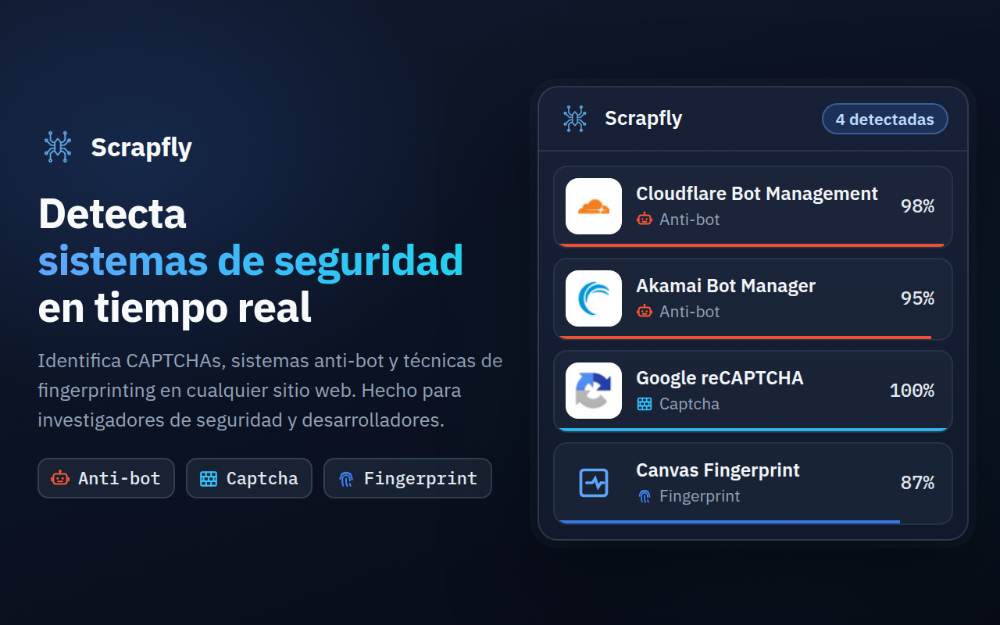
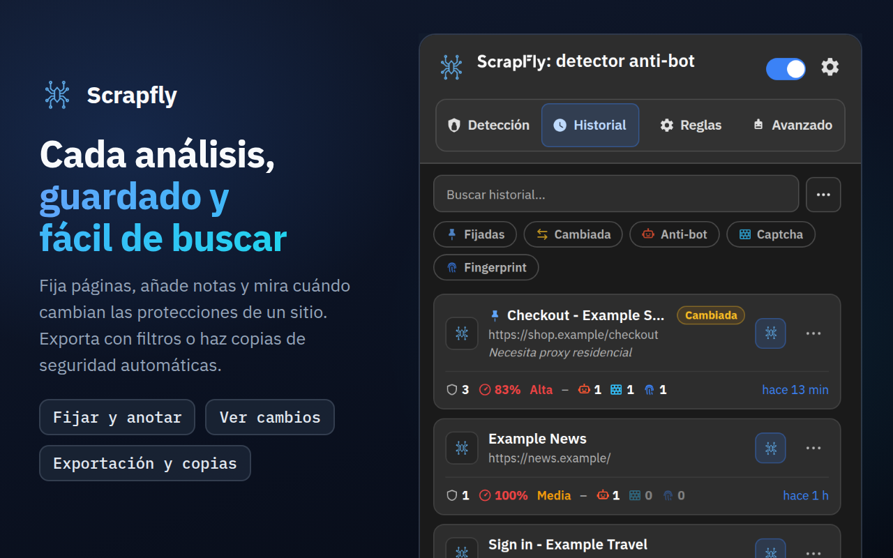
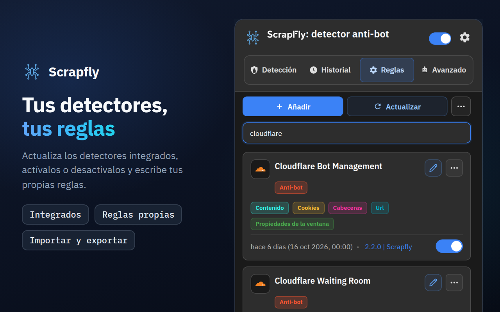
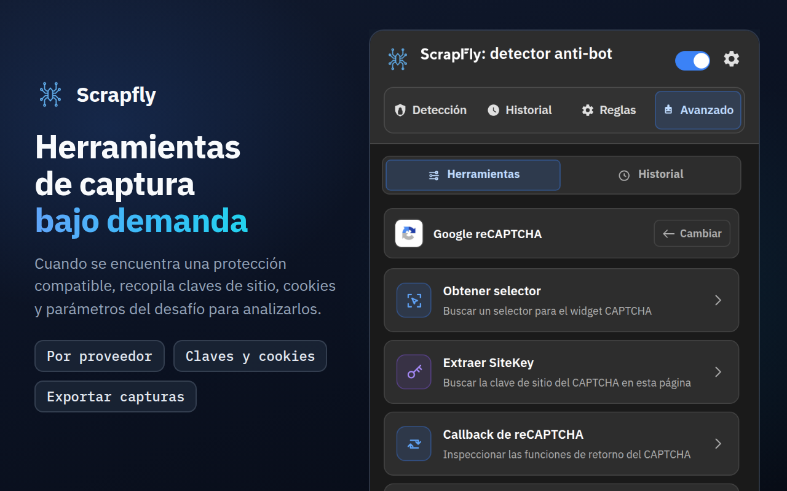
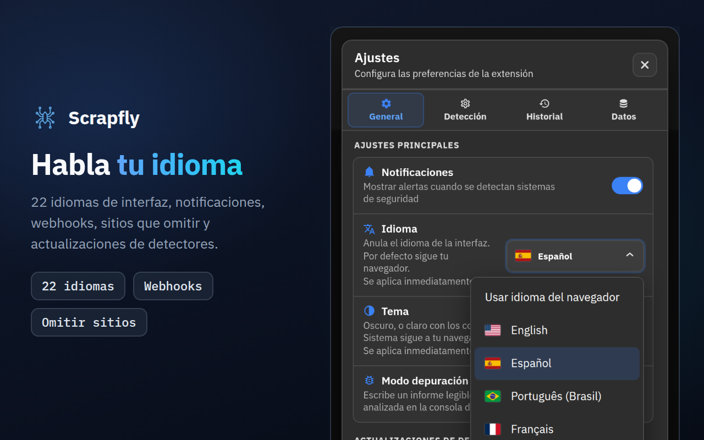

<div align="center">



# Scrapfly Anti-bot Detector

**Descubre cómo se defiende un sitio web de los bots: qué sistema anti-bot, qué CAPTCHA, qué scripts de fingerprinting y con qué seguridad se detecta cada uno.**

[](https://chromewebstore.google.com/detail/scrapfly-anti-bot-detecto/pdpakdgmjhkfimgaihlgaaiijlbilkca)
[](https://chromewebstore.google.com/detail/scrapfly-anti-bot-detecto/pdpakdgmjhkfimgaihlgaaiijlbilkca)
[](https://chromewebstore.google.com/detail/scrapfly-anti-bot-detecto/pdpakdgmjhkfimgaihlgaaiijlbilkca)
[](https://github.com/scrapfly/Antibot-Detector/actions/workflows/ci.yml)
[](../LICENSE)

[**Añadir a Chrome**](https://chromewebstore.google.com/detail/scrapfly-anti-bot-detecto/pdpakdgmjhkfimgaihlgaaiijlbilkca) · [Página del producto](https://scrapfly.io/products/antibot-detector) · [Novedades](../CHANGELOG.md) · [llms.txt](../llms.txt) · [Informar de un problema](https://github.com/scrapfly/Antibot-Detector/issues)

[English](../README.md) · [简体中文](README.zh-CN.md) · **Español** · [Русский](README.ru.md)

</div>

---

Scrapfly Anti-bot Detector es una extensión gratuita de Chrome que muestra cómo se protege un sitio web del tráfico automatizado. Navega como siempre: el número del icono de la barra de herramientas indica cuántas protecciones usa la página, y el popup las enumera con su confianza, su dificultad y las señales que las delataron.

Reconoce 85 tecnologías de serie: 42 sistemas anti-bot, 22 CAPTCHAs y 21 técnicas de fingerprinting del navegador. Cada detector es un archivo JSON sencillo que puedes leer, cambiar o ampliar, y las reglas nuevas llegan con cada versión de este repositorio, así que **Reglas → Actualizar** puede instalarlas antes de que Chrome actualice la propia extensión.

La creamos en [Scrapfly](https://scrapfly.io) porque todo proyecto de scraping empieza con la misma pregunta: ¿qué protege esta página? Es igual de útil para ver cómo se ve desde fuera la protección anti-bot de tu propio sitio, o para investigación de seguridad.

## Contenido

- [Capturas de pantalla](#capturas-de-pantalla)
- [Instalación](#instalación)
- [Cómo funciona](#cómo-funciona)
- [Qué detecta](#qué-detecta)
- [Un recorrido por el popup](#un-recorrido-por-el-popup)
- [Integraciones](#integraciones)
- [Privacidad y permisos](#privacidad-y-permisos)
- [Desarrollo y contribuciones](#desarrollo-y-contribuciones)
- [Licencia](#licencia)

## Capturas de pantalla

Haz clic en una imagen para verla a tamaño completo.

<table>
  <tr>
    <td width="50%"><a href="../assets/store-screenshots/es/02-history-1280x800.png"></a></td>
    <td width="50%"><a href="../assets/store-screenshots/es/03-rules-1280x800.png"></a></td>
  </tr>
  <tr>
    <td width="50%"><a href="../assets/store-screenshots/es/04-advanced-tools-1280x800.png"></a></td>
    <td width="50%"><a href="../assets/store-screenshots/es/05-settings-1280x800.png"></a></td>
  </tr>
</table>

## Instalación

### Chrome Web Store

La opción más sencilla: [instálala desde la Chrome Web Store](https://chromewebstore.google.com/detail/scrapfly-anti-bot-detecto/pdpakdgmjhkfimgaihlgaaiijlbilkca). Chrome la mantiene actualizada por ti.

### Desde una versión publicada

Cada versión de la [página de Releases](https://github.com/scrapfly/Antibot-Detector/releases) lleva adjunto un zip listo para cargar.

1. Descarga el zip y extráelo en una carpeta nueva.
2. Abre `chrome://extensions` y activa el **Modo de desarrollador** (arriba a la derecha).
3. Pulsa **Cargar extensión sin empaquetar** y elige esa carpeta.

### Desde el código fuente

No hay paso de compilación. Clona el repositorio y carga la carpeta tal cual:

```bash
git clone https://github.com/scrapfly/Antibot-Detector.git
```

Después sigue los pasos 2 y 3 de arriba eligiendo la carpeta clonada. Tras editar un archivo, pulsa el botón de recarga en la tarjeta de la extensión en `chrome://extensions` y recarga la página que estés probando.

## Cómo funciona

Cuando una página carga, la extensión reúne lo que la página revela de sí misma y lo compara con cada detector activado. Cada detector combina hasta ocho métodos:

| Método | Qué examina | Señal de ejemplo |
| --- | --- | --- |
| URL | La dirección de la página, el origen de los scripts y todas las peticiones de red | `challenges.cloudflare.com/turnstile/v0/api.js` |
| Cookies | Las cookies que el sitio fija o envía, incluidas las HttpOnly | `_abck` (Akamai), `datadome` |
| Cabeceras | Cabeceras de respuesta y de petición | `x-kpsdk-ct` (Kasada) |
| Contenido | El HTML de la página y el código de sus scripts en línea y cargados | `KPSDK.configure(` |
| DOM | Elementos que coinciden con un selector CSS | `.cf-turnstile[data-sitekey]` |
| Propiedades de la ventana | Objetos que los scripts añaden a `window` | `grecaptcha.render` |
| Interceptores de JavaScript | Llamadas a APIs del navegador muy usadas para fingerprinting | `HTMLCanvasElement.prototype.toDataURL` |
| Carga útil | Cuerpos de las peticiones POST, PUT y PATCH, opcionalmente filtrados por URL y método, y las respuestas de las URL que nombra una regla | `sensor_data` (Akamai), `"proofofwork":{"required":true` (OpenAI Sentinel) |

**Confianza.** Cada regla tiene su propia confianza, y los detectores definen combinaciones de reglas que puntúan más juntas. Un script que solo menciona el nombre de un proveedor puntúa un 5–10 %; una señal que solo produce el producto de ese proveedor (su propio host de scripts, su propia cookie, su endpoint de desafío) es una prueba y puntúa 100 % por sí sola, igual que la integración completa de un proveedor (su script junto con su cookie, el marco de su widget o su petición de desafío). Las señales compartidas o genéricas se quedan entre el 15 y el 90 %. La puntuación de cada detector es la de su regla o combinación más fuerte. La página recibe además una dificultad (Baja, Media o Alta), que marca el color del distintivo de la barra de herramientas.

**Fingerprinting.** Los interceptores de API se instalan antes de que se ejecuten los scripts de la propia página, y también cubren los iframes del mismo origen, donde a menudo se esconde el código de fingerprinting. Por defecto vigilan al menos 4 segundos, después hasta que la página lleva 2 segundos en calma, y 8 segundos como máximo.

**Caché.** Un resultado se reutiliza durante 7 días por defecto, así que al volver a una página se muestra al instante. En **Ajustes → Detección** puedes cambiar la duración y si un resultado lo comparte todo el dominio, las páginas con la misma ruta o solo la URL exacta. **Vaciar caché** en la pestaña Detección olvida el resultado guardado, así que la página se analiza de nuevo la próxima vez que cargue.

## Qué detecta

Estas listas son los detectores que vienen con la extensión. Puedes desactivar cualquiera, editarlo o añadir los tuyos en la pestaña Reglas.

<details>
<summary><b>Sistemas anti-bot (42)</b></summary>
<br>

Akamai Bot Manager · Alibaba Cloud WAF · Amazon Bot Protection · Anubis · AWS WAF · Azure Front Door · Castle · Cheq · Cloudflare Bot Management · Cloudflare Waiting Room · DataDome · DDoS-Guard · DeepSeek PoW · F5 BIG-IP ASM · Fastly Bot Management · FingerprintJS · Forter · Google BotGuard · HUMAN (PerimeterX) · Hunt · Incapsula (Imperva) · iovation (TransUnion TruValidate) · Jiasule (Chuangyu Shield) · Kasada · Kount · Meetrics Check · Netacea · Ocule · OpenAI Sentinel · Queue-it · Radware Bot Manager · Reblaze · Riskified · Ruishu · SEON · Shape Security · Sift · Sucuri WAF · ThreatMetrix · Vercel Firewall · Wordfence · Yundun Cloud WAF

</details>

<details>
<summary><b>CAPTCHAs (22)</b></summary>
<br>

AliExpress CAPTCHA · Aliyun Captcha 2.0 · ALTCHA · Basilisk Captcha · Binance Captcha · Cap · Captcha.eu · Capy Puzzle Captcha · Cloudflare Turnstile · Dingxiang Captcha · Friendly Captcha · FunCaptcha (Arkose Labs) · GeeTest · Google reCAPTCHA · hCaptcha · Lemin Cropped Captcha · MTCaptcha · NetEase Yidun · Prosopo Procaptcha · QCloud Captcha · Shumei Captcha · Yandex SmartCaptcha

</details>

<details>
<summary><b>Técnicas de fingerprinting (21)</b></summary>
<br>

Audio · Battery API · Canvas · Clipboard API · Crypto · CSS · Device Orientation · Font · Gamepads API · Geolocation · Hardware · IndexedDB · Media · Navigator · Performance · Screen · Timezone/Intl · USB API · Web Storage · WebGL · WebRTC

</details>

## Un recorrido por el popup

### Detección

Las protecciones encontradas en la página actual, cada una con su confianza, su dificultad y los métodos que coincidieron. Haz clic en una tarjeta para ver las señales exactas que hay detrás. Al pasar el ratón por el icono de la barra de herramientas se nombran sin abrir el popup, y **Alt+Shift+S** (Control+Shift+S en Mac; cámbialo en los atajos de teclado del navegador) vuelve a analizar la página actual. Los botones de arriba permiten:

- **Subir detecciones** para obtener un enlace para compartir (dpaste.com por defecto; consulta [Enlaces para compartir](#enlaces-para-compartir))
- **Vaciar caché**, para que la página se analice de nuevo en su próxima carga
- **Copiar**, un menú: el mismo resumen que comparte la subida, una tabla Markdown para un ticket o un chat, o JSON (ninguno incluye valores de cookies ni de cabeceras)
- **Bloquear este dominio**, para que la extensión deje de analizarlo

### Historial

Cada página que tuvo detecciones, con sus protecciones y su dificultad. Busca en él, abre una entrada para ver sus detalles, importa una exportación JSON y expórtalo como JSON, CSV, texto plano o Markdown, eligiendo antes las protecciones, el periodo, el sitio y las páginas fijadas. Desde el menú **⋯** de una entrada puedes fijarla (se conserva cuando se limpia el Historial), añadir una nota, abrir la página o analizarla de nuevo ahora. Al hacer clic en una notificación de protecciones cambiadas se abre esa página. La marca **Cambiada** señala una página cuyas protecciones difieren de su último análisis. **Ajustes → Datos → Abrir estadísticas** abre una página de estadísticas (actividad, protecciones, dominios, confianza, señales, combinaciones, reglas y herramientas avanzadas) calculada en local a partir de tu historial.

### Reglas

Todos los detectores, los integrados y los tuyos. Activa o desactiva cada uno, abre el editor para cambiar sus patrones o añade un detector propio con **Añadir**. El menú **Más acciones** (⋯) importa y exporta detectores en JSON. Cada patrón tiene sus propios ajustes: dónde buscar (la página, los scripts o todas las peticiones; petición o respuesta para cookies y cabeceras), si es una expresión regular, palabra completa o distingue mayúsculas, y su confianza. El editor también gestiona las combinaciones y el icono del detector, y un asistente de regex permite probar un patrón con un texto de ejemplo. **Comprobar con el Historial** muestra en cuántas de tus páginas guardadas coincide cada patrón y cada combinación, y **Probar en esta página** ejecuta la regla tal como está ahora (cambios sin guardar incluidos) en la página donde está abierto el popup: qué encuentra allí cada patrón de cookie, URL, contenido y DOM, y si la regla y sus combinaciones coinciden. Los patrones de cabeceras, interceptores de JS, ventana y carga útil solo puede responderlos un análisis real, así que la prueba los indica como tales en vez de como «sin coincidencia». No se guarda ni se envía nada.

**Actualizar** descarga los detectores oficiales de la última versión de este repositorio. Un detector integrado que hayas editado nunca se sustituye sin preguntar: eliges entre tu versión y la nueva. Si borras un detector integrado, **Restaurar detectores oficiales** en el mismo menú lo recupera. Las actualizaciones de detectores también pueden programarse (**Ajustes → General**).

### Avanzado

Herramientas prácticas para las protecciones que usa una página. Una protección obtiene sus herramientas cuando se detecta con más del 50 % de confianza; puedes cambiar ese límite en **Ajustes → Detección → Herramientas avanzadas**. Cuando nada en la página lo alcanza, la pestaña lo dice, indica ese mínimo (o nombra la protección encontrada por debajo) y muestra las 25 protecciones compatibles.

| Protección | Herramientas |
| --- | --- |
| Akamai Bot Manager | Check Cookies · Analyze Scripts · Extract Sensor Information · Start Capturing |
| AWS WAF | Check Cookies · Analyze Scripts |
| Cloudflare Bot Management | Check Cookies · Analyze Scripts |
| Cloudflare Turnstile | Extract SiteKey · Analyze Scripts |
| DataDome | Check Cookies · Analyze Scripts |
| FunCaptcha (Arkose Labs) | Extract Public Key · Analyze Scripts · Start Capturing |
| GeeTest | Check Version · Analyze Scripts |
| Google reCAPTCHA | Obtain Selector · Extract SiteKey · reCAPTCHA callback · Start Capturing |
| hCaptcha | Extract SiteKey · Check Version · Analyze Scripts · Start Capturing |
| Incapsula (Imperva) | Check Cookies · Analyze Scripts · Start Capturing |
| Shape Security | Check Version · Check Cookies · Analyze Scripts · Start Capturing |
| Aliyun Captcha 2.0, Captcha.eu, Capy Puzzle Captcha, Dingxiang Captcha, Friendly Captcha, MTCaptcha, NetEase Yidun, Prosopo Procaptcha, QCloud Captcha, Shumei Captcha, Yandex SmartCaptcha | Extract SiteKey · Analyze Scripts |
| AliExpress CAPTCHA, Basilisk Captcha, Binance Captcha | Analyze Scripts |

Los resultados y las capturas se guardan 30 minutos en **Avanzado → Historial**, donde puedes filtrarlos por sitio, proveedor y herramienta, abrirlos de nuevo y exportarlos.

### Ajustes

- **General:** idioma de la interfaz (22 idiomas; por defecto sigue al navegador), tema (Oscuro, Claro o Sistema), notificaciones, modo de depuración, actualizaciones programadas de detectores y los colores del distintivo, las categorías y las etiquetas.
- **Detección:** duración y alcance de la caché, el orden de las categorías en los resultados, el límite de confianza de las herramientas avanzadas, qué sitios se analizan (todos salvo los que omitas, o solo los que elijas), eventos JS API, webhooks y enlaces para compartir.
- **Historial:** qué se registra (pausar el Historial, omitir ventanas privadas, sitios ignorados, confianza mínima, omitir páginas solo con fingerprinting), cuántas entradas se guardan (hasta 10.000; 0 guarda las 1.000 más recientes), borrar entradas tras un número de días o al cerrar el navegador, omitir o actualizar análisis repetidos, avisos cuando cambian las protecciones de una página, el formato de exportación por defecto, un medidor de almacenamiento con su aviso y una copia de seguridad automática en tu carpeta de Descargas.

  El Historial se limita a unos 6 MB, o a 12 o 25 MB si eliges un tamaño mayor en **Ajustes → Historial**; cuando se llena se eliminan las entradas no fijadas más antiguas, y **Ajustes → Historial** indica cuántas. Las páginas con una protección difícil, o con una que nombres, pueden fijarse solas (hasta 50), las páginas solo con fingerprinting pueden borrarse tras un número de días propio, y hasta 10 páginas fijadas pueden vigilarse: se analizan de nuevo cada día o cada semana en una pestaña en segundo plano, y la entrada se marca como Cambiada cuando cambian sus protecciones (cada comprobación es una visita real con tus cookies).
- **Datos:** abrir la página de estadísticas; ver cuánto espacio usa cada parte de la extensión y vaciar la caché de detección, las capturas de herramientas, los registros o el Historial; hacer una copia de seguridad de los ajustes, tus reglas y el Historial en un solo archivo y restaurarla; exportar o importar tus ajustes y tu historial; aplicar el preajuste Privacidad o Desarrollador o restablecer todos los ajustes; copiar un resumen de diagnóstico para un informe de error (sin sitios, direcciones ni claves).

## Integraciones

### Eventos de JavaScript

La extensión emite eventos en el `window` de la página, así que tus propios scripts (o un entorno de pruebas) pueden reaccionar a sus resultados:

| Evento | Cuándo |
| --- | --- |
| `scrapfly:ready` | La extensión se ha cargado en la página |
| `scrapfly:onStart` | Empieza un análisis (sin resultado en caché, o un análisis manual) |
| `scrapfly:onProgress` | Ha terminado un método de detección |
| `scrapfly:onHooksComplete` | Los interceptores de JavaScript han dejado de vigilar |
| `scrapfly:onWindowPropsComplete` | Han terminado las comprobaciones de propiedades de la ventana |
| `scrapfly:onDetection` | Los resultados están listos, incluidos los servidos desde la caché |
| `scrapfly:onError` | El análisis ha fallado |

```js
const on = (ev, cb) =>
  addEventListener(`scrapfly:${ev}`, cb);

on('onDetection', (e) => {
  const { url, detections } = e.detail;
  console.log(url, detections);
});
```

Como estos eventos llegan a la propia página, cualquier sitio que visites puede escucharlos y saber que la extensión está instalada. Vienen desactivados; actívalos en **Ajustes → Detección → Eventos JS API**.

### Webhooks

Cuando un análisis encuentra protecciones, la extensión puede enviar los resultados a tu propio endpoint. Elige el método HTTP, añade cabeceras y escribe el cuerpo como una plantilla con variables como `<SITEURL>`, `<HOSTNAME>`, `<TITLE>`, `<DETECTIONS>`, `<DETECTION_COUNT>`, `<CATEGORIES>` y `<TIMESTAMP>`. Los webhooks solo van a direcciones HTTPS en hosts públicos, vienen desactivados e incluyen un botón **Probar**. Configúralos en **Ajustes → Detección → Integración de webhook**.

**Envíos recientes y reintentos.** **Ajustes → Detección → Webhook** enumera los últimos 20 intentos (la página, el estado y cuánto tardó; nunca una dirección, una cabecera ni una carga útil). Un envío fallido puede mandarse otra vez con **Reintentar**, y con **Reintentar envíos fallidos** activado (por defecto) la extensión también reintenta sola tras 1, 5 y 15 minutos cuando no hubo respuesta o el servidor respondió 408, 425, 429 o 5xx; un rechazo como 401, 403 o 404 espera a tu **Reintentar**. Para ello, los datos de página de un envío fallido se guardan en memoria durante una hora (20 como máximo), nunca en disco, y desaparecen al cerrar el navegador; un reintento vuelve a construir la petición con tus ajustes de webhook actuales, así que se usa una dirección o un secreto corregidos y no se guarda ninguna cabecera ni secreto con él.

**Firma.** Define un secreto de firma (o pulsa **Generar** y luego cópialo a tu servidor) y cada petición con cuerpo se firma igual que los propios webhooks de Scrapfly: `X-Scrapfly-Webhook-Signature` contiene el HMAC-SHA256 del cuerpo sin procesar en hexadecimal en mayúsculas, con el secreto como clave tal cual está escrito (sus bytes UTF-8; un secreto generado no se decodifica desde hexadecimal), y `X-Scrapfly-Webhook-Signature-Lowercase` el mismo valor en minúsculas. Compruébalo contra el cuerpo sin procesar antes de interpretarlo, con una comparación de tiempo constante. Las peticiones GET, HEAD y `multipart/form-data` no se firman, y la URL nunca forma parte de la firma. No hay cabecera de marca de tiempo; la plantilla por defecto envía `<TIMESTAMP>` en el cuerpo, para que tu servidor pueda rechazar peticiones antiguas. El secreto se queda en este navegador: las exportaciones, las copias de seguridad y los diagnósticos lo omiten, y Restablecer lo conserva salvo que también elimines las conexiones.

```js
// Node.js, with the raw body as a Buffer (for example express.raw({ type: '*/*' }))
const crypto = require('node:crypto');
function isFromExtension(rawBody, signatureHeader, secret) {
  const expected = Buffer.from(crypto.createHmac('sha256', secret).update(rawBody).digest('hex'));
  const received = Buffer.from(String(signatureHeader || '').toLowerCase());
  return received.length === expected.length && crypto.timingSafeEqual(received, expected);
}
// isFromExtension(req.body, req.get('X-Scrapfly-Webhook-Signature'), process.env.WEBHOOK_SECRET)
```

```python
import hashlib, hmac
def is_from_extension(raw_body: bytes, signature_header: str, secret: str) -> bool:
    expected = hmac.new(secret.encode(), raw_body, hashlib.sha256).hexdigest()
    return hmac.compare_digest(expected, (signature_header or "").lower())
```

### Enlaces para compartir

**Subir detecciones** en la pestaña Detección publica un resumen de los resultados de la página, copia el enlace y lo abre en una pestaña nueva. El resumen contiene la dirección de la página sin su query string ni su fragmento, el nombre, la categoría y la confianza de cada protección, y qué métodos coincidieron; nunca valores de cookies ni de cabeceras. Elige adónde va, y cuándo se borra si el servicio lo permite, en **Ajustes → Detección → Subidas para compartir**: dpaste.com (por defecto), dpaste.org, paste.rs, Pastebin con tu clave de API, un Gist secreto de GitHub con tu token, o tu propio servidor.

## Privacidad y permisos

La detección se ejecuta por completo en tu navegador. No hay cuentas ni analítica, y nada de las páginas que visitas se envía a Scrapfly. La extensión sí hace algunas peticiones de red, y conviene que sepas cuáles:

- **Contenido de los scripts.** Para leer el código de un script, descarga de nuevo los scripts y hojas de estilo de la página, a través de la caché del navegador y sin cookies.
- **Actualizaciones de detectores.** **Actualizar**, o la programación opcional, pregunta a `api.github.com` por la última versión de este repositorio y luego lee los archivos de detectores de esa versión desde `raw.githubusercontent.com`.
- **Iconos de sitios.** El Historial y otras listas muestran el favicon del propio sitio, o lo piden al servicio de favicons de Google cuando el sitio no tiene.
- **Banderas de idioma.** El selector de idioma de Ajustes carga sus banderas desde `flagcdn.com`.
- **Solo cuando los usas:** los webhooks y los enlaces para compartir, descritos arriba. Los eventos JS API nunca salen del navegador, pero la página que visitas puede leerlos (consulta [Eventos de JavaScript](#eventos-de-javascript)).

<details>
<summary><b>Por qué la extensión necesita cada permiso</b></summary>
<br>

| Permiso | Para qué se usa |
| --- | --- |
| Acceso a todos los sitios (`http://*/*`, `https://*/*`) | Analizar cualquier página que abras |
| `storage` | Ajustes, detectores, historial y resultados en caché |
| `tabs`, `activeTab` | Saber de qué página trata el popup y abrir páginas como la de estadísticas |
| `scripting` | Ejecutar las herramientas avanzadas dentro de la página |
| `webRequest` | Leer las URL, cabeceras y cuerpos de las peticiones para la detección y las capturas |
| `webNavigation` | Saber cuándo ha terminado de cargar una página o un marco |
| `cookies` | Leer cookies, incluidas las HttpOnly; algunas herramientas de análisis reinician una cookie de protección antes de recargar la página |
| `notifications` | Mensajes de estado de las herramientas de captura |
| `downloads` | Guardar los archivos exportados |
| `alarms` | Las actualizaciones programadas de detectores y la limpieza del historial y los resultados en caché antiguos |
| `unlimitedStorage` | Permite que el Historial ocupe más que la cuota de 10 MB del navegador cuando eliges 12 o 25 MB en **Ajustes → Historial**; el Historial se queda en 6 MB salvo que elijas más |

</details>

## Desarrollo y contribuciones

La documentación para desarrolladores solo está en inglés, para que nunca se quede desactualizada: [desarrollo y comprobaciones](../README.md#development), [cómo escribir un detector](../README.md#writing-a-detector) y [cómo contribuir](../README.md#contributing). Los informes de errores y las mejoras de detectores son bienvenidos en cualquier idioma: [abre una incidencia](https://github.com/scrapfly/Antibot-Detector/issues) con la dirección de la página y lo que esperabas ver.

## Licencia

Publicado bajo la [Non-Profit Open Software License 3.0](../LICENSE) (NPOSL-3.0).

Copyright © 2026 Scrapfly.
