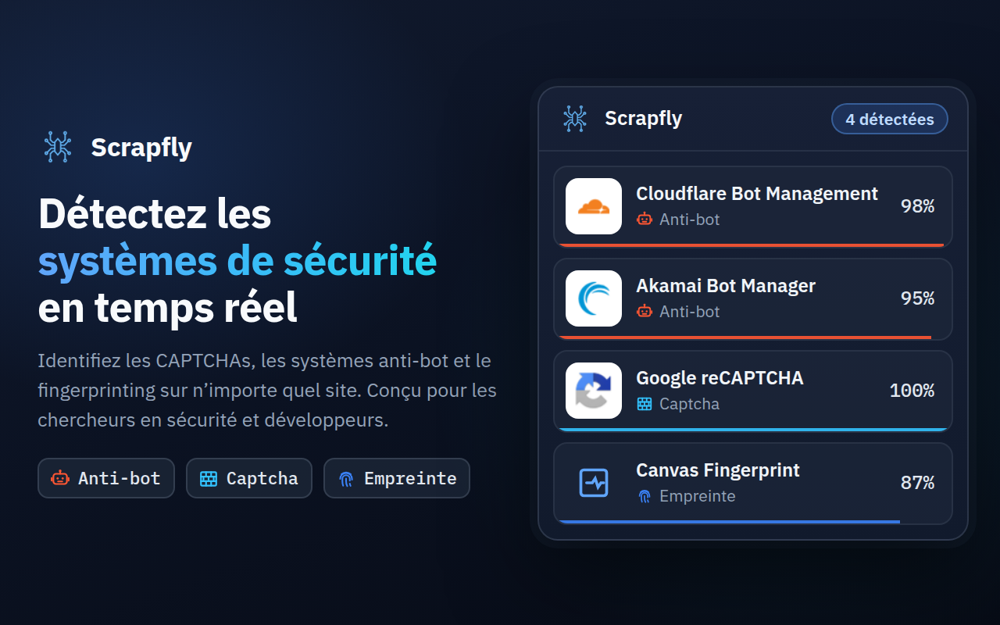
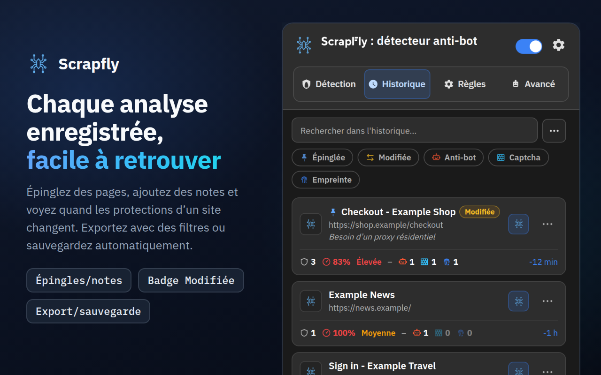
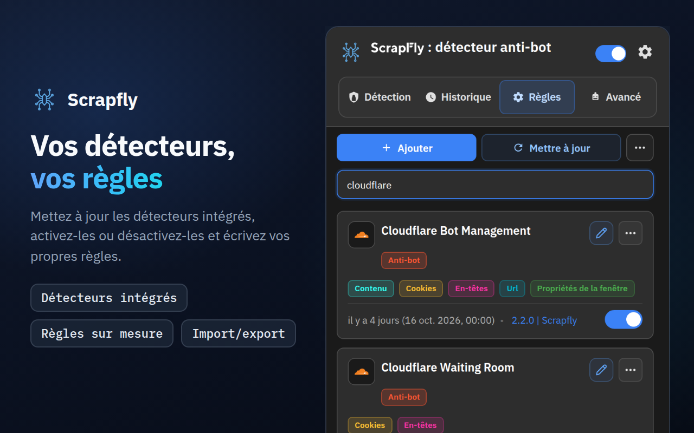
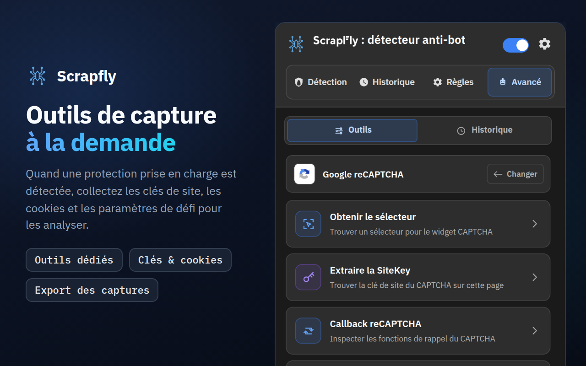
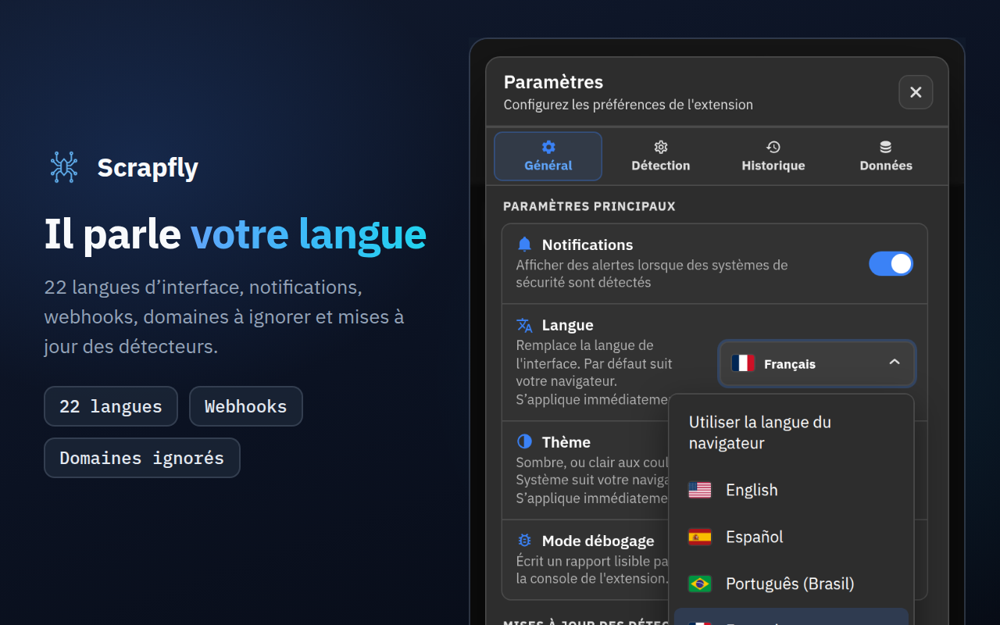

<div align="center">



# Scrapfly Anti-bot Detector

**Voyez comment un site web se défend contre les bots : quel système anti-bot, quel CAPTCHA, quels scripts de fingerprinting, et avec quelle certitude chaque détection est établie.**

[](https://chromewebstore.google.com/detail/scrapfly-anti-bot-detecto/pdpakdgmjhkfimgaihlgaaiijlbilkca)
[](https://chromewebstore.google.com/detail/scrapfly-anti-bot-detecto/pdpakdgmjhkfimgaihlgaaiijlbilkca)
[](https://chromewebstore.google.com/detail/scrapfly-anti-bot-detecto/pdpakdgmjhkfimgaihlgaaiijlbilkca)
[](https://github.com/scrapfly/Antibot-Detector/actions/workflows/ci.yml)
[](../LICENSE)

[**Ajouter à Chrome**](https://chromewebstore.google.com/detail/scrapfly-anti-bot-detecto/pdpakdgmjhkfimgaihlgaaiijlbilkca) · [Page du produit](https://scrapfly.io/products/antibot-detector) · [Nouveautés](../CHANGELOG.md) · [llms.txt](../llms.txt) · [Signaler un problème](https://github.com/scrapfly/Antibot-Detector/issues)

[English](../README.md) · [简体中文](README.zh-CN.md) · [Español](README.es.md) · [Русский](README.ru.md) · [日本語](README.ja.md) · [Português (Brasil)](README.pt-BR.md) · [Deutsch](README.de.md) · **Français** · [한국어](README.ko.md)

</div>

---

Scrapfly Anti-bot Detector est une extension Chrome gratuite qui montre comment un site web se protège du trafic automatisé. Naviguez comme d'habitude : le nombre affiché sur l'icône de la barre d'outils indique combien de protections la page utilise, et le popup les liste avec leur confiance, leur difficulté et les signaux qui les ont trahies.

Elle reconnaît 94 technologies d'origine : 49 systèmes anti-bot, 24 CAPTCHA et 21 techniques de fingerprinting du navigateur. Chaque détecteur est un simple fichier JSON que vous pouvez lire, modifier ou étendre, et les nouvelles règles arrivent avec chaque version de ce dépôt, de sorte que **Règles → Mettre à jour** peut les installer avant même que Chrome ne mette à jour l'extension elle-même.

Nous l'avons créée chez [Scrapfly](https://scrapfly.io) parce que tout projet de scraping commence par la même question : qu'est-ce qui protège cette page ? Elle est tout aussi utile pour voir à quoi ressemble, de l'extérieur, la protection anti-bot de votre propre site, ou pour la recherche en sécurité.

## Sommaire

- [Captures d'écran](#captures-décran)
- [Installation](#installation)
- [Fonctionnement](#fonctionnement)
- [Ce qu'elle détecte](#ce-quelle-détecte)
- [Visite guidée du popup](#visite-guidée-du-popup)
- [Intégrations](#intégrations)
- [Confidentialité et autorisations](#confidentialité-et-autorisations)
- [Développement et contributions](#développement-et-contributions)
- [Licence](#licence)

## Captures d'écran

Cliquez sur une image pour l'afficher en taille réelle.

<table>
  <tr>
    <td width="50%"><a href="../assets/store-screenshots/fr/02-history-1280x800.png"></a></td>
    <td width="50%"><a href="../assets/store-screenshots/fr/03-rules-1280x800.png"></a></td>
  </tr>
  <tr>
    <td width="50%"><a href="../assets/store-screenshots/fr/04-advanced-tools-1280x800.png"></a></td>
    <td width="50%"><a href="../assets/store-screenshots/fr/05-settings-1280x800.png"></a></td>
  </tr>
</table>

## Installation

### Chrome Web Store

L'option la plus simple : [installez-la depuis le Chrome Web Store](https://chromewebstore.google.com/detail/scrapfly-anti-bot-detecto/pdpakdgmjhkfimgaihlgaaiijlbilkca). Chrome la maintient à jour pour vous.

### Depuis une version publiée

Chaque version de la [page Releases](https://github.com/scrapfly/Antibot-Detector/releases) est accompagnée d'un zip prêt à charger.

1. Téléchargez le zip et extrayez-le dans un nouveau dossier.
2. Ouvrez `chrome://extensions` et activez le **Mode développeur** (en haut à droite).
3. Cliquez sur **Charger l'extension non empaquetée** et choisissez ce dossier.

### Depuis le code source

Il n'y a pas d'étape de compilation. Clonez le dépôt et chargez le dossier tel quel :

```bash
git clone https://github.com/scrapfly/Antibot-Detector.git
```

Suivez ensuite les étapes 2 et 3 ci-dessus en choisissant le dossier cloné. Après avoir modifié un fichier, cliquez sur le bouton de rechargement de la carte de l'extension dans `chrome://extensions` et rechargez la page que vous testez.

## Fonctionnement

Lorsqu'une page se charge, l'extension rassemble ce que la page révèle d'elle-même et le compare à chaque détecteur activé. Chaque détecteur combine jusqu'à huit méthodes :

| Méthode | Ce qu'elle examine | Signal d'exemple |
| --- | --- | --- |
| URL | L'adresse de la page, l'origine des scripts et toutes les requêtes réseau | `challenges.cloudflare.com/turnstile/v0/api.js` |
| Cookies | Les cookies que le site définit ou envoie, y compris les HttpOnly | `_abck` (Akamai), `datadome` |
| En-têtes | Les en-têtes de réponse et de requête | `x-kpsdk-ct` (Kasada) |
| Contenu | Le HTML de la page et le code de ses scripts intégrés et chargés | `KPSDK.configure(` |
| DOM | Les éléments qui correspondent à un sélecteur CSS | `.cf-turnstile[data-sitekey]` |
| Propriétés de window | Les objets que les scripts ajoutent à `window` | `grecaptcha.render` |
| Hooks JavaScript | Les appels aux API du navigateur très utilisées pour le fingerprinting | `HTMLCanvasElement.prototype.toDataURL` |
| Charge utile | Les corps des requêtes POST, PUT et PATCH, éventuellement filtrés par URL et par méthode, et les réponses des URL qu'une règle désigne | `sensor_data` (Akamai), `"proofofwork":{"required":true` (OpenAI Sentinel) |

**Confiance.** Chaque règle a sa propre confiance, et les détecteurs définissent des combinaisons de règles qui obtiennent un meilleur score ensemble. Un script qui se contente de mentionner le nom d'un éditeur obtient 5 à 10 % ; un signal que seul le produit de cet éditeur produit (son propre hôte de scripts, son propre cookie, son point de terminaison de challenge) est une preuve et obtient 100 % à lui seul, tout comme l'intégration complète d'un éditeur (son script avec son cookie, le cadre de son widget ou sa requête de challenge). Les signaux partagés ou génériques se situent entre 15 et 90 %. Le score de chaque détecteur est celui de sa règle ou combinaison la plus forte. La page reçoit aussi une difficulté (Faible, Moyenne ou Élevée), qui détermine la couleur du badge de la barre d'outils. Seules les protections anti-bot et CAPTCHA trouvées à 50 % ou plus la fixent : le fingerprinting et un script qui ne fait que mentionner un fournisseur ne comptent pas.

**Fingerprinting.** Les hooks d'API sont installés avant l'exécution des scripts de la page elle-même, et couvrent aussi les iframes de même origine, où se cache souvent le code de fingerprinting. Par défaut, ils observent au moins 4 secondes, puis jusqu'à ce que la page soit restée calme 2 secondes, et 8 secondes au maximum.

**Cache.** Un résultat est réutilisé 7 jours par défaut, de sorte que revenir sur une page l'affiche instantanément. Dans **Paramètres → Détection**, vous pouvez changer la durée et choisir si un résultat est partagé par tout le domaine, par les pages ayant le même chemin ou seulement par l'URL exacte. **Vider le cache** dans l'onglet Détection oublie le résultat enregistré, et la page est donc analysée de nouveau au prochain chargement. Modifier, désactiver, importer ou mettre à jour des règles vide aussi les résultats enregistrés, de sorte que chaque page est analysée de nouveau avec les nouvelles règles à sa prochaine visite.

## Ce qu'elle détecte

Ces listes sont les détecteurs fournis avec l'extension. Vous pouvez désactiver n'importe lequel, le modifier ou ajouter les vôtres dans l'onglet Règles.

Chaque système anti-bot a sa propre page, avec les cookies, en-têtes et scripts qui le trahissent : [pages de détection anti-bot](antibots/fr/README.md).

<details>
<summary><b>Systèmes anti-bot (49)</b></summary>
<br>

Akamai Bot Manager · Alibaba Cloud WAF · Amazon Bot Protection · Anubis · AWS WAF · Azure Front Door · Azure WAF · Bunny Shield · Castle · Cheq · Cloudflare Bot Management · Cloudflare Waiting Room · DataDome · DDoS-Guard · DeepSeek PoW · F5 BIG-IP ASM · Fastly Bot Management · FingerprintJS · Forter · Google BotGuard · Google Cloud Armor · Huawei Cloud WAF · HUMAN (PerimeterX) · Hunt · Incapsula (Imperva) · iovation (TransUnion TruValidate) · Jiasule (Chuangyu Shield) · Kasada · Kount · Meetrics Check · Netacea · Ocule · OpenAI Sentinel · Queue-it · Radware Bot Manager · Reblaze · Riskified · Ruishu · SEON · Shape Security · Sift · Signifyd · SiteGround SG-CAPTCHA · Sucuri WAF · Tencent Cloud EdgeOne · ThreatMetrix · Vercel Firewall · Wordfence · Yundun Cloud WAF

</details>

<details>
<summary><b>CAPTCHA (24)</b></summary>
<br>

AliExpress CAPTCHA · Aliyun Captcha 2.0 · ALTCHA · Basilisk Captcha · Binance Captcha · Cap · Captcha.eu · CaptchaFox · Capy Puzzle Captcha · Cloudflare Turnstile · Dingxiang Captcha · EU CAPTCHA (Myra) · Friendly Captcha · FunCaptcha (Arkose Labs) · GeeTest · Google reCAPTCHA · hCaptcha · Lemin Cropped Captcha · MTCaptcha · NetEase Yidun · Prosopo Procaptcha · QCloud Captcha · Shumei Captcha · Yandex SmartCaptcha

</details>

<details>
<summary><b>Techniques de fingerprinting (21)</b></summary>
<br>

Audio · Battery API · Canvas · Clipboard API · Crypto · CSS · Device Orientation · Font · Gamepads API · Geolocation · Hardware · IndexedDB · Media · Navigator · Performance · Screen · Timezone/Intl · USB API · Web Storage · WebGL · WebRTC

</details>

## Visite guidée du popup

### Détection

Les protections trouvées sur la page actuelle, chacune avec sa confiance, sa difficulté et les méthodes qui ont correspondu. Cliquez sur une carte pour voir les signaux exacts qui la justifient, ou utilisez les puces sous le champ de recherche pour n'afficher que les résultats Anti-bot, Captcha ou Fingerprint. Survoler l'icône de la barre d'outils les nomme sans ouvrir le popup. **Réanalyser maintenant**, à côté de l'adresse de la page, et **Alt+Shift+S** (Control+Shift+S sur Mac ; modifiable dans les raccourcis clavier du navigateur) réanalysent la page actuelle. Les boutons du haut permettent de :

- **Téléverser les détections** pour obtenir un lien partageable (dpaste.com par défaut ; voir [Liens de partage](#liens-de-partage))
- **Vider le cache**, pour que la page soit analysée de nouveau au prochain chargement
- **Copier**, un menu : le même résumé que celui partagé par le téléversement, un tableau Markdown pour un ticket ou un chat, une ligne avec le site et ses protections, ou du JSON (aucun de ceux-ci n'inclut de valeurs de cookies ni d'en-têtes) ; ou du code qui redemande la page, sous forme de commande curl, de Python (requests) ou de Node.js (fetch), avec le User-Agent, l'Accept-Language et les client hints de ce navigateur et tous les cookies que la page envoie, y compris les HttpOnly. Ce code inclut bien les valeurs des cookies et l'adresse de la page avec sa query string : gardez-le privé
- **Bloquer ce domaine**, pour que l'extension cesse de l'analyser

### Historique

Chaque page qui a eu des détections, avec ses protections et sa difficulté. Recherchez-y (les accents sont ignorés), restreignez-le avec les puces sous le champ de recherche (Épinglées, Modifiée, une catégorie ou Combinaisons, les pages où une combinaison de signaux a correspondu), ouvrez une entrée pour voir son détail, importez un export JSON et exportez-le en JSON, CSV, texte brut ou Markdown, en choisissant au préalable les protections, la période, le site et les pages épinglées. Depuis le menu **⋯** d'une entrée, vous pouvez l'épingler (elle est conservée lorsque l'Historique est nettoyé), ajouter une note, ouvrir la page, la réanalyser maintenant ou la copier en Markdown. Cliquer sur une notification de protections modifiées ouvre cette page. Le badge **Modifiée** signale une page dont les protections diffèrent de sa dernière analyse. **Paramètres → Données → Ouvrir les statistiques** ouvre une page de statistiques (activité, protections, domaines, confiance, signaux, combinaisons, règles et outils avancés) calculée en local à partir de votre historique.

**Analyse groupée**, dans le menu **Plus d'actions** (⋯) de l'Historique, analyse une liste de pages pour vous : collez des adresses ou un sitemap https, ou importez un fichier .txt ou .csv, et chaque page s'ouvre dans un onglet en arrière-plan, l'une après l'autre, comme une vraie visite avec vos cookies. Choisissez combien de pages analyser et la limite de temps par page, mettez en pause ou arrêtez l'exécution (elle continue même si vous fermez le popup), réanalysez les pages en erreur et exportez le tableau en CSV, JSON ou Markdown. Les pages terminées passent par l'analyse normale : elles sont donc enregistrées dans l'Historique (sauf s'il est en pause) et envoyées à votre webhook, et les totaux ajoutent une ligne **Les plus vues** avec les protections trouvées sur le plus de pages. Un sitemap n'ajoute que des pages de son propre site, et les sites que vous ignorez dans **Paramètres → Détection** sont laissés de côté.

### Règles

Tous les détecteurs, ceux fournis et les vôtres ; les puces sous le champ de recherche restreignent la liste à une catégorie ou aux détecteurs personnalisés, modifiés ou désactivés. Activez ou désactivez chacun, ouvrez l'éditeur pour modifier ses motifs ou ajoutez votre propre détecteur avec **Ajouter**. Le menu **Plus d'actions** (⋯) importe et exporte des détecteurs en JSON. Chaque motif a ses propres options : où chercher (la page, les scripts ou toutes les requêtes ; requête ou réponse pour les cookies et les en-têtes), s'il s'agit d'une expression régulière, d'un mot entier ou s'il respecte la casse, et sa confiance. L'éditeur gère aussi les combinaisons et l'icône du détecteur, et un assistant regex permet de tester un motif sur un texte d'exemple. **Vérifier avec l'Historique** montre sur combien de vos pages enregistrées chaque motif et chaque combinaison correspondent, et **Tester sur cette page** exécute la règle telle qu'elle est maintenant (modifications non enregistrées comprises) sur la page où le popup est ouvert : ce que trouve chaque motif de cookie, d'URL, de contenu et de DOM, et si la règle et ses combinaisons correspondent. Les motifs d'en-têtes, de hooks JS, de window et de charge utile ne peuvent être vérifiés que par une vraie analyse ; le test les signale donc comme tels au lieu d'indiquer « aucune correspondance ». Rien n'est enregistré ni envoyé.

**Mettre à jour** télécharge les détecteurs officiels de la dernière version de ce dépôt. Un détecteur fourni que vous avez modifié n'est jamais remplacé sans demander : vous choisissez entre votre version et la nouvelle. Si vous supprimez un détecteur fourni, **Restaurer les détecteurs officiels** dans le même menu le ramène. Les mises à jour des détecteurs peuvent aussi être planifiées (**Paramètres → Général**).

### Avancé

Des outils pratiques pour les protections qu'utilise une page. Une protection obtient ses outils lorsqu'elle est détectée avec plus de 50 % de confiance ; vous pouvez changer ce seuil dans **Paramètres → Détection → Outils avancés**. Quand rien sur la page n'atteint ce seuil, l'onglet le dit, indique ce minimum (ou nomme la protection trouvée en dessous) et affiche les 27 protections prises en charge.

| Protection | Outils |
| --- | --- |
| Akamai Bot Manager | Check Cookies · Analyze Scripts · Extract Sensor Information · Start Capturing |
| AWS WAF | Check Cookies · Analyze Scripts |
| Cloudflare Bot Management | Check Cookies · Analyze Scripts |
| Cloudflare Turnstile | Extract SiteKey · Analyze Scripts |
| DataDome | Check Cookies · Analyze Scripts |
| FunCaptcha (Arkose Labs) | Extract Public Key · Analyze Scripts · Start Capturing |
| GeeTest | Check Version · Analyze Scripts |
| Google reCAPTCHA | Obtain Selector · Extract SiteKey · reCAPTCHA callback · Start Capturing |
| hCaptcha | Extract SiteKey · Check Version · Analyze Scripts · Start Capturing |
| Incapsula (Imperva) | Check Cookies · Analyze Scripts · Start Capturing |
| Shape Security | Check Version · Check Cookies · Analyze Scripts · Start Capturing |
| Aliyun Captcha 2.0, ALTCHA, Captcha.eu, Capy Puzzle Captcha, Dingxiang Captcha, Friendly Captcha, Lemin Cropped Captcha, MTCaptcha, NetEase Yidun, Prosopo Procaptcha, QCloud Captcha, Shumei Captcha, Yandex SmartCaptcha | Extract SiteKey · Analyze Scripts |
| AliExpress CAPTCHA, Basilisk Captcha, Binance Captcha | Analyze Scripts |

Les résultats et les captures sont conservés 30 minutes dans **Avancé → Captures**, où vous pouvez les filtrer par site, éditeur et outil, les rouvrir et les exporter.

### Paramètres

- **Général :** langue de l'interface (22 langues ; celle du navigateur par défaut), thème (Sombre, Clair ou Système), notifications, mode débogage, mises à jour planifiées des détecteurs, ce que compte le nombre de la barre d'outils (toutes les détections, ou seulement anti-bot et CAPTCHA) et les couleurs du badge, des catégories et des étiquettes.
- **Détection :** durée et portée du cache, l'ordre des catégories dans les résultats, le seuil de confiance des outils avancés, quels sites sont analysés (tous sauf ceux que vous ignorez, ou seulement ceux que vous choisissez), événements JS API, webhooks et liens de partage.
- **Historique :** ce qui est enregistré (mettre l'Historique en pause, ignorer les fenêtres privées, sites ignorés, confiance minimale, ignorer les pages avec seulement du fingerprinting), combien d'entrées sont conservées (jusqu'à 10 000 ; 0 conserve les 1 000 plus récentes), supprimer les entrées après un certain nombre de jours ou à la fermeture du navigateur, ignorer ou actualiser les analyses répétées, alertes quand les protections d'une page changent, le format d'export par défaut, une jauge de stockage avec son avertissement et une sauvegarde automatique dans votre dossier Téléchargements.

  L'Historique est limité à environ 6 Mo, ou à 12 ou 25 Mo si vous choisissez une taille supérieure dans **Paramètres → Historique** ; lorsqu'il est plein, les entrées non épinglées les plus anciennes sont supprimées, et **Paramètres → Historique** indique combien. Les pages avec une protection difficile, ou avec une que vous nommez, peuvent s'épingler automatiquement (jusqu'à 50), les pages avec seulement du fingerprinting peuvent être supprimées après un nombre de jours qui leur est propre, et jusqu'à 10 pages épinglées peuvent être surveillées : elles sont réanalysées chaque jour ou chaque semaine dans un onglet en arrière-plan, et l'entrée est marquée Modifiée lorsque leurs protections changent (chaque vérification est une vraie visite avec vos cookies).
- **Données :** ouvrir la page de statistiques ; voir l'espace utilisé par chaque partie de l'extension et vider le cache de détection, les captures des outils, les journaux ou l'Historique ; sauvegarder les paramètres, vos règles et l'Historique dans un seul fichier et les restaurer ; exporter ou importer vos paramètres et votre historique ; appliquer le préréglage Confidentialité ou Développeur ou réinitialiser tous les paramètres ; copier un résumé de diagnostic pour un rapport de bug (sans sites, adresses ni clés).

## Intégrations

### Événements JavaScript

L'extension émet des événements sur le `window` de la page, afin que vos propres scripts (ou un banc de test) puissent réagir à ses résultats :

| Événement | Quand |
| --- | --- |
| `scrapfly:ready` | L'extension s'est chargée dans la page |
| `scrapfly:onStart` | Une analyse commence (pas de résultat en cache, ou une analyse manuelle) |
| `scrapfly:onProgress` | Une méthode de détection est terminée |
| `scrapfly:onHooksComplete` | Les hooks JavaScript ont cessé d'observer |
| `scrapfly:onWindowPropsComplete` | Les vérifications des propriétés de window sont terminées |
| `scrapfly:onDetection` | Les résultats sont prêts, y compris ceux servis depuis le cache |
| `scrapfly:onError` | L'analyse a échoué |

```js
const on = (ev, cb) =>
  addEventListener(`scrapfly:${ev}`, cb);

on('onDetection', (e) => {
  const { url, detections } = e.detail;
  console.log(url, detections);
});
```

Comme ces événements atteignent la page elle-même, n'importe quel site que vous visitez peut les écouter et savoir que l'extension est installée. Ils sont désactivés par défaut ; activez-les dans **Paramètres → Détection → Événements JS API**.

### Webhooks

Lorsqu'une analyse trouve des protections, l'extension peut envoyer les résultats à votre propre point de terminaison. Choisissez la méthode HTTP, ajoutez des en-têtes et écrivez le corps sous forme de modèle avec des variables comme `<SITEURL>`, `<HOSTNAME>`, `<TITLE>`, `<DETECTIONS>`, `<DETECTION_COUNT>`, `<DETECTION_NAMES>` (les protections avec leur confiance, sur une seule ligne), `<HTTP_STATUS>` (le code de statut HTTP de la page, par exemple 403 pour une page de blocage), `<CATEGORIES>` et `<TIMESTAMP>`. **Commencer avec un modèle** (Slack, Mattermost ou Google Chat, Discord ou une ligne de texte brut) renseigne le Content-Type et un message de chat prêt à l'emploi. Les webhooks ne vont que vers des adresses HTTPS sur des hôtes publics, sont désactivés par défaut et comportent un bouton **Tester**. Configurez-les dans **Paramètres → Détection → Intégration Webhook**.

**Envois récents et nouvelles tentatives.** **Paramètres → Détection → Webhook** liste les 20 dernières tentatives (la page, le statut et la durée ; jamais une adresse, un en-tête ni une charge utile). Un envoi échoué peut être renvoyé avec **Réessayer**, et avec **Réessayer les envois échoués** activé (par défaut), l'extension réessaie aussi d'elle-même après 1, 5 et 15 minutes lorsqu'il n'y a pas eu de réponse ou que le serveur a répondu 408, 425, 429 ou 5xx ; un refus comme 401, 403 ou 404 attend votre **Réessayer**. Pour cela, les données de page d'un envoi échoué sont conservées en mémoire pendant une heure (20 au maximum), jamais sur le disque, et disparaissent à la fermeture du navigateur ; une nouvelle tentative reconstruit la requête avec vos paramètres de webhook actuels, de sorte qu'une adresse ou un secret corrigés sont utilisés et qu'aucun en-tête ni secret n'est conservé avec elle.

**Signature.** Définissez un secret de signature (ou cliquez sur **Générer**, puis copiez-le sur votre serveur) et chaque requête avec un corps est signée comme les propres webhooks de Scrapfly : `X-Scrapfly-Webhook-Signature` contient le HMAC-SHA256 du corps brut en hexadécimal majuscule, avec le secret comme clé exactement tel qu'il est écrit (ses octets UTF-8 ; un secret généré n'est pas décodé depuis l'hexadécimal), et `X-Scrapfly-Webhook-Signature-Lowercase` la même valeur en minuscules. Vérifiez-la par rapport au corps brut avant de l'analyser, avec une comparaison en temps constant. Les requêtes GET, HEAD et `multipart/form-data` ne sont pas signées, et l'URL ne fait jamais partie de la signature. Il n'y a pas d'en-tête d'horodatage ; le modèle par défaut envoie `<TIMESTAMP>` dans le corps, afin que votre serveur puisse rejeter les requêtes anciennes. Le secret reste dans ce navigateur : les exports, les sauvegardes et les diagnostics l'omettent, et Réinitialiser le conserve sauf si vous supprimez aussi les connexions.

```js
// Node.js, with the raw body as a Buffer (for example express.raw({ type: '*/*' }))
const crypto = require('node:crypto');
function isFromExtension(rawBody, signatureHeader, secret) {
  const expected = Buffer.from(crypto.createHmac('sha256', secret).update(rawBody).digest('hex'));
  const received = Buffer.from(String(signatureHeader || '').toLowerCase());
  return received.length === expected.length && crypto.timingSafeEqual(received, expected);
}
// isFromExtension(req.body, req.get('X-Scrapfly-Webhook-Signature'), process.env.WEBHOOK_SECRET)
```

```python
import hashlib, hmac
def is_from_extension(raw_body: bytes, signature_header: str, secret: str) -> bool:
    expected = hmac.new(secret.encode(), raw_body, hashlib.sha256).hexdigest()
    return hmac.compare_digest(expected, (signature_header or "").lower())
```

### Liens de partage

**Téléverser les détections** dans l'onglet Détection publie un résumé des résultats de la page, copie le lien et l'ouvre dans un nouvel onglet. Le résumé contient l'adresse de la page sans sa query string ni son fragment, le nom, la catégorie et la confiance de chaque protection, et les méthodes qui ont correspondu ; jamais de valeurs de cookies ni d'en-têtes. Choisissez où il va, et quand il est supprimé si le service le permet, dans **Paramètres → Détection → Envois à partager** : dpaste.com (par défaut), dpaste.org, paste.rs, Pastebin avec votre clé d'API, un Gist GitHub secret avec votre jeton, ou votre propre serveur.

## Confidentialité et autorisations

La détection s'exécute entièrement dans votre navigateur. Il n'y a ni compte ni analytique, et rien des pages que vous visitez n'est envoyé à Scrapfly. L'extension effectue toutefois quelques requêtes réseau, et il est bon de savoir lesquelles :

- **Contenu des scripts.** Pour lire le code d'un script, elle télécharge de nouveau les scripts et les feuilles de style de la page, via le cache du navigateur et sans cookies.
- **Mises à jour des détecteurs.** **Mettre à jour**, ou la planification facultative, interroge `api.github.com` pour connaître la dernière version de ce dépôt, puis lit les fichiers de détecteurs de cette version depuis `raw.githubusercontent.com`.
- **Icônes des sites.** L'Historique et d'autres listes affichent le favicon du site lui-même, ou le demandent au service de favicons de Google lorsque le site n'en a pas.
- **Drapeaux des langues.** Le sélecteur de langue des Paramètres charge ses drapeaux depuis `flagcdn.com`.
- **Seulement lorsque vous les utilisez :** les webhooks et les liens de partage, décrits ci-dessus. Les événements JS API ne quittent jamais le navigateur, mais la page que vous visitez peut les lire (voir [Événements JavaScript](#événements-javascript)).

<details>
<summary><b>Pourquoi l'extension a besoin de chaque autorisation</b></summary>
<br>

| Autorisation | À quoi elle sert |
| --- | --- |
| Accès à tous les sites (`http://*/*`, `https://*/*`) | Analyser n'importe quelle page que vous ouvrez |
| `storage` | Paramètres, détecteurs, historique et résultats en cache |
| `tabs`, `activeTab` | Savoir de quelle page parle le popup et ouvrir des pages comme celle des statistiques |
| `scripting` | Exécuter les outils avancés dans la page |
| `webRequest` | Lire les URL, les en-têtes et les corps des requêtes pour la détection et les captures |
| `webNavigation` | Savoir quand une page ou un cadre a fini de se charger |
| `cookies` | Lire les cookies, y compris les HttpOnly ; certains outils d'analyse réinitialisent un cookie de protection avant de recharger la page |
| `notifications` | Messages d'état des outils de capture |
| `downloads` | Enregistrer les fichiers exportés |
| `alarms` | Les mises à jour planifiées des détecteurs et le nettoyage de l'ancien historique et des anciens résultats en cache |
| `unlimitedStorage` | Permet à l'Historique d'occuper plus que le quota de 10 Mo du navigateur quand vous choisissez 12 ou 25 Mo dans **Paramètres → Historique** ; l'Historique reste à 6 Mo sauf si vous choisissez plus |

</details>

## Développement et contributions

La documentation pour développeurs n'existe qu'en anglais, afin qu'elle ne soit jamais périmée : [développement et vérifications](../README.md#development), [écrire un détecteur](../README.md#writing-a-detector) et [contribuer](../README.md#contributing). Les rapports de bugs et les améliorations de détecteurs sont les bienvenus dans toutes les langues : [ouvrez une issue](https://github.com/scrapfly/Antibot-Detector/issues) avec l'adresse de la page et ce que vous vous attendiez à voir.

## Licence

Publié sous la [Non-Profit Open Software License 3.0](../LICENSE) (NPOSL-3.0).

Copyright © 2026 Scrapfly.
