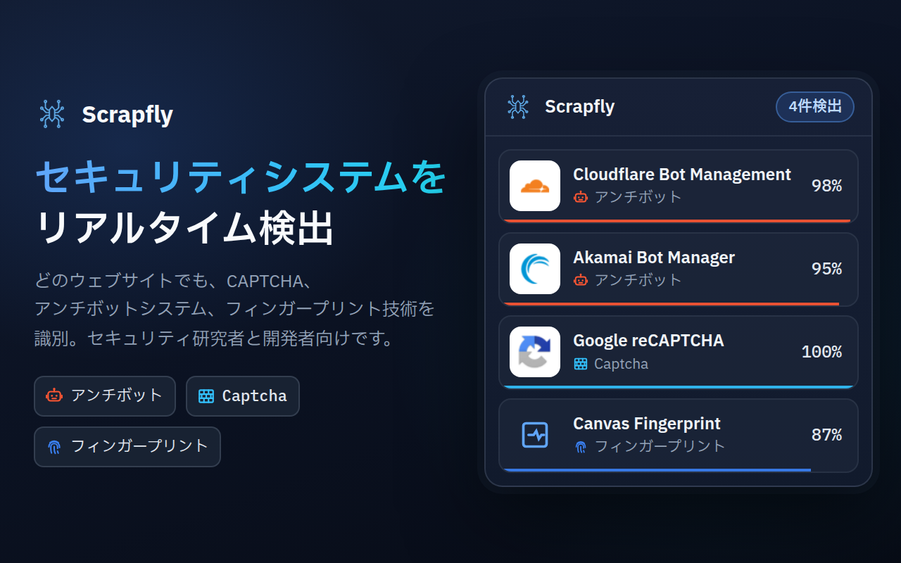
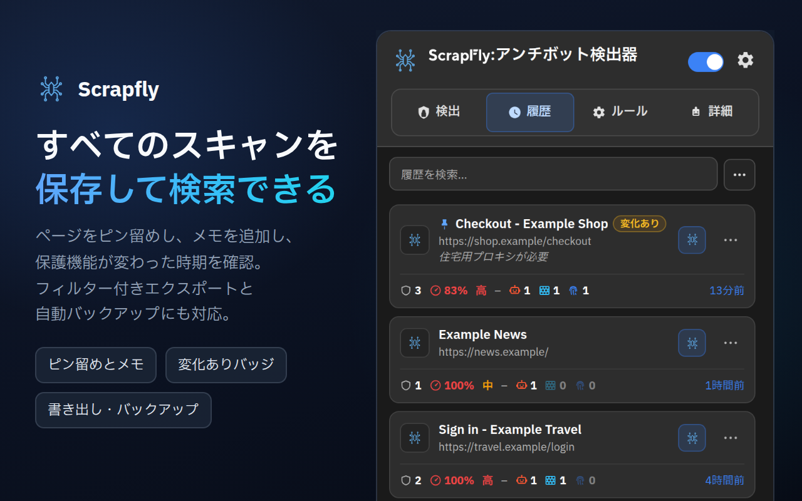
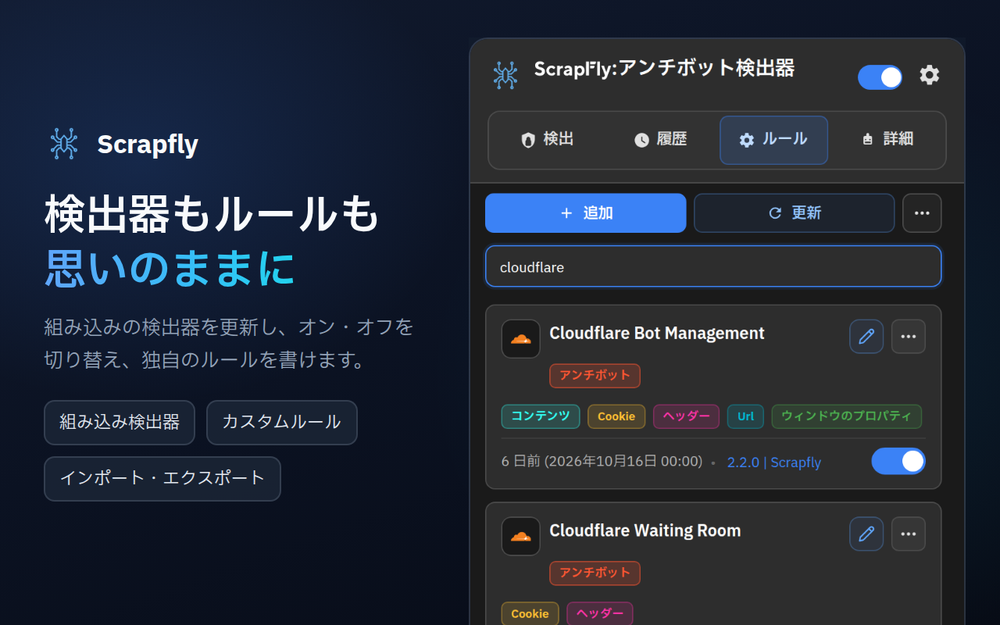
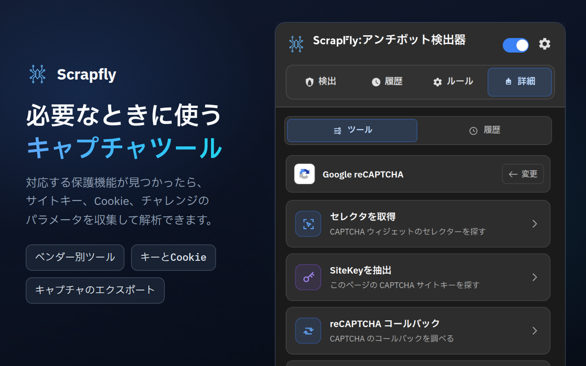
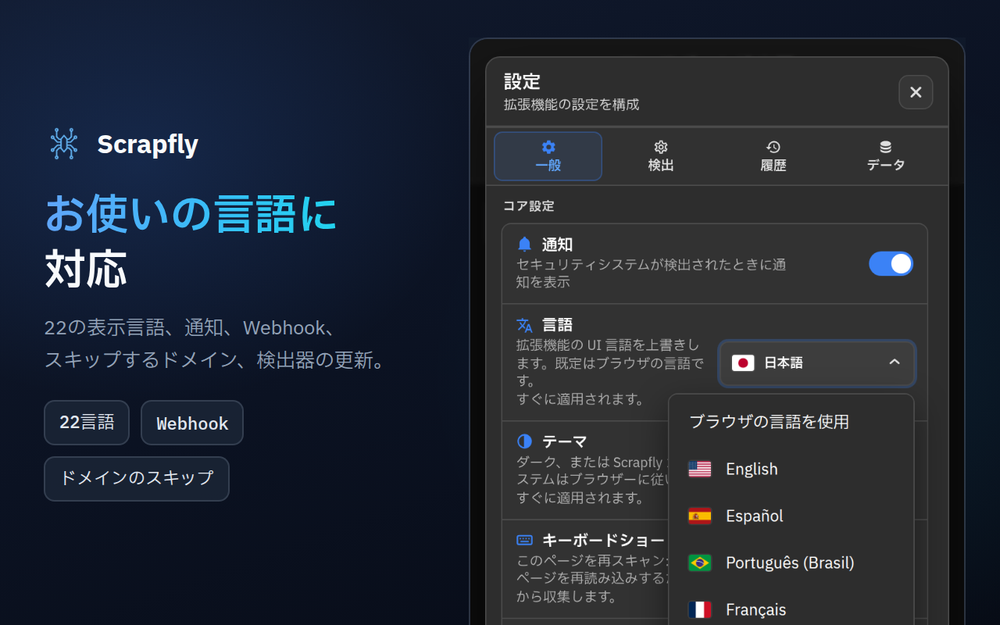

<div align="center">



# Scrapfly Anti-bot Detector

**ウェブサイトがボットからどう身を守っているかを確認できます。どのアンチボットシステムか、どの CAPTCHA か、どのフィンガープリントスクリプトか、そしてそれぞれの一致の確からしさまで分かります。**

[](https://chromewebstore.google.com/detail/scrapfly-anti-bot-detecto/pdpakdgmjhkfimgaihlgaaiijlbilkca)
[](https://chromewebstore.google.com/detail/scrapfly-anti-bot-detecto/pdpakdgmjhkfimgaihlgaaiijlbilkca)
[](https://chromewebstore.google.com/detail/scrapfly-anti-bot-detecto/pdpakdgmjhkfimgaihlgaaiijlbilkca)
[](https://github.com/scrapfly/Antibot-Detector/actions/workflows/ci.yml)
[](../LICENSE)

[**Chrome に追加**](https://chromewebstore.google.com/detail/scrapfly-anti-bot-detecto/pdpakdgmjhkfimgaihlgaaiijlbilkca) · [製品ページ](https://scrapfly.io/products/antibot-detector) · [更新履歴](../CHANGELOG.md) · [llms.txt](../llms.txt) · [問題を報告](https://github.com/scrapfly/Antibot-Detector/issues)

[English](../README.md) · [简体中文](README.zh-CN.md) · [Español](README.es.md) · [Русский](README.ru.md) · **日本語** · [Português (Brasil)](README.pt-BR.md) · [Deutsch](README.de.md) · [Français](README.fr.md) · [한국어](README.ko.md)

</div>

---

Scrapfly Anti-bot Detector は、ウェブサイトが自動化されたトラフィックからどのように身を守っているかを表示する、無料の Chrome 拡張機能です。普段どおりにブラウズするだけで、ツールバーアイコンの数字がそのページで使われている保護の数を示し、ポップアップには各保護の信頼度、難易度、そして見つかった手がかりが一覧表示されます。

標準で 86 の技術を認識します。43 のアンチボットシステム、22 の CAPTCHA、21 のブラウザフィンガープリント技術です。各検出器は、読んで、変更して、拡張できるシンプルな JSON ファイルです。新しいルールはこのリポジトリのリリースごとに届くため、Chrome が拡張機能自体を更新するより前に、**ルール → 更新** でインストールできます。

[Scrapfly](https://scrapfly.io) がこれを作ったのは、スクレイピングのプロジェクトがどれも同じ疑問から始まるからです。このページは何に守られているのか。自分のサイトのアンチボット保護が外からどう見えるかを確認したいときや、セキュリティ調査にも同じように役立ちます。

## 目次

- [スクリーンショット](#スクリーンショット)
- [インストール](#インストール)
- [仕組み](#仕組み)
- [検出対象](#検出対象)
- [ポップアップの案内](#ポップアップの案内)
- [連携](#連携)
- [プライバシーと権限](#プライバシーと権限)
- [開発と貢献](#開発と貢献)
- [ライセンス](#ライセンス)

## スクリーンショット

画像をクリックすると原寸で表示されます。

<table>
  <tr>
    <td width="50%"><a href="../assets/store-screenshots/ja/02-history-1280x800.png"></a></td>
    <td width="50%"><a href="../assets/store-screenshots/ja/03-rules-1280x800.png"></a></td>
  </tr>
  <tr>
    <td width="50%"><a href="../assets/store-screenshots/ja/04-advanced-tools-1280x800.png"></a></td>
    <td width="50%"><a href="../assets/store-screenshots/ja/05-settings-1280x800.png"></a></td>
  </tr>
</table>

## インストール

### Chrome Web Store

いちばん簡単な方法です。[Chrome Web Store からインストール](https://chromewebstore.google.com/detail/scrapfly-anti-bot-detecto/pdpakdgmjhkfimgaihlgaaiijlbilkca)してください。更新は Chrome が自動で行います。

### リリースから

[Releases ページ](https://github.com/scrapfly/Antibot-Detector/releases)の各リリースには、そのまま読み込める zip が添付されています。

1. zip をダウンロードし、新しいフォルダに展開します。
2. `chrome://extensions` を開き、右上の **デベロッパー モード** をオンにします。
3. **パッケージ化されていない拡張機能を読み込む** をクリックし、そのフォルダを選びます。

### ソースコードから

ビルド手順はありません。リポジトリをクローンして、フォルダをそのまま読み込みます。

```bash
git clone https://github.com/scrapfly/Antibot-Detector.git
```

あとは上の手順 2 と 3 に従い、クローンしたフォルダを選びます。ファイルを編集したら、`chrome://extensions` の拡張機能カードにある再読み込みボタンを押し、テスト中のページも再読み込みしてください。

## 仕組み

ページが読み込まれると、拡張機能はそのページ自身が明かしている情報を集め、有効なすべての検出器と照合します。各検出器は最大 8 つの方法を組み合わせます。

| 方法 | 調べる対象 | 手がかりの例 |
| --- | --- | --- |
| URL | ページのアドレス、スクリプトの読み込み元、すべてのネットワークリクエスト | `challenges.cloudflare.com/turnstile/v0/api.js` |
| Cookie | サイトが設定または送信する Cookie（HttpOnly を含む） | `_abck`（Akamai）、`datadome` |
| ヘッダー | レスポンスヘッダーとリクエストヘッダー | `x-kpsdk-ct`（Kasada） |
| コンテンツ | ページの HTML と、インラインおよび読み込まれたスクリプトのコード | `KPSDK.configure(` |
| DOM | CSS セレクターに一致する要素 | `.cf-turnstile[data-sitekey]` |
| ウィンドウプロパティ | スクリプトが `window` に追加するオブジェクト | `grecaptcha.render` |
| JavaScript フック | フィンガープリントによく使われるブラウザ API の呼び出し | `HTMLCanvasElement.prototype.toDataURL` |
| ペイロード | POST、PUT、PATCH リクエストの本文（URL とメソッドで絞り込み可能）と、ルールが指定する URL のレスポンス | `sensor_data`（Akamai）、`"proofofwork":{"required":true`（OpenAI Sentinel） |

**信頼度。** 各ルールには独自の信頼度があり、検出器は組み合わせるとより高いスコアになるルールの組み合わせを定義します。ベンダー名に触れているだけのスクリプトは 5〜10 % です。そのベンダーの製品だけが生み出すシグナル（専用のスクリプトホスト、専用の Cookie、チャレンジのエンドポイントなど）は証拠となり、それだけで 100 % になります。ベンダーの完全な統合（スクリプトと Cookie、ウィジェットのフレーム、チャレンジのリクエストの組み合わせ）も同様です。共有されている、または汎用的なシグナルは 15〜90 % にとどまります。各検出器のスコアは、最も強いルールまたは組み合わせのスコアです。ページには難易度（低、中、高）も付き、ツールバーバッジの色になります。

**フィンガープリント。** API フックは、ページ自身のスクリプトが実行される前にインストールされ、同一オリジンの iframe も対象にします。フィンガープリントのコードはそこに隠れていることが多いためです。既定では少なくとも 4 秒間監視し、その後ページが 2 秒間落ち着くまで、最長 8 秒まで監視します。

**キャッシュ。** 結果は既定で 7 日間再利用されるため、ページに戻ると即座に表示されます。**設定 → 検出** で、保持期間と、結果をドメイン全体、同じパスのページ、または正確な URL のどれで共有するかを変更できます。検出タブの **キャッシュをクリア** は保存された結果を破棄するため、次にそのページを読み込むと再度分析されます。ルールの編集、無効化、インポート、更新でも保存された結果はクリアされるので、各ページは次回訪問時に新しいルールで分析し直されます。

## 検出対象

これらのリストは拡張機能に同梱されている検出器です。どれでも無効にしたり編集したりでき、ルールタブで独自のものを追加することもできます。

各アンチボットシステムには専用ページがあり、見分けるための Cookie、ヘッダー、スクリプトを載せています：[アンチボット検出ページ](antibots/ja/README.md)。

<details>
<summary><b>アンチボットシステム（43）</b></summary>
<br>

Akamai Bot Manager · Alibaba Cloud WAF · Amazon Bot Protection · Anubis · AWS WAF · Azure Front Door · Castle · Cheq · Cloudflare Bot Management · Cloudflare Waiting Room · DataDome · DDoS-Guard · DeepSeek PoW · F5 BIG-IP ASM · Fastly Bot Management · FingerprintJS · Forter · Google BotGuard · HUMAN (PerimeterX) · Hunt · Incapsula (Imperva) · iovation (TransUnion TruValidate) · Jiasule (Chuangyu Shield) · Kasada · Kount · Meetrics Check · Netacea · Ocule · OpenAI Sentinel · Queue-it · Radware Bot Manager · Reblaze · Riskified · Ruishu · SEON · Shape Security · Sift · SiteGround SG-CAPTCHA · Sucuri WAF · ThreatMetrix · Vercel Firewall · Wordfence · Yundun Cloud WAF

</details>

<details>
<summary><b>CAPTCHA（22）</b></summary>
<br>

AliExpress CAPTCHA · Aliyun Captcha 2.0 · ALTCHA · Basilisk Captcha · Binance Captcha · Cap · Captcha.eu · Capy Puzzle Captcha · Cloudflare Turnstile · Dingxiang Captcha · Friendly Captcha · FunCaptcha (Arkose Labs) · GeeTest · Google reCAPTCHA · hCaptcha · Lemin Cropped Captcha · MTCaptcha · NetEase Yidun · Prosopo Procaptcha · QCloud Captcha · Shumei Captcha · Yandex SmartCaptcha

</details>

<details>
<summary><b>フィンガープリント技術（21）</b></summary>
<br>

Audio · Battery API · Canvas · Clipboard API · Crypto · CSS · Device Orientation · Font · Gamepads API · Geolocation · Hardware · IndexedDB · Media · Navigator · Performance · Screen · Timezone/Intl · USB API · Web Storage · WebGL · WebRTC

</details>

## ポップアップの案内

### 検出

現在のページで見つかった保護が、それぞれの信頼度、難易度、一致した方法とともに表示されます。カードをクリックすると根拠となる正確なシグナルを確認できます。検索ボックスの下のチップを使うと、アンチボット、CAPTCHA、フィンガープリントの結果だけに絞り込めます。ツールバーアイコンにマウスを重ねると、ポップアップを開かなくても保護の名前が表示されます。ページのアドレスの隣にある **今すぐ再スキャン** と **Alt+Shift+S**（Mac では Control+Shift+S。ブラウザのキーボードショートカット設定で変更可能）で、現在のページを再分析できます。上部のボタンでは次の操作ができます。

- **検出結果をアップロード**: 共有リンクを取得します（既定は dpaste.com。[共有リンク](#共有リンク)を参照）
- **キャッシュをクリア**: 次回の読み込み時にそのページを再分析します
- **コピー**: メニューから、アップロードで共有されるものと同じ概要、チケットやチャットに貼れる Markdown の表、または JSON を選べます（Cookie 値やヘッダー値はどれにも含まれません）
- **このドメインをブロック**: 拡張機能がそのドメインを分析しないようにします

### 履歴

検出があったすべてのページが、保護と難易度とともに記録されます。検索（アクセント記号は無視されます）、検索ボックスの下のチップ（ピン留め、変化あり、カテゴリ、または組み合わせ。シグナルの組み合わせが一致したページ）による絞り込み、エントリを開いて詳細を確認、JSON エクスポートのインポート、JSON、CSV、プレーンテキスト、Markdown でのエクスポートができます。エクスポートでは、事前に保護、期間、サイト、ピン留めしたページを選べます。エントリの **⋯** メニューからは、ピン留め（履歴の整理で削除されなくなります）、メモの追加、ページを開く、今すぐ再分析、Markdown としてコピーができます。保護の変化を知らせる通知をクリックすると、そのページが開きます。**変化あり** の印は、直近の分析と保護の内容が異なるページを示します。**設定 → データ → 統計を開く** で、履歴から端末内で集計した統計ページ（アクティビティ、保護、ドメイン、信頼度、シグナル、組み合わせ、ルール、高度なツール）が開きます。

履歴の **その他の操作**（⋯）メニューにある **一括スキャン** は、ページの一覧を代わりに分析します。アドレスまたは https のサイトマップを貼り付けるか、.txt や .csv ファイルをアップロードすると、各ページがバックグラウンドのタブで 1 つずつ、あなたの Cookie を使った実際の訪問として開かれます。分析するページ数とページごとの制限時間を選べ、実行の一時停止と停止ができ（ポップアップを閉じても続行します）、エラーになったページの再スキャンや、表の CSV、JSON、Markdown でのエクスポートもできます。完了したページは通常の分析を経るため、履歴に記録され（一時停止中を除く）、Webhook にも送られます。集計には、最も多くのページで見つかった保護を示す **最も多く確認された保護** の行も加わります。サイトマップからは同じサイトのページだけが追加され、**設定 → 検出** でスキップしているサイトは除外されます。

### ルール

標準搭載のものも自作のものも含め、すべての検出器が並びます。検索ボックスの下のチップで、カテゴリ、またはカスタム、編集済み、無効の検出器に絞り込めます。それぞれのオン・オフの切り替え、エディターを開いてパターンの変更、**追加** による独自の検出器の追加ができます。**その他の操作**（⋯）メニューでは、検出器を JSON でインポート・エクスポートできます。各パターンには個別の設定があり、どこを調べるか（ページ、スクリプト、すべてのリクエスト。Cookie とヘッダーはリクエストかレスポンスか）、正規表現か、単語全体か、大文字小文字を区別するか、そして信頼度を指定できます。エディターでは組み合わせと検出器のアイコンも管理でき、正規表現ヘルパーでサンプルテキストに対してパターンを試せます。**履歴で確認** は、保存済みのページのうち各パターンと各組み合わせが一致する数を示し、**このページでテスト** は、ポップアップを開いているページに対して、保存前の変更を含めた現在のルールを実行します。Cookie、URL、コンテンツ、DOM の各パターンがそこで何を見つけるか、ルールとその組み合わせが一致するかが分かります。ヘッダー、JS フック、ウィンドウ、ペイロードのパターンは実際の分析でしか判定できないため、テストでは「一致なし」ではなくその旨が表示されます。何も保存も送信もされません。

**更新** は、このリポジトリの最新リリースから公式の検出器をダウンロードします。編集済みの標準搭載の検出器は、確認なしに置き換えられることはありません。自分のバージョンと新しいバージョンのどちらにするかを選べます。標準搭載の検出器を削除した場合は、同じメニューの **公式検出器を復元** で元に戻せます。検出器の更新はスケジュールすることもできます（**設定 → 一般**）。

### 詳細

ページが使っている保護に対する実用的なツールです。保護は信頼度 50 % を超えて検出されるとツールが利用可能になります。このしきい値は **設定 → 検出 → 高度なツール** で変更できます。ページ上でしきい値を満たすものがない場合、このタブはそう伝え、必要な最低値（またはそれ未満で見つかった保護の名前）を示し、対応している 27 の保護を表示します。

| 保護 | ツール |
| --- | --- |
| Akamai Bot Manager | Check Cookies · Analyze Scripts · Extract Sensor Information · Start Capturing |
| AWS WAF | Check Cookies · Analyze Scripts |
| Cloudflare Bot Management | Check Cookies · Analyze Scripts |
| Cloudflare Turnstile | Extract SiteKey · Analyze Scripts |
| DataDome | Check Cookies · Analyze Scripts |
| FunCaptcha (Arkose Labs) | Extract Public Key · Analyze Scripts · Start Capturing |
| GeeTest | Check Version · Analyze Scripts |
| Google reCAPTCHA | Obtain Selector · Extract SiteKey · reCAPTCHA callback · Start Capturing |
| hCaptcha | Extract SiteKey · Check Version · Analyze Scripts · Start Capturing |
| Incapsula (Imperva) | Check Cookies · Analyze Scripts · Start Capturing |
| Shape Security | Check Version · Check Cookies · Analyze Scripts · Start Capturing |
| Aliyun Captcha 2.0, ALTCHA, Captcha.eu, Capy Puzzle Captcha, Dingxiang Captcha, Friendly Captcha, Lemin Cropped Captcha, MTCaptcha, NetEase Yidun, Prosopo Procaptcha, QCloud Captcha, Shumei Captcha, Yandex SmartCaptcha | Extract SiteKey · Analyze Scripts |
| AliExpress CAPTCHA, Basilisk Captcha, Binance Captcha | Analyze Scripts |

結果とキャプチャは **詳細 → 履歴** に 30 分間保存され、サイト、プロバイダー、ツールで絞り込み、再度開き、エクスポートできます。

### 設定

- **一般:** 表示言語（22 言語。既定ではブラウザに従います）、テーマ（ダーク、ライト、システム）、通知、デバッグモード、検出器のスケジュール更新、バッジ、カテゴリ、ラベルの色。
- **検出:** キャッシュの保持期間と範囲、結果でのカテゴリの並び順、高度なツールの信頼度しきい値、スキャンするサイト（スキップするサイト以外のすべて、または選んだサイトのみ）、JS API イベント、Webhook、共有リンク。
- **履歴:** 記録する内容（履歴の一時停止、プライベートウィンドウのスキップ、無視するサイト、最低信頼度、フィンガープリントのみのページのスキップ）、保存するエントリ数（最大 10,000 件。0 にすると最新の 1,000 件を保持）、指定日数後またはブラウザ終了時のエントリ削除、繰り返しスキャンのスキップまたは更新、ページの保護が変わったときの通知、既定のエクスポート形式、警告付きのストレージメーター、ダウンロードフォルダへの自動バックアップ。

  履歴は約 6 MB に制限されます。**設定 → 履歴** でより大きなサイズを選べば 12 MB または 25 MB になります。いっぱいになると、ピン留めされていない古いエントリから削除され、その件数は **設定 → 履歴** に表示されます。難しい保護や指定した保護を含むページは自動でピン留めでき（最大 50 件）、フィンガープリントのみのページは独自の日数が過ぎると削除でき、ピン留めしたページのうち最大 10 件を監視できます。監視対象は毎日または毎週、バックグラウンドのタブで再スキャンされ、保護が変わるとエントリに「変化あり」の印が付きます（各チェックはあなたの Cookie を使った実際の訪問です）。
- **データ:** 統計ページを開く。拡張機能の各部分が使っている容量を確認し、検出キャッシュ、ツールのキャプチャ、ログ、履歴をクリアする。設定、ルール、履歴を 1 つのファイルにバックアップして復元する。設定と履歴をエクスポートまたはインポートする。プライバシーまたは開発者プリセットを適用する、またはすべての設定をリセットする。バグ報告用の診断サマリー（サイト、アドレス、キーは含まれません）をコピーする。

## 連携

### JavaScript イベント

拡張機能はページの `window` 上でイベントを発行するため、独自のスクリプト（またはテストハーネス）がその結果に反応できます。

| イベント | タイミング |
| --- | --- |
| `scrapfly:ready` | 拡張機能がページに読み込まれたとき |
| `scrapfly:onStart` | スキャンが始まったとき（キャッシュされた結果がない場合、または手動スキャン） |
| `scrapfly:onProgress` | 検出方法が 1 つ完了したとき |
| `scrapfly:onHooksComplete` | JavaScript フックの監視が終了したとき |
| `scrapfly:onWindowPropsComplete` | ウィンドウプロパティのチェックが完了したとき |
| `scrapfly:onDetection` | 結果が準備できたとき（キャッシュから返されたものを含む） |
| `scrapfly:onError` | スキャンが失敗したとき |

```js
const on = (ev, cb) =>
  addEventListener(`scrapfly:${ev}`, cb);

on('onDetection', (e) => {
  const { url, detections } = e.detail;
  console.log(url, detections);
});
```

これらのイベントはページ自体に届くため、訪問したどのサイトでも受信でき、拡張機能がインストールされていることが分かってしまいます。既定ではオフになっています。**設定 → 検出 → JS API イベント** でオンにできます。

### Webhook

スキャンで保護が見つかると、拡張機能は結果を自分のエンドポイントに送信できます。HTTP メソッドを選び、ヘッダーを追加し、`<SITEURL>`、`<HOSTNAME>`、`<TITLE>`、`<DETECTIONS>`、`<DETECTION_COUNT>`、`<DETECTION_NAMES>`（信頼度付きの保護を 1 行で）、`<CATEGORIES>`、`<TIMESTAMP>` といった変数を使ったテンプレートとして本文を書きます。**テンプレートから始める**（Slack、Mattermost または Google Chat、Discord、プレーンテキストの 1 行）を選ぶと、Content-Type と用意済みのチャットメッセージが入力されます。Webhook は公開ホストの HTTPS アドレスにのみ送信され、既定ではオフで、**テスト** ボタンがあります。**設定 → 検出 → Webhook連携** で設定します。

**最近の送信と再試行。** **設定 → 検出 → Webhook** には直近 20 件の送信が一覧表示されます（ページ、ステータス、所要時間。アドレス、ヘッダー、ペイロードは決して含まれません）。失敗した送信は **再試行** でもう一度送れます。**失敗した送信を再試行**（既定でオン）が有効なら、応答がなかった場合やサーバーが 408、425、429、5xx を返した場合に、拡張機能が 1 分後、5 分後、15 分後に自動で再試行します。401、403、404 などの拒否は、あなたの **再試行** を待ちます。そのため、失敗した送信のページデータは 1 時間（最大 20 件）メモリ上にのみ保持され、ディスクには書き込まれず、ブラウザを閉じると消えます。再試行は現在の Webhook 設定でリクエストを作り直すので、修正したアドレスやシークレットが使われ、ヘッダーやシークレットは一緒に保存されません。

**署名。** 署名シークレットを設定する（または **生成** を押して自分のサーバーにコピーする）と、本文のあるすべてのリクエストが Scrapfly 自身の Webhook と同じ方法で署名されます。`X-Scrapfly-Webhook-Signature` には、生の本文の HMAC-SHA256 を大文字の 16 進数にしたものが入り、鍵はシークレットを書かれたまま（その UTF-8 バイト列。生成されたシークレットを 16 進数としてデコードすることはありません）使います。`X-Scrapfly-Webhook-Signature-Lowercase` には同じ値が小文字で入ります。解析する前に、生の本文に対して定時間比較で検証してください。GET、HEAD、`multipart/form-data` のリクエストは署名されず、URL は署名の対象になりません。タイムスタンプのヘッダーはありません。既定のテンプレートは本文に `<TIMESTAMP>` を入れて送るので、サーバー側で古いリクエストを拒否できます。シークレットはこのブラウザの中にとどまります。エクスポート、バックアップ、診断には含まれず、リセットしても、接続も削除しない限り残ります。

```js
// Node.js, with the raw body as a Buffer (for example express.raw({ type: '*/*' }))
const crypto = require('node:crypto');
function isFromExtension(rawBody, signatureHeader, secret) {
  const expected = Buffer.from(crypto.createHmac('sha256', secret).update(rawBody).digest('hex'));
  const received = Buffer.from(String(signatureHeader || '').toLowerCase());
  return received.length === expected.length && crypto.timingSafeEqual(received, expected);
}
// isFromExtension(req.body, req.get('X-Scrapfly-Webhook-Signature'), process.env.WEBHOOK_SECRET)
```

```python
import hashlib, hmac
def is_from_extension(raw_body: bytes, signature_header: str, secret: str) -> bool:
    expected = hmac.new(secret.encode(), raw_body, hashlib.sha256).hexdigest()
    return hmac.compare_digest(expected, (signature_header or "").lower())
```

### 共有リンク

検出タブの **検出結果をアップロード** は、ページの結果の概要を公開し、リンクをコピーして新しいタブで開きます。概要に含まれるのは、クエリ文字列とフラグメントを除いたページのアドレス、各保護の名前、カテゴリ、信頼度、どの方法が一致したかです。Cookie 値やヘッダー値は含まれません。送信先と、サービスが対応していれば削除までの期間は、**設定 → 検出 → 共有アップロード** で選べます。dpaste.com（既定）、dpaste.org、paste.rs、API キーを使う Pastebin、トークンを使う GitHub のシークレット Gist、または自分のサーバーです。

## プライバシーと権限

検出はすべてブラウザ内で実行されます。アカウントも分析もなく、訪問したページの情報が Scrapfly に送られることはありません。ただし、拡張機能はいくつかネットワークリクエストを行います。内容は次のとおりです。

- **スクリプトの内容。** スクリプトのコードを読むために、ページのスクリプトとスタイルシートを、ブラウザのキャッシュ経由で Cookie なしに再取得します。
- **検出器の更新。** **更新**（または任意のスケジュール）は、`api.github.com` にこのリポジトリの最新リリースを問い合わせ、そのリリースの検出器ファイルを `raw.githubusercontent.com` から読み込みます。
- **サイトアイコン。** 履歴などのリストには、そのサイト自身のファビコンが表示されます。サイトにない場合は Google のファビコンサービスに問い合わせます。
- **言語の国旗。** 設定の言語ピッカーは、国旗を `flagcdn.com` から読み込みます。
- **使用したときのみ:** 上で説明した Webhook と共有リンク。JS API イベントはブラウザの外には出ませんが、訪問しているページからは読み取れます（[JavaScript イベント](#javascript-イベント)を参照）。

<details>
<summary><b>拡張機能が各権限を必要とする理由</b></summary>
<br>

| 権限 | 用途 |
| --- | --- |
| すべてのサイトへのアクセス（`http://*/*`、`https://*/*`） | 開いたすべてのページを分析するため |
| `storage` | 設定、検出器、履歴、キャッシュされた結果 |
| `tabs`、`activeTab` | ポップアップがどのページについてのものかを把握し、統計などのページを開くため |
| `scripting` | 高度なツールをページ内で実行するため |
| `webRequest` | 検出とキャプチャのために、リクエストの URL、ヘッダー、本文を読み取るため |
| `webNavigation` | ページまたはフレームの読み込みが完了したことを知るため |
| `cookies` | HttpOnly を含む Cookie を読み取るため。一部の分析ツールは、ページを再読み込みする前に保護用の Cookie をリセットします |
| `notifications` | キャプチャツールのステータスメッセージ |
| `downloads` | エクスポートしたファイルの保存 |
| `alarms` | 検出器のスケジュール更新と、古い履歴やキャッシュ結果の整理 |
| `unlimitedStorage` | **設定 → 履歴** で 12 MB または 25 MB を選んだときに、履歴がブラウザの 10 MB の割り当てを超えられるようにします。より大きなサイズを選ばない限り、履歴は 6 MB にとどまります |

</details>

## 開発と貢献

開発者向けのドキュメントは、常に最新に保つため英語のみです。[開発とチェック](../README.md#development)、[検出器の書き方](../README.md#writing-a-detector)、[貢献の方法](../README.md#contributing)をご覧ください。バグ報告や検出器の改善は、どの言語でも歓迎します。ページのアドレスと、期待していた結果を添えて[Issue を作成](https://github.com/scrapfly/Antibot-Detector/issues)してください。

## ライセンス

[Non-Profit Open Software License 3.0](../LICENSE)（NPOSL-3.0）の下で公開されています。

Copyright © 2026 Scrapfly.
