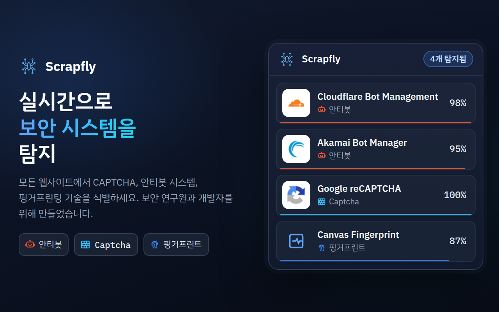
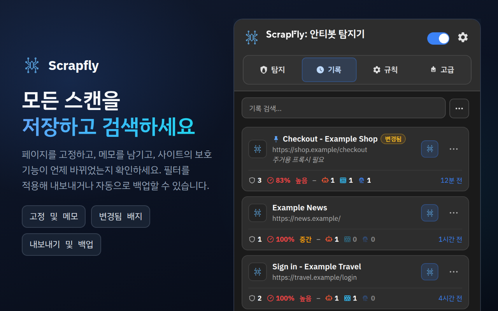
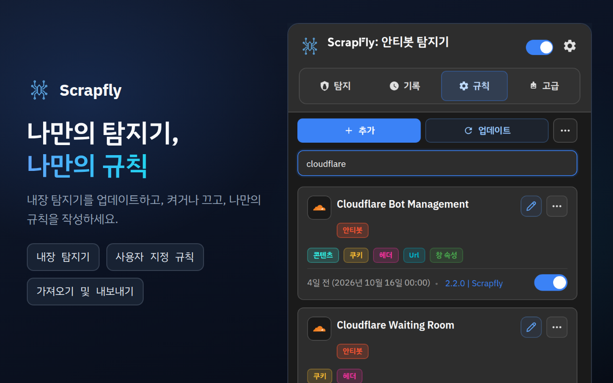
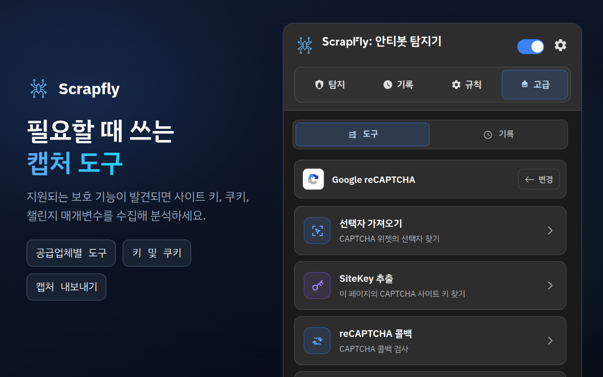
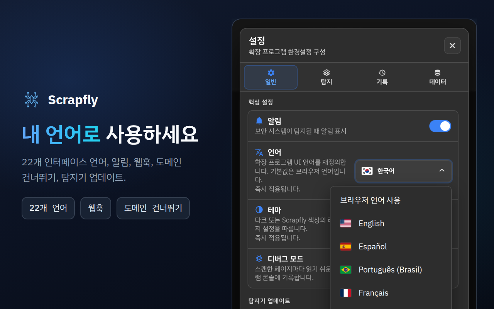

<div align="center">



# Scrapfly Anti-bot Detector

**웹사이트가 봇을 어떻게 막는지 확인하세요. 어떤 안티봇 시스템인지, 어떤 CAPTCHA인지, 어떤 핑거프린팅 스크립트인지, 그리고 각 탐지가 얼마나 확실한지 보여 줍니다.**

[](https://chromewebstore.google.com/detail/scrapfly-anti-bot-detecto/pdpakdgmjhkfimgaihlgaaiijlbilkca)
[](https://chromewebstore.google.com/detail/scrapfly-anti-bot-detecto/pdpakdgmjhkfimgaihlgaaiijlbilkca)
[](https://chromewebstore.google.com/detail/scrapfly-anti-bot-detecto/pdpakdgmjhkfimgaihlgaaiijlbilkca)
[](https://github.com/scrapfly/Antibot-Detector/actions/workflows/ci.yml)
[](../LICENSE)

[**Chrome에 추가**](https://chromewebstore.google.com/detail/scrapfly-anti-bot-detecto/pdpakdgmjhkfimgaihlgaaiijlbilkca) · [제품 페이지](https://scrapfly.io/products/antibot-detector) · [새로운 기능](../CHANGELOG.md) · [llms.txt](../llms.txt) · [문제 신고](https://github.com/scrapfly/Antibot-Detector/issues)

[English](../README.md) · [简体中文](README.zh-CN.md) · [Español](README.es.md) · [Русский](README.ru.md) · [日本語](README.ja.md) · [Português (Brasil)](README.pt-BR.md) · [Deutsch](README.de.md) · [Français](README.fr.md) · **한국어**

</div>

---

Scrapfly Anti-bot Detector는 웹사이트가 자동화된 트래픽으로부터 스스로를 어떻게 보호하는지 보여 주는 무료 Chrome 확장 프로그램입니다. 평소처럼 탐색하기만 하면 됩니다. 도구 모음 아이콘의 숫자가 페이지가 사용하는 보호 기술의 수를 알려 주고, 팝업에는 각 보호 기술이 신뢰도, 난이도, 그리고 이를 드러낸 신호와 함께 나열됩니다.

기본으로 86가지 기술을 인식합니다. 안티봇 시스템 43개, CAPTCHA 22개, 브라우저 핑거프린팅 기법 21개입니다. 각 탐지기는 읽고, 바꾸고, 확장할 수 있는 단순한 JSON 파일이며, 새 규칙은 이 저장소의 버전마다 함께 배포됩니다. 따라서 Chrome이 확장 프로그램 자체를 업데이트하기 전에도 **규칙 → 업데이트**로 설치할 수 있습니다.

[Scrapfly](https://scrapfly.io)에서 이 도구를 만든 이유는 모든 스크래핑 프로젝트가 같은 질문에서 시작하기 때문입니다. 이 페이지를 무엇이 보호하고 있는가? 내 사이트의 안티봇 보호가 바깥에서 어떻게 보이는지 확인하거나 보안 연구를 할 때도 똑같이 유용합니다.

## 목차

- [스크린샷](#스크린샷)
- [설치](#설치)
- [작동 방식](#작동-방식)
- [탐지 대상](#탐지-대상)
- [팝업 둘러보기](#팝업-둘러보기)
- [연동](#연동)
- [개인정보 보호와 권한](#개인정보-보호와-권한)
- [개발 및 기여](#개발-및-기여)
- [라이선스](#라이선스)

## 스크린샷

이미지를 클릭하면 원본 크기로 볼 수 있습니다.

<table>
  <tr>
    <td width="50%"><a href="../assets/store-screenshots/ko/02-history-1280x800.png"></a></td>
    <td width="50%"><a href="../assets/store-screenshots/ko/03-rules-1280x800.png"></a></td>
  </tr>
  <tr>
    <td width="50%"><a href="../assets/store-screenshots/ko/04-advanced-tools-1280x800.png"></a></td>
    <td width="50%"><a href="../assets/store-screenshots/ko/05-settings-1280x800.png"></a></td>
  </tr>
</table>

## 설치

### Chrome Web Store

가장 간단한 방법입니다. [Chrome Web Store에서 설치](https://chromewebstore.google.com/detail/scrapfly-anti-bot-detecto/pdpakdgmjhkfimgaihlgaaiijlbilkca)하세요. Chrome이 최신 상태로 유지해 줍니다.

### 릴리스에서 설치

[Releases 페이지](https://github.com/scrapfly/Antibot-Detector/releases)의 각 버전에는 바로 불러올 수 있는 zip 파일이 포함되어 있습니다.

1. zip 파일을 내려받아 새 폴더에 압축을 풉니다.
2. `chrome://extensions`를 열고 **개발자 모드**(오른쪽 위)를 켭니다.
3. **압축해제된 확장 프로그램을 로드합니다**를 클릭하고 그 폴더를 선택합니다.

### 소스에서 설치

빌드 단계는 없습니다. 저장소를 복제한 뒤 폴더를 그대로 불러오세요.

```bash
git clone https://github.com/scrapfly/Antibot-Detector.git
```

그런 다음 위의 2단계와 3단계를 따라 복제한 폴더를 선택합니다. 파일을 수정한 뒤에는 `chrome://extensions`에서 확장 프로그램 카드의 새로고침 버튼을 누르고, 테스트 중인 페이지를 다시 로드하세요.

## 작동 방식

페이지가 로드되면 확장 프로그램은 페이지가 스스로 드러내는 정보를 모아 활성화된 모든 탐지기와 대조합니다. 각 탐지기는 최대 여덟 가지 방법을 조합합니다.

| 방법 | 확인하는 대상 | 신호 예시 |
| --- | --- | --- |
| URL | 페이지 주소, 스크립트의 출처, 모든 네트워크 요청 | `challenges.cloudflare.com/turnstile/v0/api.js` |
| 쿠키 | 사이트가 설정하거나 보내는 쿠키(HttpOnly 포함) | `_abck` (Akamai), `datadome` |
| 헤더 | 응답 및 요청 헤더 | `x-kpsdk-ct` (Kasada) |
| 콘텐츠 | 페이지의 HTML과 인라인 및 로드된 스크립트의 코드 | `KPSDK.configure(` |
| DOM | CSS 선택자와 일치하는 요소 | `.cf-turnstile[data-sitekey]` |
| 윈도우 속성 | 스크립트가 `window`에 추가하는 객체 | `grecaptcha.render` |
| JavaScript 후크 | 핑거프린팅에 자주 쓰이는 브라우저 API 호출 | `HTMLCanvasElement.prototype.toDataURL` |
| 페이로드 | URL과 메서드로 필터링할 수 있는 POST, PUT, PATCH 요청 본문, 그리고 규칙이 지정한 URL의 응답 | `sensor_data` (Akamai), `"proofofwork":{"required":true` (OpenAI Sentinel) |

**신뢰도.** 각 규칙에는 고유한 신뢰도가 있으며, 탐지기는 함께 일치할 때 더 높은 점수를 받는 규칙 조합을 정의합니다. 공급업체의 이름만 언급하는 스크립트는 5~10%를 받습니다. 그 공급업체의 제품만 만들어 내는 신호(고유한 스크립트 호스트, 고유한 쿠키, 챌린지 엔드포인트)는 증거로 간주되어 단독으로 100%를 받으며, 공급업체의 전체 연동(스크립트와 쿠키, 위젯 프레임 또는 챌린지 요청의 조합)도 마찬가지입니다. 공유되거나 일반적인 신호는 15~90% 사이에 머뭅니다. 각 탐지기의 점수는 가장 강한 규칙 또는 조합의 점수입니다. 페이지에는 난이도(낮음, 중간, 높음)도 부여되며, 이것이 도구 모음 배지의 색을 결정합니다.

**핑거프린팅.** API 후크는 페이지 자체의 스크립트가 실행되기 전에 설치되며, 핑거프린팅 코드가 자주 숨어 있는 동일 출처 iframe도 다룹니다. 기본적으로 최소 4초 동안 관찰하고, 이후 페이지가 2초 동안 조용해질 때까지 관찰하며, 최대 8초까지 지속합니다.

**캐시.** 결과는 기본적으로 7일 동안 재사용되므로 페이지에 다시 방문하면 즉시 표시됩니다. **설정 → 탐지**에서 유지 기간과, 결과를 도메인 전체, 같은 경로의 페이지, 또는 정확히 같은 URL 중 어느 범위로 공유할지 바꿀 수 있습니다. 탐지 탭의 **캐시 지우기**는 저장된 결과를 잊게 하므로 다음에 페이지가 로드될 때 다시 검사합니다. 규칙을 편집, 비활성화, 가져오기 또는 업데이트해도 저장된 결과가 지워지므로, 다음 방문 때 모든 페이지가 새 규칙으로 다시 검사됩니다.

## 탐지 대상

이 목록은 확장 프로그램에 포함된 탐지기입니다. 규칙 탭에서 각각을 비활성화하거나 편집하고, 직접 만든 탐지기를 추가할 수 있습니다.

<details>
<summary><b>안티봇 시스템 (43)</b></summary>
<br>

Akamai Bot Manager · Alibaba Cloud WAF · Amazon Bot Protection · Anubis · AWS WAF · Azure Front Door · Castle · Cheq · Cloudflare Bot Management · Cloudflare Waiting Room · DataDome · DDoS-Guard · DeepSeek PoW · F5 BIG-IP ASM · Fastly Bot Management · FingerprintJS · Forter · Google BotGuard · HUMAN (PerimeterX) · Hunt · Incapsula (Imperva) · iovation (TransUnion TruValidate) · Jiasule (Chuangyu Shield) · Kasada · Kount · Meetrics Check · Netacea · Ocule · OpenAI Sentinel · Queue-it · Radware Bot Manager · Reblaze · Riskified · Ruishu · SEON · Shape Security · Sift · SiteGround SG-CAPTCHA · Sucuri WAF · ThreatMetrix · Vercel Firewall · Wordfence · Yundun Cloud WAF

</details>

<details>
<summary><b>CAPTCHA (22)</b></summary>
<br>

AliExpress CAPTCHA · Aliyun Captcha 2.0 · ALTCHA · Basilisk Captcha · Binance Captcha · Cap · Captcha.eu · Capy Puzzle Captcha · Cloudflare Turnstile · Dingxiang Captcha · Friendly Captcha · FunCaptcha (Arkose Labs) · GeeTest · Google reCAPTCHA · hCaptcha · Lemin Cropped Captcha · MTCaptcha · NetEase Yidun · Prosopo Procaptcha · QCloud Captcha · Shumei Captcha · Yandex SmartCaptcha

</details>

<details>
<summary><b>핑거프린팅 기법 (21)</b></summary>
<br>

Audio · Battery API · Canvas · Clipboard API · Crypto · CSS · Device Orientation · Font · Gamepads API · Geolocation · Hardware · IndexedDB · Media · Navigator · Performance · Screen · Timezone/Intl · USB API · Web Storage · WebGL · WebRTC

</details>

## 팝업 둘러보기

### 탐지

현재 페이지에서 발견된 보호 기술이 각각의 신뢰도, 난이도, 일치한 방법과 함께 표시됩니다. 카드를 클릭하면 그 뒤의 정확한 신호를 볼 수 있고, 검색창 아래의 칩으로 Anti-bot, Captcha, Fingerprint 결과만 표시할 수도 있습니다. 도구 모음 아이콘에 마우스를 올리면 팝업을 열지 않고도 보호 기술의 이름을 볼 수 있습니다. 페이지 주소 옆의 **지금 다시 스캔**과 **Alt+Shift+S**(Mac에서는 Control+Shift+S, 브라우저의 키보드 단축키에서 변경 가능)로 현재 페이지를 다시 스캔합니다. 상단의 버튼으로 다음을 할 수 있습니다.

- **탐지 결과 업로드**로 공유 링크 받기(기본값은 dpaste.com, [공유 링크](#공유-링크) 참고)
- **캐시 지우기**로 다음 로드 때 페이지를 다시 스캔하기
- **복사** 메뉴: 업로드가 공유하는 것과 같은 요약, 티켓이나 채팅용 Markdown 표, 또는 JSON(어느 쪽에도 쿠키나 헤더 값은 포함되지 않습니다)
- **이 도메인 차단**으로 확장 프로그램이 해당 도메인을 더 이상 스캔하지 않게 하기

### 기록

탐지 결과가 있었던 모든 페이지가 보호 기술과 난이도와 함께 표시됩니다. 검색할 수 있고(악센트는 무시됩니다), 검색창 아래의 칩(고정됨, 변경됨, 카테고리, 또는 신호 조합이 일치한 페이지인 조합)으로 좁힐 수 있으며, 항목을 열어 세부 정보를 보고, JSON 내보내기 파일을 가져오고, JSON, CSV, 일반 텍스트 또는 Markdown으로 내보낼 수 있습니다. 내보내기 전에 보호 기술, 기간, 사이트, 고정된 페이지를 선택합니다. 항목의 **⋯** 메뉴에서 고정(기록을 정리해도 유지됩니다), 메모 추가, 페이지 열기, 지금 다시 스캔, Markdown으로 복사를 할 수 있습니다. 보호 기술이 변경되었다는 알림을 클릭하면 해당 페이지가 열립니다. **변경됨** 표시는 보호 기술이 마지막 스캔과 달라진 페이지를 나타냅니다. **설정 → 데이터 → 통계 열기**는 기록을 바탕으로 로컬에서 계산한 통계 페이지(활동, 보호 기술, 도메인, 신뢰도, 신호, 조합, 규칙, 고급 도구)를 엽니다.

기록의 **추가 작업**(⋯) 메뉴에 있는 **일괄 스캔**은 페이지 목록을 대신 스캔해 줍니다. 주소나 https 사이트맵을 붙여넣거나 .txt 또는 .csv 파일을 업로드하면, 각 페이지가 쿠키를 가진 실제 방문처럼 백그라운드 탭에서 하나씩 열립니다. 스캔할 페이지 수와 페이지당 시간 제한을 정하고, 실행을 일시정지하거나 중지하고(팝업을 닫아도 계속됩니다), 오류가 난 페이지를 다시 스캔하고, 표를 CSV, JSON, Markdown으로 내보낼 수 있습니다. 완료된 페이지는 일반 스캔을 거치므로 기록에 저장되고(일시정지 상태가 아닌 경우) 웹훅으로 전송되며, 합계에는 가장 많은 페이지에서 발견된 보호 기술을 보여 주는 **가장 많이 확인됨** 줄이 추가됩니다. 사이트맵은 자기 사이트의 페이지만 추가하며, **설정 → 탐지**에서 건너뛰도록 한 사이트는 제외됩니다.

### 규칙

내장 탐지기와 직접 만든 탐지기를 모두 보여 줍니다. 검색창 아래의 칩으로 목록을 카테고리 또는 사용자 정의, 편집됨, 비활성화된 탐지기로 좁힐 수 있습니다. 각 탐지기를 켜거나 끄고, 편집기를 열어 패턴을 바꾸거나, **추가**로 직접 만든 탐지기를 추가하세요. **추가 작업**(⋯) 메뉴에서 탐지기를 JSON으로 가져오고 내보낼 수 있습니다. 각 패턴에는 고유한 옵션이 있습니다. 어디에서 찾을지(페이지, 스크립트, 또는 모든 요청, 쿠키와 헤더는 요청 또는 응답), 정규 표현식인지, 단어 전체 일치인지, 대소문자를 구분하는지, 그리고 신뢰도입니다. 편집기는 탐지기의 조합과 아이콘도 관리하며, regex 도우미로 예시 텍스트에 패턴을 시험해 볼 수 있습니다. **기록으로 확인**은 저장된 페이지 중 몇 개에서 각 패턴과 조합이 일치하는지 보여 주고, **이 페이지에서 테스트**는 지금 상태 그대로의 규칙(저장하지 않은 변경 포함)을 팝업이 열려 있는 페이지에서 실행합니다. 쿠키, URL, 콘텐츠, DOM 패턴이 그곳에서 각각 무엇을 찾는지, 그리고 규칙과 조합이 일치하는지 알려 줍니다. 헤더, JS 후크, 윈도우, 페이로드 패턴은 실제 스캔으로만 확인할 수 있으므로, 테스트는 이를 «일치 없음»이 아니라 그대로 해당 유형이라고 표시합니다. 아무것도 저장되거나 전송되지 않습니다.

**업데이트**는 이 저장소의 최신 릴리스에서 공식 탐지기를 내려받습니다. 직접 편집한 내장 탐지기는 묻지 않고 교체되는 일이 없으며, 내 버전과 새 버전 중에서 선택합니다. 내장 탐지기를 삭제했다면 같은 메뉴의 **공식 탐지기 복원**으로 되돌릴 수 있습니다. 탐지기 업데이트는 예약할 수도 있습니다(**설정 → 일반**).

### 고급

페이지가 사용하는 보호 기술을 위한 실용적인 도구입니다. 보호 기술이 신뢰도 50% 넘게 탐지되면 해당 도구가 제공되며, 이 기준은 **설정 → 탐지 → 고급 도구**에서 바꿀 수 있습니다. 페이지에서 기준에 도달한 것이 없으면 탭이 그렇게 알려 주고, 최소 기준(또는 그 아래에서 발견된 보호 기술의 이름)을 표시하며, 지원되는 27개 보호 기술을 보여 줍니다.

| 보호 기술 | 도구 |
| --- | --- |
| Akamai Bot Manager | Check Cookies · Analyze Scripts · Extract Sensor Information · Start Capturing |
| AWS WAF | Check Cookies · Analyze Scripts |
| Cloudflare Bot Management | Check Cookies · Analyze Scripts |
| Cloudflare Turnstile | Extract SiteKey · Analyze Scripts |
| DataDome | Check Cookies · Analyze Scripts |
| FunCaptcha (Arkose Labs) | Extract Public Key · Analyze Scripts · Start Capturing |
| GeeTest | Check Version · Analyze Scripts |
| Google reCAPTCHA | Obtain Selector · Extract SiteKey · reCAPTCHA callback · Start Capturing |
| hCaptcha | Extract SiteKey · Check Version · Analyze Scripts · Start Capturing |
| Incapsula (Imperva) | Check Cookies · Analyze Scripts · Start Capturing |
| Shape Security | Check Version · Check Cookies · Analyze Scripts · Start Capturing |
| Aliyun Captcha 2.0, ALTCHA, Captcha.eu, Capy Puzzle Captcha, Dingxiang Captcha, Friendly Captcha, Lemin Cropped Captcha, MTCaptcha, NetEase Yidun, Prosopo Procaptcha, QCloud Captcha, Shumei Captcha, Yandex SmartCaptcha | Extract SiteKey · Analyze Scripts |
| AliExpress CAPTCHA, Basilisk Captcha, Binance Captcha | Analyze Scripts |

결과와 캡처는 **고급 → 기록**에 30분 동안 보관되며, 사이트, 공급업체, 도구별로 필터링하고 다시 열고 내보낼 수 있습니다.

### 설정

- **일반:** 인터페이스 언어(22개 언어, 기본값은 브라우저 언어), 테마(다크, 라이트 또는 시스템), 알림, 디버그 모드, 예약된 탐지기 업데이트, 그리고 배지, 카테고리, 라벨의 색상.
- **탐지:** 캐시 유지 기간과 범위, 결과에서 카테고리가 표시되는 순서, 고급 도구의 신뢰도 기준, 스캔할 사이트(건너뛰도록 한 사이트를 제외한 모든 사이트, 또는 선택한 사이트만), JS API 이벤트, 웹훅, 공유 링크.
- **기록:** 기록되는 항목(기록 일시정지, 시크릿 창 건너뛰기, 무시할 사이트, 최소 신뢰도, 핑거프린팅만 있는 페이지 건너뛰기), 보관할 항목 수(최대 10,000개, 0은 최근 1,000개 보관), 일정 일수 후 또는 브라우저를 닫을 때 항목 삭제, 반복 스캔 건너뛰기 또는 갱신, 페이지의 보호 기술이 바뀔 때의 알림, 기본 내보내기 형식, 경고가 있는 저장 공간 표시기, 다운로드 폴더에 저장되는 자동 백업.

  기록은 약 6MB로 제한되며, **설정 → 기록**에서 더 큰 크기를 선택하면 12MB 또는 25MB까지 늘어납니다. 가득 차면 고정되지 않은 가장 오래된 항목이 삭제되고, **설정 → 기록**에 그 수가 표시됩니다. 어려운 보호 기술이 있거나 직접 지정한 보호 기술이 있는 페이지는 자동으로 고정될 수 있고(최대 50개), 핑거프린팅만 있는 페이지는 별도로 정한 일수 후에 삭제될 수 있으며, 고정된 페이지 최대 10개를 감시할 수 있습니다. 감시 중인 페이지는 매일 또는 매주 백그라운드 탭에서 다시 스캔되고, 보호 기술이 바뀌면 항목에 변경됨 표시가 붙습니다(각 확인은 쿠키를 가진 실제 방문입니다).
- **데이터:** 통계 페이지 열기, 확장 프로그램의 각 부분이 차지하는 공간 확인 및 탐지 캐시, 도구 캡처, 로그, 기록 지우기, 설정과 내 규칙과 기록을 하나의 파일로 백업하고 복원하기, 설정과 기록 내보내기 또는 가져오기, 개인정보 보호 또는 개발자 프리셋 적용 또는 모든 설정 초기화, 버그 신고용 진단 요약 복사(사이트, 주소, 키는 포함되지 않음).

## 연동

### JavaScript 이벤트

확장 프로그램은 페이지의 `window`에서 이벤트를 발생시키므로, 직접 만든 스크립트(또는 테스트 환경)가 그 결과에 반응할 수 있습니다.

| 이벤트 | 시점 |
| --- | --- |
| `scrapfly:ready` | 확장 프로그램이 페이지에 로드되었을 때 |
| `scrapfly:onStart` | 스캔이 시작될 때(캐시된 결과가 없거나 수동 스캔) |
| `scrapfly:onProgress` | 탐지 방법 하나가 끝났을 때 |
| `scrapfly:onHooksComplete` | JavaScript 후크가 관찰을 마쳤을 때 |
| `scrapfly:onWindowPropsComplete` | 윈도우 속성 검사가 끝났을 때 |
| `scrapfly:onDetection` | 캐시에서 제공된 결과를 포함해 결과가 준비되었을 때 |
| `scrapfly:onError` | 스캔이 실패했을 때 |

```js
const on = (ev, cb) =>
  addEventListener(`scrapfly:${ev}`, cb);

on('onDetection', (e) => {
  const { url, detections } = e.detail;
  console.log(url, detections);
});
```

이 이벤트는 페이지 자체에 전달되므로, 방문하는 어떤 사이트든 이를 수신해 확장 프로그램이 설치되어 있음을 알 수 있습니다. 기본적으로 꺼져 있으며, **설정 → 탐지 → JS API 이벤트**에서 켤 수 있습니다.

### 웹훅

스캔에서 보호 기술이 발견되면 확장 프로그램이 결과를 사용자의 엔드포인트로 보낼 수 있습니다. HTTP 메서드를 선택하고, 헤더를 추가하고, `<SITEURL>`, `<HOSTNAME>`, `<TITLE>`, `<DETECTIONS>`, `<DETECTION_COUNT>`, `<DETECTION_NAMES>`(신뢰도가 포함된 보호 기술을 한 줄로), `<CATEGORIES>`, `<TIMESTAMP>` 같은 변수를 쓴 템플릿으로 본문을 작성하세요. **템플릿으로 시작**(Slack, Mattermost 또는 Google Chat, Discord, 또는 일반 텍스트 한 줄)을 선택하면 Content-Type과 바로 쓸 수 있는 채팅 메시지가 채워집니다. 웹훅은 공개 호스트의 HTTPS 주소로만 전송되고, 기본적으로 꺼져 있으며, **테스트** 버튼이 있습니다. **설정 → 탐지 → 웹훅 연동**에서 설정하세요.

**최근 전송과 재시도.** **설정 → 탐지 → 웹훅**에는 최근 20번의 시도(페이지, 상태, 소요 시간이며 주소, 헤더, 페이로드는 절대 포함되지 않습니다)가 나열됩니다. 실패한 전송은 **재시도**로 다시 보낼 수 있고, **실패한 전송 재시도**가 켜져 있으면(기본값) 응답이 없거나 서버가 408, 425, 429 또는 5xx로 응답한 경우 확장 프로그램이 1분, 5분, 15분 뒤에 스스로 다시 시도합니다. 401, 403, 404 같은 거부는 사용자의 **재시도**를 기다립니다. 이를 위해 실패한 전송의 페이지 데이터는 한 시간 동안(최대 20개) 메모리에만 보관되고 디스크에는 절대 저장되지 않으며, 브라우저를 닫으면 사라집니다. 재시도는 현재 웹훅 설정으로 요청을 다시 구성하므로 수정한 주소나 비밀 값이 사용되며, 헤더나 비밀 값은 함께 저장되지 않습니다.

**서명.** 서명 비밀 값을 설정하면(또는 **생성**을 누른 뒤 서버에 복사하면) 본문이 있는 모든 요청이 Scrapfly 자체 웹훅과 같은 방식으로 서명됩니다. `X-Scrapfly-Webhook-Signature`에는 원본 본문의 HMAC-SHA256이 대문자 16진수로 들어 있으며, 비밀 값은 적힌 그대로(UTF-8 바이트) 키로 사용됩니다. 생성된 비밀 값을 16진수에서 디코딩하지 않습니다. `X-Scrapfly-Webhook-Signature-Lowercase`에는 같은 값이 소문자로 들어 있습니다. 본문을 파싱하기 전에 원본 본문과 대조해 확인하고, 상수 시간 비교를 사용하세요. GET, HEAD, `multipart/form-data` 요청은 서명되지 않으며, URL은 서명에 포함되지 않습니다. 타임스탬프 헤더는 없습니다. 기본 템플릿은 본문에 `<TIMESTAMP>`를 보내므로 서버가 오래된 요청을 거부할 수 있습니다. 비밀 값은 이 브라우저에만 남습니다. 내보내기, 백업, 진단에서는 제외되며, 초기화해도 연결까지 함께 삭제하지 않는 한 유지됩니다.

```js
// Node.js, with the raw body as a Buffer (for example express.raw({ type: '*/*' }))
const crypto = require('node:crypto');
function isFromExtension(rawBody, signatureHeader, secret) {
  const expected = Buffer.from(crypto.createHmac('sha256', secret).update(rawBody).digest('hex'));
  const received = Buffer.from(String(signatureHeader || '').toLowerCase());
  return received.length === expected.length && crypto.timingSafeEqual(received, expected);
}
// isFromExtension(req.body, req.get('X-Scrapfly-Webhook-Signature'), process.env.WEBHOOK_SECRET)
```

```python
import hashlib, hmac
def is_from_extension(raw_body: bytes, signature_header: str, secret: str) -> bool:
    expected = hmac.new(secret.encode(), raw_body, hashlib.sha256).hexdigest()
    return hmac.compare_digest(expected, (signature_header or "").lower())
```

### 공유 링크

탐지 탭의 **탐지 결과 업로드**는 페이지 결과의 요약을 게시하고, 링크를 복사한 뒤 새 탭에서 엽니다. 요약에는 쿼리 문자열과 프래그먼트를 뺀 페이지 주소, 각 보호 기술의 이름, 카테고리, 신뢰도, 일치한 방법이 들어 있으며, 쿠키나 헤더 값은 절대 포함되지 않습니다. 어디로 보낼지, 서비스가 허용한다면 언제 삭제할지는 **설정 → 탐지 → 공유 업로드**에서 선택합니다. dpaste.com(기본값), dpaste.org, paste.rs, API 키를 사용하는 Pastebin, 토큰을 사용하는 GitHub 비공개 Gist, 또는 직접 운영하는 서버를 고를 수 있습니다.

## 개인정보 보호와 권한

탐지는 전적으로 브라우저 안에서 실행됩니다. 계정도 분석도 없으며, 방문하는 페이지의 어떤 내용도 Scrapfly로 전송되지 않습니다. 다만 확장 프로그램은 몇 가지 네트워크 요청을 보내므로, 어떤 것인지 알아 두면 좋습니다.

- **스크립트 내용.** 스크립트의 코드를 읽기 위해 페이지의 스크립트와 스타일시트를 브라우저 캐시를 거쳐 쿠키 없이 다시 내려받습니다.
- **탐지기 업데이트.** **업데이트** 또는 선택적 일정은 `api.github.com`에 이 저장소의 최신 릴리스를 문의한 다음, 그 릴리스의 탐지기 파일을 `raw.githubusercontent.com`에서 읽습니다.
- **사이트 아이콘.** 기록과 다른 목록에는 사이트 자체의 파비콘이 표시되며, 사이트에 없으면 Google의 파비콘 서비스에 요청합니다.
- **언어 국기.** 설정의 언어 선택기는 `flagcdn.com`에서 국기를 불러옵니다.
- **사용할 때만:** 위에서 설명한 웹훅과 공유 링크. JS API 이벤트는 브라우저를 떠나지 않지만, 방문 중인 페이지가 읽을 수 있습니다([JavaScript 이벤트](#javascript-이벤트) 참고).

<details>
<summary><b>확장 프로그램에 각 권한이 필요한 이유</b></summary>
<br>

| 권한 | 용도 |
| --- | --- |
| 모든 사이트에 대한 액세스(`http://*/*`, `https://*/*`) | 사용자가 여는 모든 페이지를 스캔 |
| `storage` | 설정, 탐지기, 기록, 캐시된 결과 |
| `tabs`, `activeTab` | 팝업이 어느 페이지에 대한 것인지 파악하고 통계 같은 페이지를 열기 |
| `scripting` | 페이지 안에서 고급 도구를 실행 |
| `webRequest` | 탐지와 캡처를 위해 요청의 URL, 헤더, 본문을 읽기 |
| `webNavigation` | 페이지나 프레임의 로드가 끝난 시점을 파악 |
| `cookies` | HttpOnly 쿠키를 포함해 쿠키를 읽기, 일부 분석 도구는 페이지를 다시 로드하기 전에 보호 쿠키를 초기화 |
| `notifications` | 캡처 도구의 상태 메시지 |
| `downloads` | 내보낸 파일 저장 |
| `alarms` | 예약된 탐지기 업데이트와 오래된 기록 및 캐시된 결과 정리 |
| `unlimitedStorage` | **설정 → 기록**에서 12MB 또는 25MB를 선택했을 때 기록이 브라우저의 10MB 할당량보다 더 많이 차지할 수 있도록 허용, 더 크게 선택하지 않으면 기록은 6MB에 머뭅니다 |

</details>

## 개발 및 기여

개발자 문서는 항상 최신 상태를 유지하기 위해 영어로만 제공됩니다. [개발 및 검사](../README.md#development), [탐지기 작성](../README.md#writing-a-detector), [기여하기](../README.md#contributing)를 참고하세요. 버그 신고와 탐지기 개선은 어떤 언어로든 환영합니다. 페이지 주소와 기대했던 결과를 적어 [이슈를 열어](https://github.com/scrapfly/Antibot-Detector/issues) 주세요.

## 라이선스

[Non-Profit Open Software License 3.0](../LICENSE)(NPOSL-3.0)에 따라 배포됩니다.

Copyright © 2026 Scrapfly.
