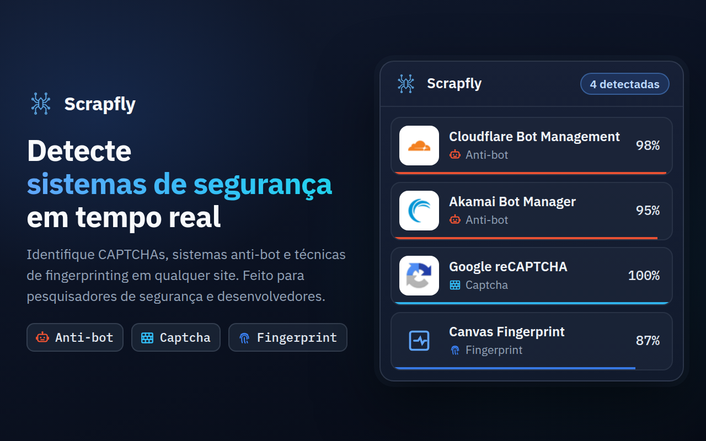
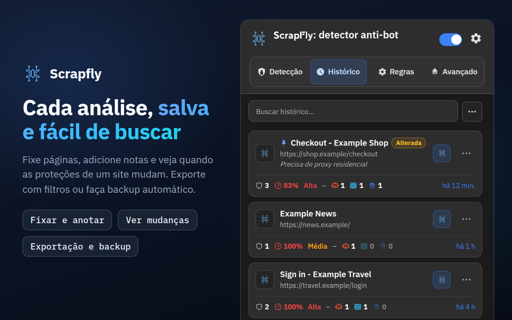
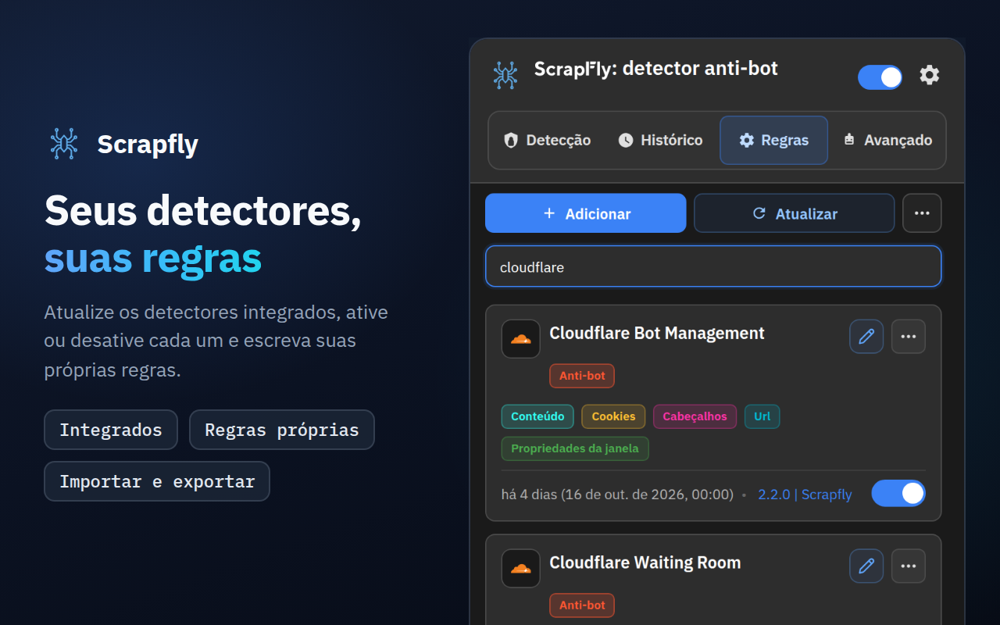
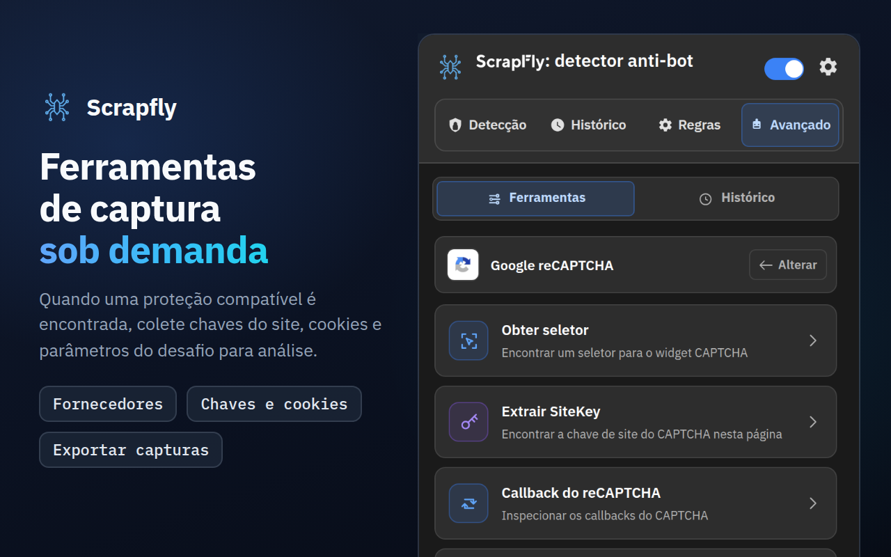
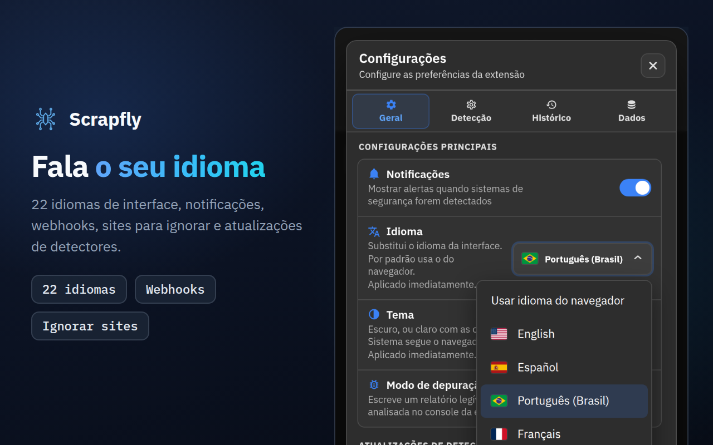

<div align="center">



# Scrapfly Anti-bot Detector

**Veja como um site se defende contra bots: qual sistema anti-bot, qual CAPTCHA, quais scripts de fingerprinting e com que certeza cada um foi identificado.**

[](https://chromewebstore.google.com/detail/scrapfly-anti-bot-detecto/pdpakdgmjhkfimgaihlgaaiijlbilkca)
[](https://chromewebstore.google.com/detail/scrapfly-anti-bot-detecto/pdpakdgmjhkfimgaihlgaaiijlbilkca)
[](https://chromewebstore.google.com/detail/scrapfly-anti-bot-detecto/pdpakdgmjhkfimgaihlgaaiijlbilkca)
[](https://github.com/scrapfly/Antibot-Detector/actions/workflows/ci.yml)
[](../LICENSE)

[**Adicionar ao Chrome**](https://chromewebstore.google.com/detail/scrapfly-anti-bot-detecto/pdpakdgmjhkfimgaihlgaaiijlbilkca) · [Página do produto](https://scrapfly.io/products/antibot-detector) · [Novidades](../CHANGELOG.md) · [llms.txt](../llms.txt) · [Relatar um problema](https://github.com/scrapfly/Antibot-Detector/issues)

[English](../README.md) · [简体中文](README.zh-CN.md) · [Español](README.es.md) · [Русский](README.ru.md) · [日本語](README.ja.md) · **Português (Brasil)** · [Deutsch](README.de.md) · [Français](README.fr.md) · [한국어](README.ko.md)

</div>

---

O Scrapfly Anti-bot Detector é uma extensão gratuita do Chrome que mostra como um site se protege contra tráfego automatizado. Navegue como de costume: o número no ícone da barra de ferramentas indica quantas proteções a página usa, e o popup as lista com a confiança, a dificuldade e os sinais que as denunciaram.

Ele reconhece 88 tecnologias de fábrica: 44 sistemas anti-bot, 23 CAPTCHAs e 21 técnicas de fingerprinting de navegador. Cada detector é um arquivo JSON simples que você pode ler, alterar ou estender, e as novas regras chegam a cada versão deste repositório, então **Regras → Atualizar** pode instalá-las antes mesmo de o Chrome atualizar a própria extensão.

Nós a criamos na [Scrapfly](https://scrapfly.io) porque todo projeto de scraping começa com a mesma pergunta: o que protege esta página? Ela é igualmente útil para ver como a proteção anti-bot do seu próprio site aparece de fora, ou para pesquisa de segurança.

## Conteúdo

- [Capturas de tela](#capturas-de-tela)
- [Instalação](#instalação)
- [Como funciona](#como-funciona)
- [O que detecta](#o-que-detecta)
- [Um tour pelo popup](#um-tour-pelo-popup)
- [Integrações](#integrações)
- [Privacidade e permissões](#privacidade-e-permissões)
- [Desenvolvimento e contribuições](#desenvolvimento-e-contribuições)
- [Licença](#licença)

## Capturas de tela

Clique em uma imagem para vê-la em tamanho real.

<table>
  <tr>
    <td width="50%"><a href="../assets/store-screenshots/pt_BR/02-history-1280x800.png"></a></td>
    <td width="50%"><a href="../assets/store-screenshots/pt_BR/03-rules-1280x800.png"></a></td>
  </tr>
  <tr>
    <td width="50%"><a href="../assets/store-screenshots/pt_BR/04-advanced-tools-1280x800.png"></a></td>
    <td width="50%"><a href="../assets/store-screenshots/pt_BR/05-settings-1280x800.png"></a></td>
  </tr>
</table>

## Instalação

### Chrome Web Store

A opção mais simples: [instale pela Chrome Web Store](https://chromewebstore.google.com/detail/scrapfly-anti-bot-detecto/pdpakdgmjhkfimgaihlgaaiijlbilkca). O Chrome a mantém atualizada para você.

### A partir de uma versão publicada

Cada versão na [página de Releases](https://github.com/scrapfly/Antibot-Detector/releases) traz um zip pronto para carregar.

1. Baixe o zip e extraia-o em uma pasta nova.
2. Abra `chrome://extensions` e ative o **Modo do desenvolvedor** (canto superior direito).
3. Clique em **Carregar sem compactação** e escolha essa pasta.

### A partir do código-fonte

Não há etapa de build. Clone o repositório e carregue a pasta como está:

```bash
git clone https://github.com/scrapfly/Antibot-Detector.git
```

Depois siga as etapas 2 e 3 acima, escolhendo a pasta clonada. Depois de editar um arquivo, clique no botão de recarregar no cartão da extensão em `chrome://extensions` e recarregue a página que você está testando.

## Como funciona

Quando uma página carrega, a extensão reúne o que ela revela sobre si mesma e compara com cada detector ativado. Cada detector combina até oito métodos:

| Método | O que examina | Sinal de exemplo |
| --- | --- | --- |
| URL | O endereço da página, a origem dos scripts e todas as requisições de rede | `challenges.cloudflare.com/turnstile/v0/api.js` |
| Cookies | Os cookies que o site define ou envia, incluindo os HttpOnly | `_abck` (Akamai), `datadome` |
| Cabeçalhos | Cabeçalhos de resposta e de requisição | `x-kpsdk-ct` (Kasada) |
| Conteúdo | O HTML da página e o código de seus scripts inline e carregados | `KPSDK.configure(` |
| DOM | Elementos que correspondem a um seletor CSS | `.cf-turnstile[data-sitekey]` |
| Propriedades da janela | Objetos que os scripts adicionam a `window` | `grecaptcha.render` |
| Hooks de JavaScript | Chamadas a APIs do navegador muito usadas para fingerprinting | `HTMLCanvasElement.prototype.toDataURL` |
| Payload | Corpos de requisições POST, PUT e PATCH, opcionalmente filtrados por URL e método, e as respostas das URLs que uma regra indica | `sensor_data` (Akamai), `"proofofwork":{"required":true` (OpenAI Sentinel) |

**Confiança.** Cada regra tem sua própria confiança, e os detectores definem combinações de regras que pontuam mais quando juntas. Um script que apenas menciona o nome de um fornecedor pontua de 5 a 10%; um sinal que só o produto desse fornecedor gera (seu próprio host de scripts, seu próprio cookie, seu endpoint de desafio) é uma prova e pontua 100% sozinho, assim como a integração completa de um fornecedor (seu script junto com seu cookie, o frame do seu widget ou sua requisição de desafio). Sinais compartilhados ou genéricos ficam entre 15 e 90%. A pontuação de cada detector é a de sua regra ou combinação mais forte. A página também recebe uma dificuldade (Baixa, Média ou Alta), que define a cor do selo na barra de ferramentas. Só as proteções anti-bot e CAPTCHA encontradas com 50% ou mais a definem: fingerprinting e um script que apenas menciona um fornecedor não contam.

**Fingerprinting.** Os hooks de API são instalados antes de os scripts da própria página rodarem, e também cobrem iframes de mesma origem, onde o código de fingerprinting costuma se esconder. Por padrão, eles observam por pelo menos 4 segundos, depois até a página ficar 2 segundos em silêncio, e no máximo por 8 segundos.

**Cache.** Um resultado é reutilizado por 7 dias por padrão, então voltar a uma página o mostra na hora. Em **Configurações → Detecção** você pode alterar a duração e se um resultado é compartilhado por todo o domínio, pelas páginas com o mesmo caminho ou apenas pela URL exata. **Limpar cache** na aba Detecção esquece o resultado salvo, e a página é analisada de novo no próximo carregamento. Editar, desativar, importar ou atualizar regras também limpa os resultados salvos, então cada página é analisada novamente com as regras novas na próxima visita.

## O que detecta

Estas listas são os detectores que acompanham a extensão. Você pode desativar qualquer um, editá-lo ou adicionar os seus na aba Regras.

Cada sistema antibot tem a sua própria página, com os cookies, cabeçalhos e scripts que o denunciam: [páginas de detecção antibot](antibots/pt-BR/README.md).

<details>
<summary><b>Sistemas anti-bot (44)</b></summary>
<br>

Akamai Bot Manager · Alibaba Cloud WAF · Amazon Bot Protection · Anubis · AWS WAF · Azure Front Door · Castle · Cheq · Cloudflare Bot Management · Cloudflare Waiting Room · DataDome · DDoS-Guard · DeepSeek PoW · F5 BIG-IP ASM · Fastly Bot Management · FingerprintJS · Forter · Google BotGuard · Huawei Cloud WAF · HUMAN (PerimeterX) · Hunt · Incapsula (Imperva) · iovation (TransUnion TruValidate) · Jiasule (Chuangyu Shield) · Kasada · Kount · Meetrics Check · Netacea · Ocule · OpenAI Sentinel · Queue-it · Radware Bot Manager · Reblaze · Riskified · Ruishu · SEON · Shape Security · Sift · SiteGround SG-CAPTCHA · Sucuri WAF · ThreatMetrix · Vercel Firewall · Wordfence · Yundun Cloud WAF

</details>

<details>
<summary><b>CAPTCHAs (23)</b></summary>
<br>

AliExpress CAPTCHA · Aliyun Captcha 2.0 · ALTCHA · Basilisk Captcha · Binance Captcha · Cap · Captcha.eu · CaptchaFox · Capy Puzzle Captcha · Cloudflare Turnstile · Dingxiang Captcha · Friendly Captcha · FunCaptcha (Arkose Labs) · GeeTest · Google reCAPTCHA · hCaptcha · Lemin Cropped Captcha · MTCaptcha · NetEase Yidun · Prosopo Procaptcha · QCloud Captcha · Shumei Captcha · Yandex SmartCaptcha

</details>

<details>
<summary><b>Técnicas de fingerprinting (21)</b></summary>
<br>

Audio · Battery API · Canvas · Clipboard API · Crypto · CSS · Device Orientation · Font · Gamepads API · Geolocation · Hardware · IndexedDB · Media · Navigator · Performance · Screen · Timezone/Intl · USB API · Web Storage · WebGL · WebRTC

</details>

## Um tour pelo popup

### Detecção

As proteções encontradas na página atual, cada uma com sua confiança, sua dificuldade e os métodos que corresponderam. Clique em um cartão para ver os sinais exatos por trás dele, ou use os chips abaixo da caixa de busca para mostrar apenas os resultados de Anti-bot, Captcha ou Fingerprint. Passar o mouse sobre o ícone da barra de ferramentas as nomeia sem abrir o popup. **Analisar novamente agora**, ao lado do endereço da página, e **Alt+Shift+S** (Control+Shift+S no Mac; altere nos atalhos de teclado do navegador) analisam a página atual de novo. Os botões no topo permitem:

- **Enviar detecções** para obter um link compartilhável (dpaste.com por padrão; veja [Links de compartilhamento](#links-de-compartilhamento))
- **Limpar cache**, para que a página seja analisada de novo no próximo carregamento
- **Copiar**, um menu: o mesmo resumo que o envio compartilha, uma tabela Markdown para um ticket ou chat, uma linha com o site e suas proteções, ou JSON (nenhum destes inclui valores de cookies ou de cabeçalhos); ou código que pede a página de novo, como comando curl, Python (requests) ou Node.js (fetch), com o User-Agent, o Accept-Language e as client hints deste navegador e todos os cookies que a página envia, inclusive os HttpOnly. O código inclui, sim, os valores dos cookies e o endereço da página com a query string, então mantenha-o em sigilo
- **Bloquear este domínio**, para que a extensão deixe de analisá-lo

### Histórico

Cada página que teve detecções, com suas proteções e sua dificuldade. Pesquise nele (os acentos são ignorados), restrinja com os chips abaixo da caixa de busca (Fixadas, Alterada, uma categoria ou Combinações, as páginas em que uma combinação de sinais correspondeu), abra uma entrada para ver os detalhes, importe uma exportação JSON e exporte como JSON, CSV, texto simples ou Markdown, escolhendo antes as proteções, o período, o site e as páginas fixadas. No menu **⋯** de uma entrada você pode fixá-la (ela é mantida quando o Histórico é limpo), adicionar uma nota, abrir a página, analisá-la de novo agora ou copiá-la como Markdown. Clicar em uma notificação de proteções alteradas abre essa página. O selo **Alterada** marca uma página cujas proteções diferem da última análise. **Configurações → Dados → Abrir estatísticas** abre uma página de estatísticas (atividade, proteções, domínios, confiança, sinais, combinações, regras e ferramentas avançadas) calculada localmente a partir do seu histórico.

**Análise em massa**, no menu **Mais ações** (⋯) do Histórico, analisa uma lista de páginas para você: cole endereços ou um sitemap https, ou envie um arquivo .txt ou .csv, e cada página é aberta em uma aba em segundo plano, uma de cada vez, como uma visita real com seus cookies. Escolha quantas páginas analisar e o limite de tempo por página, pause ou pare a execução (ela continua mesmo se você fechar o popup), analise de novo as páginas com erro e exporte a tabela como CSV, JSON ou Markdown. As páginas concluídas passam pela análise normal, então são registradas no Histórico (a menos que esteja pausado) e enviadas ao seu webhook, e os totais ganham uma linha **Mais vistas** com as proteções encontradas em mais páginas. Um sitemap só adiciona páginas do próprio site, e os sites que você ignora em **Configurações → Detecção** ficam de fora.

### Regras

Todos os detectores, os integrados e os seus; os chips abaixo da caixa de busca restringem a lista a uma categoria ou aos detectores personalizados, editados ou desativados. Ative ou desative cada um, abra o editor para alterar seus padrões ou adicione um detector seu com **Adicionar**. O menu **Mais ações** (⋯) importa e exporta detectores em JSON. Cada padrão tem suas próprias opções: onde procurar (a página, os scripts ou todas as requisições; requisição ou resposta para cookies e cabeçalhos), se é uma expressão regular, palavra inteira ou diferencia maiúsculas de minúsculas, e sua confiança. O editor também gerencia as combinações e o ícone do detector, e um assistente de regex permite testar um padrão com um texto de exemplo. **Verificar com o Histórico** mostra em quantas das suas páginas salvas cada padrão e cada combinação correspondem, e **Testar nesta página** executa a regra como ela está agora (alterações não salvas incluídas) na página em que o popup está aberto: o que cada padrão de cookie, URL, conteúdo e DOM encontra ali, e se a regra e suas combinações correspondem. Padrões de cabeçalhos, hooks de JS, janela e payload só podem ser respondidos por uma análise real, então o teste os indica como tal em vez de «sem correspondência». Nada é salvo nem enviado.

**Atualizar** baixa os detectores oficiais da versão mais recente deste repositório. Um detector integrado que você editou nunca é substituído sem perguntar: você escolhe entre a sua versão e a nova. Se você excluir um detector integrado, **Restaurar detectores oficiais** no mesmo menu o traz de volta. As atualizações de detectores também podem ser agendadas (**Configurações → Geral**).

### Avançado

Ferramentas práticas para as proteções que uma página usa. Uma proteção ganha suas ferramentas quando é detectada com mais de 50% de confiança; você pode alterar esse limite em **Configurações → Detecção → Ferramentas avançadas**. Quando nada na página o atinge, a aba informa isso, indica esse mínimo (ou nomeia a proteção encontrada abaixo dele) e mostra as 27 proteções compatíveis.

| Proteção | Ferramentas |
| --- | --- |
| Akamai Bot Manager | Check Cookies · Analyze Scripts · Extract Sensor Information · Start Capturing |
| AWS WAF | Check Cookies · Analyze Scripts |
| Cloudflare Bot Management | Check Cookies · Analyze Scripts |
| Cloudflare Turnstile | Extract SiteKey · Analyze Scripts |
| DataDome | Check Cookies · Analyze Scripts |
| FunCaptcha (Arkose Labs) | Extract Public Key · Analyze Scripts · Start Capturing |
| GeeTest | Check Version · Analyze Scripts |
| Google reCAPTCHA | Obtain Selector · Extract SiteKey · reCAPTCHA callback · Start Capturing |
| hCaptcha | Extract SiteKey · Check Version · Analyze Scripts · Start Capturing |
| Incapsula (Imperva) | Check Cookies · Analyze Scripts · Start Capturing |
| Shape Security | Check Version · Check Cookies · Analyze Scripts · Start Capturing |
| Aliyun Captcha 2.0, ALTCHA, Captcha.eu, Capy Puzzle Captcha, Dingxiang Captcha, Friendly Captcha, Lemin Cropped Captcha, MTCaptcha, NetEase Yidun, Prosopo Procaptcha, QCloud Captcha, Shumei Captcha, Yandex SmartCaptcha | Extract SiteKey · Analyze Scripts |
| AliExpress CAPTCHA, Basilisk Captcha, Binance Captcha | Analyze Scripts |

Os resultados e as capturas ficam guardados por 30 minutos em **Avançado → Histórico**, onde você pode filtrá-los por site, fornecedor e ferramenta, reabri-los e exportá-los.

### Configurações

- **Geral:** idioma da interface (22 idiomas; por padrão segue o navegador), tema (Escuro, Claro ou Sistema), notificações, modo de depuração, atualizações agendadas de detectores, o que o número na barra de ferramentas conta (todas as detecções, ou só anti-bot e CAPTCHA) e as cores do selo, das categorias e dos rótulos.
- **Detecção:** duração e escopo do cache, a ordem das categorias nos resultados, o limite de confiança das ferramentas avançadas, quais sites são analisados (todos, exceto os que você ignora, ou apenas os que você escolhe), eventos da JS API, webhooks e links de compartilhamento.
- **Histórico:** o que é registrado (pausar o Histórico, ignorar janelas anônimas, sites ignorados, confiança mínima, ignorar páginas só com fingerprinting), quantas entradas são guardadas (até 10.000; 0 guarda as 1.000 mais recentes), apagar entradas após um número de dias ou ao fechar o navegador, ignorar ou atualizar análises repetidas, avisos quando as proteções de uma página mudam, o formato de exportação padrão, um medidor de armazenamento com seu aviso e um backup automático na sua pasta Downloads.

  O Histórico é limitado a cerca de 6 MB, ou a 12 ou 25 MB se você escolher um tamanho maior em **Configurações → Histórico**; quando ele enche, as entradas não fixadas mais antigas são removidas, e **Configurações → Histórico** informa quantas. Páginas com uma proteção difícil, ou com uma que você nomear, podem ser fixadas automaticamente (até 50), páginas só com fingerprinting podem ser apagadas após um número de dias próprio, e até 10 páginas fixadas podem ser vigiadas: elas são analisadas de novo a cada dia ou semana em uma aba em segundo plano, e a entrada é marcada como Alterada quando suas proteções mudam (cada verificação é uma visita real com seus cookies).
- **Dados:** abrir a página de estatísticas; ver quanto espaço cada parte da extensão usa e limpar o cache de detecção, as capturas das ferramentas, os logs ou o Histórico; fazer backup das configurações, das suas regras e do Histórico em um único arquivo e restaurá-lo; exportar ou importar suas configurações e seu histórico; aplicar a predefinição Privacidade ou Desenvolvedor ou redefinir todas as configurações; copiar um resumo de diagnóstico para um relatório de bug (sem sites, endereços ou chaves).

## Integrações

### Eventos JavaScript

A extensão emite eventos no `window` da página, para que seus próprios scripts (ou um ambiente de testes) possam reagir aos resultados:

| Evento | Quando |
| --- | --- |
| `scrapfly:ready` | A extensão foi carregada na página |
| `scrapfly:onStart` | Uma análise começa (sem resultado em cache, ou uma análise manual) |
| `scrapfly:onProgress` | Um método de detecção terminou |
| `scrapfly:onHooksComplete` | Os hooks de JavaScript pararam de observar |
| `scrapfly:onWindowPropsComplete` | As verificações de propriedades da janela terminaram |
| `scrapfly:onDetection` | Os resultados estão prontos, inclusive os servidos do cache |
| `scrapfly:onError` | A análise falhou |

```js
const on = (ev, cb) =>
  addEventListener(`scrapfly:${ev}`, cb);

on('onDetection', (e) => {
  const { url, detections } = e.detail;
  console.log(url, detections);
});
```

Como esses eventos chegam à própria página, qualquer site que você visite pode ouvi-los e saber que a extensão está instalada. Eles vêm desativados; ative-os em **Configurações → Detecção → Eventos da JS API**.

### Webhooks

Quando uma análise encontra proteções, a extensão pode enviar os resultados ao seu próprio endpoint. Escolha o método HTTP, adicione cabeçalhos e escreva o corpo como um modelo com variáveis como `<SITEURL>`, `<HOSTNAME>`, `<TITLE>`, `<DETECTIONS>`, `<DETECTION_COUNT>`, `<DETECTION_NAMES>` (as proteções com sua confiança, em uma única linha), `<CATEGORIES>` e `<TIMESTAMP>`. **Começar com um modelo** (Slack, Mattermost ou Google Chat, Discord ou uma linha de texto simples) preenche o Content-Type e uma mensagem de chat pronta. Os webhooks só vão para endereços HTTPS em hosts públicos, vêm desativados e incluem um botão **Testar**. Configure-os em **Configurações → Detecção → Integração de Webhook**.

**Envios recentes e novas tentativas.** **Configurações → Detecção → Webhook** lista as últimas 20 tentativas (a página, o status e quanto tempo levou; nunca um endereço, um cabeçalho ou um payload). Um envio que falhou pode ser enviado de novo com **Tentar de novo**, e com **Tentar de novo envios que falharam** ativado (padrão) a extensão também tenta sozinha após 1, 5 e 15 minutos quando não houve resposta ou o servidor respondeu 408, 425, 429 ou 5xx; uma recusa como 401, 403 ou 404 aguarda o seu **Tentar de novo**. Para isso, os dados de página de um envio que falhou ficam na memória por uma hora (no máximo 20), nunca em disco, e desaparecem quando o navegador é fechado; uma nova tentativa remonta a requisição com suas configurações de webhook atuais, então um endereço ou segredo corrigido é usado e nenhum cabeçalho nem segredo é guardado junto.

**Assinatura.** Defina um segredo de assinatura (ou clique em **Gerar** e copie-o para o seu servidor) e toda requisição com corpo é assinada como os próprios webhooks da Scrapfly: `X-Scrapfly-Webhook-Signature` contém o HMAC-SHA256 do corpo bruto em hexadecimal maiúsculo, com o segredo como chave exatamente como está escrito (seus bytes UTF-8; um segredo gerado não é decodificado de hexadecimal), e `X-Scrapfly-Webhook-Signature-Lowercase` o mesmo valor em minúsculas. Verifique-o contra o corpo bruto antes de interpretá-lo, com uma comparação em tempo constante. Requisições GET, HEAD e `multipart/form-data` não são assinadas, e a URL nunca faz parte da assinatura. Não há cabeçalho de timestamp; o modelo padrão envia `<TIMESTAMP>` no corpo, para que seu servidor possa rejeitar requisições antigas. O segredo fica neste navegador: exportações, backups e diagnósticos o omitem, e Redefinir o mantém, a menos que você também remova as conexões.

```js
// Node.js, with the raw body as a Buffer (for example express.raw({ type: '*/*' }))
const crypto = require('node:crypto');
function isFromExtension(rawBody, signatureHeader, secret) {
  const expected = Buffer.from(crypto.createHmac('sha256', secret).update(rawBody).digest('hex'));
  const received = Buffer.from(String(signatureHeader || '').toLowerCase());
  return received.length === expected.length && crypto.timingSafeEqual(received, expected);
}
// isFromExtension(req.body, req.get('X-Scrapfly-Webhook-Signature'), process.env.WEBHOOK_SECRET)
```

```python
import hashlib, hmac
def is_from_extension(raw_body: bytes, signature_header: str, secret: str) -> bool:
    expected = hmac.new(secret.encode(), raw_body, hashlib.sha256).hexdigest()
    return hmac.compare_digest(expected, (signature_header or "").lower())
```

### Links de compartilhamento

**Enviar detecções** na aba Detecção publica um resumo dos resultados da página, copia o link e o abre em uma nova aba. O resumo contém o endereço da página sem a query string nem o fragmento, o nome, a categoria e a confiança de cada proteção, e quais métodos corresponderam; nunca valores de cookies ou de cabeçalhos. Escolha para onde ele vai, e quando é apagado se o serviço permitir, em **Configurações → Detecção → Envios para compartilhar**: dpaste.com (padrão), dpaste.org, paste.rs, Pastebin com sua chave de API, um Gist secreto do GitHub com seu token, ou seu próprio servidor.

## Privacidade e permissões

A detecção roda inteiramente no seu navegador. Não há contas nem análises de uso, e nada das páginas que você visita é enviado à Scrapfly. A extensão faz algumas requisições de rede, e é bom saber quais:

- **Conteúdo dos scripts.** Para ler o código de um script, ela baixa de novo os scripts e as folhas de estilo da página, pelo cache do navegador e sem cookies.
- **Atualizações de detectores.** **Atualizar**, ou o agendamento opcional, consulta `api.github.com` para saber a versão mais recente deste repositório e depois lê os arquivos de detectores dessa versão em `raw.githubusercontent.com`.
- **Ícones dos sites.** O Histórico e outras listas mostram o favicon do próprio site, ou o pedem ao serviço de favicons do Google quando o site não tem um.
- **Bandeiras de idiomas.** O seletor de idioma das Configurações carrega as bandeiras de `flagcdn.com`.
- **Somente quando você os usa:** os webhooks e os links de compartilhamento, descritos acima. Os eventos da JS API nunca saem do navegador, mas a página que você visita pode lê-los (veja [Eventos JavaScript](#eventos-javascript)).

<details>
<summary><b>Por que a extensão precisa de cada permissão</b></summary>
<br>

| Permissão | Para que é usada |
| --- | --- |
| Acesso a todos os sites (`http://*/*`, `https://*/*`) | Analisar qualquer página que você abrir |
| `storage` | Configurações, detectores, histórico e resultados em cache |
| `tabs`, `activeTab` | Saber de qual página o popup trata e abrir páginas como a de estatísticas |
| `scripting` | Executar as ferramentas avançadas dentro da página |
| `webRequest` | Ler as URLs, os cabeçalhos e os corpos das requisições para a detecção e as capturas |
| `webNavigation` | Saber quando uma página ou um frame terminou de carregar |
| `cookies` | Ler cookies, incluindo os HttpOnly; algumas ferramentas de análise reiniciam um cookie de proteção antes de recarregar a página |
| `notifications` | Mensagens de status das ferramentas de captura |
| `downloads` | Salvar os arquivos exportados |
| `alarms` | As atualizações agendadas de detectores e a limpeza do histórico e dos resultados em cache antigos |
| `unlimitedStorage` | Permite que o Histórico ocupe mais que a cota de 10 MB do navegador quando você escolhe 12 ou 25 MB em **Configurações → Histórico**; o Histórico fica em 6 MB a menos que você escolha mais |

</details>

## Desenvolvimento e contribuições

A documentação para desenvolvedores existe apenas em inglês, para que nunca fique desatualizada: [desenvolvimento e verificações](../README.md#development), [como escrever um detector](../README.md#writing-a-detector) e [como contribuir](../README.md#contributing). Relatos de bugs e melhorias de detectores são bem-vindos em qualquer idioma: [abra uma issue](https://github.com/scrapfly/Antibot-Detector/issues) com o endereço da página e o que você esperava ver.

## Licença

Publicado sob a [Non-Profit Open Software License 3.0](../LICENSE) (NPOSL-3.0).

Copyright © 2026 Scrapfly.
