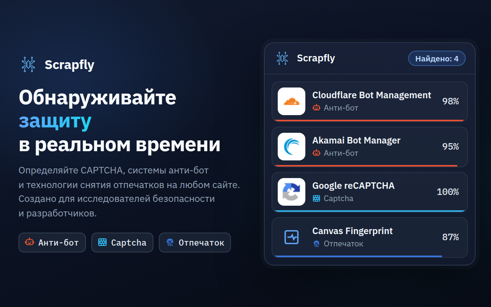
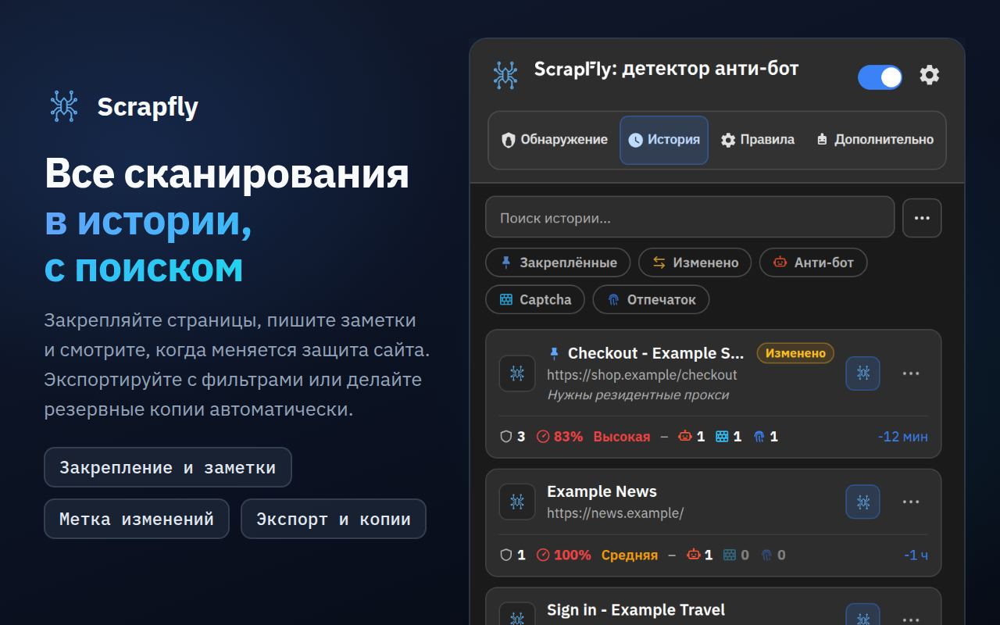
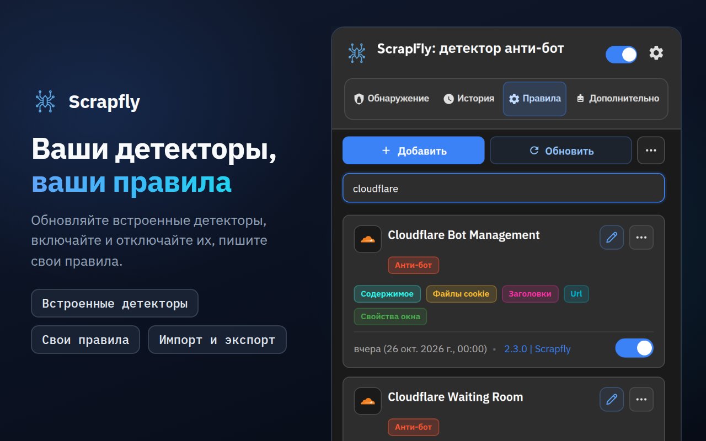
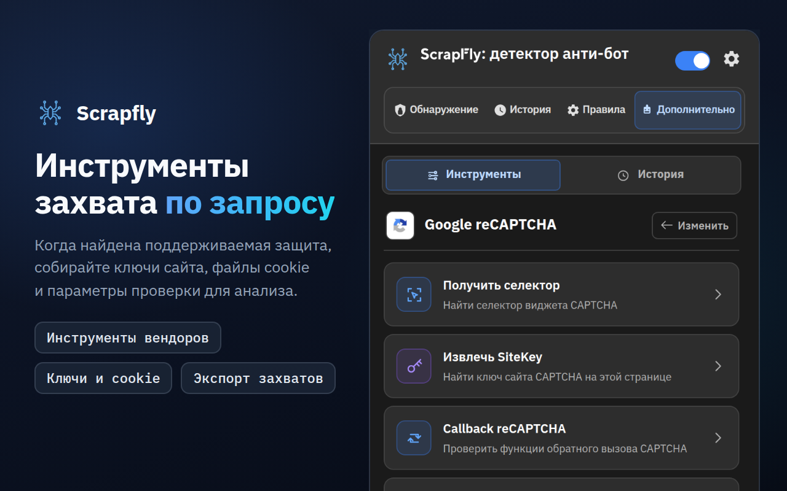
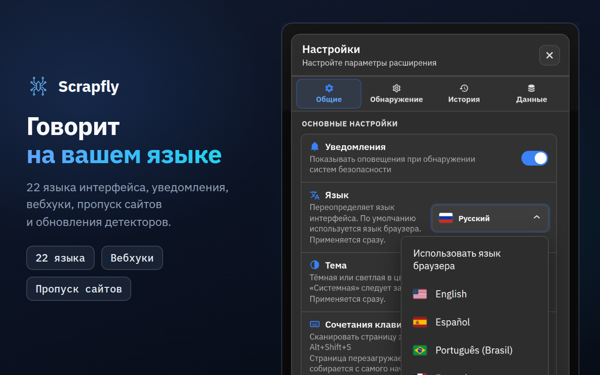

<div align="center">



# Scrapfly Anti-bot Detector

**Узнайте, как сайт защищается от ботов: какая система анти-бот, какая CAPTCHA, какие скрипты снятия отпечатков и насколько надёжно каждое совпадение.**

[](https://chromewebstore.google.com/detail/scrapfly-anti-bot-detecto/pdpakdgmjhkfimgaihlgaaiijlbilkca)
[](https://chromewebstore.google.com/detail/scrapfly-anti-bot-detecto/pdpakdgmjhkfimgaihlgaaiijlbilkca)
[](https://chromewebstore.google.com/detail/scrapfly-anti-bot-detecto/pdpakdgmjhkfimgaihlgaaiijlbilkca)
[](https://github.com/scrapfly/Antibot-Detector/actions/workflows/ci.yml)
[](../LICENSE)

[**Установить в Chrome**](https://chromewebstore.google.com/detail/scrapfly-anti-bot-detecto/pdpakdgmjhkfimgaihlgaaiijlbilkca) · [Страница продукта](https://scrapfly.io/products/antibot-detector) · [Что нового](../CHANGELOG.md) · [llms.txt](../llms.txt) · [Сообщить о проблеме](https://github.com/scrapfly/Antibot-Detector/issues)

[English](../README.md) · [简体中文](README.zh-CN.md) · [Español](README.es.md) · **Русский**

</div>

---

Scrapfly Anti-bot Detector — бесплатное расширение для Chrome, которое показывает, как сайт защищается от автоматизированного трафика. Просто пользуйтесь браузером как обычно: число на значке расширения показывает, сколько защит использует страница, а во всплывающем окне каждая из них указана с уровнем уверенности, сложностью и сигналами, которые её выдали.

Сразу после установки расширение распознаёт 85 технологий: 42 системы анти-бот, 22 CAPTCHA и 21 технику снятия отпечатков браузера. Каждый детектор — это обычный JSON-файл, который можно прочитать, изменить или дополнить. Новые правила выходят с каждым релизом этого репозитория, поэтому **Правила → Обновить** может установить их ещё до того, как Chrome обновит само расширение.

Мы сделали его в [Scrapfly](https://scrapfly.io), потому что любой проект по сбору данных начинается с одного вопроса: что защищает эту страницу? Расширение так же полезно, чтобы посмотреть, как защита от ботов на вашем собственном сайте выглядит снаружи, и для исследований в области безопасности.

## Содержание

- [Скриншоты](#скриншоты)
- [Установка](#установка)
- [Как это работает](#как-это-работает)
- [Что распознаёт расширение](#что-распознаёт-расширение)
- [Обзор всплывающего окна](#обзор-всплывающего-окна)
- [Интеграции](#интеграции)
- [Конфиденциальность и разрешения](#конфиденциальность-и-разрешения)
- [Разработка и участие](#разработка-и-участие)
- [Лицензия](#лицензия)

## Скриншоты

Нажмите на изображение, чтобы открыть его в полном размере.

<table>
  <tr>
    <td width="50%"><a href="../assets/store-screenshots/ru/02-history-1280x800.png"></a></td>
    <td width="50%"><a href="../assets/store-screenshots/ru/03-rules-1280x800.png"></a></td>
  </tr>
  <tr>
    <td width="50%"><a href="../assets/store-screenshots/ru/04-advanced-tools-1280x800.png"></a></td>
    <td width="50%"><a href="../assets/store-screenshots/ru/05-settings-1280x800.png"></a></td>
  </tr>
</table>

## Установка

### Chrome Web Store

Самый простой способ — [установить расширение из Chrome Web Store](https://chromewebstore.google.com/detail/scrapfly-anti-bot-detecto/pdpakdgmjhkfimgaihlgaaiijlbilkca). Chrome будет обновлять его сам.

### Из релиза

К каждой версии на [странице релизов](https://github.com/scrapfly/Antibot-Detector/releases) приложен zip-архив, готовый к загрузке.

1. Скачайте архив и распакуйте его в новую папку.
2. Откройте `chrome://extensions` и включите **Режим разработчика** (справа вверху).
3. Нажмите **Загрузить распакованное расширение** и выберите эту папку.

### Из исходников

Сборка не нужна. Клонируйте репозиторий и загрузите папку как есть:

```bash
git clone https://github.com/scrapfly/Antibot-Detector.git
```

Затем выполните шаги 2 и 3 выше, выбрав клонированную папку. После изменения файла нажмите кнопку перезагрузки на карточке расширения в `chrome://extensions` и перезагрузите страницу, на которой проверяете.

## Как это работает

Когда страница загружается, расширение собирает всё, что она о себе раскрывает, и сверяет это с каждым включённым детектором. Детектор сочетает до восьми методов:

| Метод | Что проверяет | Пример сигнала |
| --- | --- | --- |
| URL | Адрес страницы, источники скриптов и все сетевые запросы | `challenges.cloudflare.com/turnstile/v0/api.js` |
| Файлы cookie | Cookie, которые сайт устанавливает или отправляет, включая HttpOnly | `_abck` (Akamai), `datadome` |
| Заголовки | Заголовки ответов и запросов | `x-kpsdk-ct` (Kasada) |
| Содержимое | HTML страницы и код встроенных и загружаемых скриптов | `KPSDK.configure(` |
| DOM | Элементы, найденные по CSS-селектору | `.cf-turnstile[data-sitekey]` |
| Свойства окна | Объекты, которые скрипты добавляют в `window` | `grecaptcha.render` |
| Перехватчики JavaScript | Вызовы API браузера, которые часто используют для снятия отпечатков | `HTMLCanvasElement.prototype.toDataURL` |
| Полезная нагрузка | Тела запросов POST, PUT и PATCH (с фильтром по URL и методу или без) и ответы на URL, указанные в правиле | `sensor_data` (Akamai), `"proofofwork":{"required":true` (OpenAI Sentinel) |

**Уверенность.** У каждого правила своя уверенность, а детекторы задают комбинации правил, которые вместе дают более высокую оценку. Скрипт, в котором лишь упоминается название вендора, получает 5–10%. Сигнал, который даёт только продукт этого вендора (его собственный хост скриптов, его cookie, его эндпоинт проверки), считается доказательством и сам по себе даёт 100%; то же относится к полной интеграции вендора (его скрипт вместе с его cookie, фреймом виджета или запросом проверки). Общие или неспецифичные сигналы остаются в пределах 15–90%. Для детектора показывается оценка его самого сильного правила или комбинации. Странице также присваивается сложность (Низкая, Средняя или Высокая), от которой зависит цвет значка на панели инструментов.

**Снятие отпечатков.** Перехватчики API устанавливаются до запуска собственных скриптов страницы и охватывают также iframe того же источника, где часто прячется код снятия отпечатков. По умолчанию они наблюдают не меньше 4 секунд, затем до тех пор, пока страница не затихнет на 2 секунды, но не дольше 8 секунд.

**Кэширование.** По умолчанию результат хранится 7 дней, поэтому при повторном визите он появляется сразу. Срок хранения и то, к чему относится результат (ко всему домену, к страницам с тем же путём или только к точному URL), можно изменить в **Настройки → Обнаружение**. Кнопка **Очистить кэш** на вкладке **Обнаружение** удаляет сохранённый результат, и при следующей загрузке страница сканируется заново.

## Что распознаёт расширение

Ниже перечислены детекторы, которые поставляются с расширением. Любой из них можно отключить, отредактировать или добавить свой на вкладке **Правила**.

<details>
<summary><b>Системы анти-бот (42)</b></summary>
<br>

Akamai Bot Manager · Alibaba Cloud WAF · Amazon Bot Protection · Anubis · AWS WAF · Azure Front Door · Castle · Cheq · Cloudflare Bot Management · Cloudflare Waiting Room · DataDome · DDoS-Guard · DeepSeek PoW · F5 BIG-IP ASM · Fastly Bot Management · FingerprintJS · Forter · Google BotGuard · HUMAN (PerimeterX) · Hunt · Incapsula (Imperva) · iovation (TransUnion TruValidate) · Jiasule (Chuangyu Shield) · Kasada · Kount · Meetrics Check · Netacea · Ocule · OpenAI Sentinel · Queue-it · Radware Bot Manager · Reblaze · Riskified · Ruishu · SEON · Shape Security · Sift · Sucuri WAF · ThreatMetrix · Vercel Firewall · Wordfence · Yundun Cloud WAF

</details>

<details>
<summary><b>CAPTCHA (22)</b></summary>
<br>

AliExpress CAPTCHA · Aliyun Captcha 2.0 · ALTCHA · Basilisk Captcha · Binance Captcha · Cap · Captcha.eu · Capy Puzzle Captcha · Cloudflare Turnstile · Dingxiang Captcha · Friendly Captcha · FunCaptcha (Arkose Labs) · GeeTest · Google reCAPTCHA · hCaptcha · Lemin Cropped Captcha · MTCaptcha · NetEase Yidun · Prosopo Procaptcha · QCloud Captcha · Shumei Captcha · Yandex SmartCaptcha

</details>

<details>
<summary><b>Техники снятия отпечатков (21)</b></summary>
<br>

Audio · Battery API · Canvas · Clipboard API · Crypto · CSS · Device Orientation · Font · Gamepads API · Geolocation · Hardware · IndexedDB · Media · Navigator · Performance · Screen · Timezone/Intl · USB API · Web Storage · WebGL · WebRTC

</details>

## Обзор всплывающего окна

### Обнаружение

Защиты, найденные на текущей странице, — у каждой уверенность, сложность и сработавшие методы. Нажмите на карточку, чтобы увидеть конкретные сигналы. Если навести курсор на значок расширения, их названия видны без открытия окна, а **Alt+Shift+S** (Control+Shift+S на Mac; сочетание меняется в настройках быстрых клавиш браузера) заново сканирует текущую страницу. Кнопки вверху позволяют:

- **Загрузить обнаружения** и получить ссылку, которой можно поделиться (по умолчанию dpaste.com; см. [Ссылки для обмена](#ссылки-для-обмена))
- **Очистить кэш**, чтобы страница была просканирована заново при следующей загрузке
- **Копировать** — меню: та же сводка, что публикуется при загрузке, таблица Markdown для тикета или чата либо JSON (ни один вариант не содержит значений cookie и заголовков)
- **Заблокировать этот домен**, чтобы расширение перестало его сканировать

### История

Все страницы, на которых что-то было обнаружено, с их защитами и сложностью. Историю можно искать, открывать записи с подробностями, импортировать экспорт в JSON и экспортировать её в JSON, CSV, обычный текст или Markdown, предварительно выбрав защиты, период, сайт и закреплённые страницы. Через меню **⋯** записи можно её закрепить (она сохранится при очистке истории), добавить заметку, открыть страницу или сразу просканировать её заново. Нажатие на уведомление «Защита изменилась» открывает соответствующую страницу. Метка **Изменено** отмечает страницу, защиты которой отличаются от прошлого сканирования. **Настройки → Данные → Открыть статистику** открывает страницу статистики (активность, защиты, домены, уверенность, сигналы, комбинации, правила и расширенные инструменты), которая рассчитывается локально по вашей истории.

### Правила

Все детекторы — встроенные и ваши собственные. Каждый можно включить или отключить, открыть в редакторе, чтобы изменить шаблоны, или создать свой кнопкой **Добавить**. Меню **Другие действия** (⋯) импортирует и экспортирует детекторы в JSON. У каждого шаблона свои настройки: где искать (страница, скрипты или все запросы; для cookie и заголовков — запрос или ответ), является ли он регулярным выражением, ищется ли целым словом и с учётом регистра, а также его уверенность. В редакторе также задаются комбинации и значок детектора, а помощник по регулярным выражениям позволяет проверить шаблон на примере текста. **Проверить по Истории** показывает, на скольких сохранённых страницах срабатывает каждый шаблон и комбинация, а **Проверить на этой странице** запускает правило в текущем виде (включая несохранённые правки) на странице, где открыто окно: что находит там каждый шаблон cookie, URL, содержимого и DOM и срабатывают ли правило и его комбинации. На шаблоны заголовков, JS-перехватчиков, свойств окна и полезной нагрузки может ответить только настоящее сканирование, поэтому тест перечисляет их отдельно, а не как «нет совпадения». Ничего не сохраняется и не отправляется.

**Обновить** загружает официальные детекторы из последнего релиза этого репозитория. Отредактированный вами встроенный детектор никогда не заменяется без вопроса: вы выбираете между своей версией и новой. Если вы удалили встроенный детектор, **Восстановить официальные детекторы** в том же меню вернёт его. Обновление детекторов можно также запускать по расписанию (**Настройки → Общие**).

### Дополнительно

Практические инструменты для защит, которые использует страница. Защита получает свои инструменты, когда она обнаружена с уверенностью выше 50%; этот порог меняется в **Настройки → Обнаружение → Расширенные инструменты**. Если на странице ничего не подходит, вкладка сообщает об этом, указывает порог (или называет защиту, найденную ниже него) и показывает 25 поддерживаемых защит.

| Защита | Инструменты |
| --- | --- |
| Akamai Bot Manager | Проверить куки · Анализ скриптов · Извлечь данные сенсора · Начать захват |
| AWS WAF | Проверить куки · Анализ скриптов |
| Cloudflare Bot Management | Проверить куки · Анализ скриптов |
| Cloudflare Turnstile | Извлечь SiteKey · Анализ скриптов |
| DataDome | Проверить куки · Анализ скриптов |
| FunCaptcha (Arkose Labs) | Извлечь открытый ключ · Анализ скриптов · Начать захват |
| GeeTest | Проверить версию · Анализ скриптов |
| Google reCAPTCHA | Получить селектор · Извлечь SiteKey · Callback reCAPTCHA · Начать захват |
| hCaptcha | Извлечь SiteKey · Проверить версию · Анализ скриптов · Начать захват |
| Incapsula (Imperva) | Проверить куки · Анализ скриптов · Начать захват |
| Shape Security | Проверить версию · Проверить куки · Анализ скриптов · Начать захват |
| Aliyun Captcha 2.0, Captcha.eu, Capy Puzzle Captcha, Dingxiang Captcha, Friendly Captcha, MTCaptcha, NetEase Yidun, Prosopo Procaptcha, QCloud Captcha, Shumei Captcha, Yandex SmartCaptcha | Извлечь SiteKey · Анализ скриптов |
| AliExpress CAPTCHA, Basilisk Captcha, Binance Captcha | Анализ скриптов |

Результаты и захваты хранятся 30 минут в **Дополнительно → История**, где их можно фильтровать по сайту, вендору и инструменту, открывать снова и экспортировать.

### Настройки

- **Общие:** язык интерфейса (22 языка, по умолчанию как в браузере), тема (Тёмная, Светлая или Системная), уведомления, режим отладки, обновление детекторов по расписанию, цвета значка, категорий и меток.
- **Обнаружение:** срок и область действия кэша, порядок категорий в результатах, порог уверенности для расширенных инструментов, какие сайты сканировать (все, кроме пропущенных, или только выбранные), события JS API, вебхуки и ссылки для обмена.
- **История:** что записывать (приостановить историю, пропускать приватные окна, игнорируемые сайты, минимальная уверенность, пропуск страниц только с отпечатками), сколько записей хранить (до 10 000; 0 — хранить 1 000 самых новых), удаление записей через заданное число дней или при закрытии браузера, пропуск или обновление повторных сканирований, уведомления при изменении защит страницы, формат экспорта по умолчанию, индикатор занятого места с предупреждением и автоматическая резервная копия в папку «Загрузки».

  История ограничена примерно 6 МБ — или 12 либо 25 МБ, если выбрать больший размер в **Настройки → История**; когда место заканчивается, удаляются самые старые незакреплённые записи, и **Настройки → История** сообщает, сколько их было. Страницы с высокой сложностью защиты или с указанной вами защитой могут закрепляться сами (до 50), для страниц только с отпечатками можно задать свой срок хранения в днях, а за 10 закреплёнными страницами можно следить: они сканируются заново каждый день или неделю в фоновой вкладке, и при изменении защит запись помечается как **Изменено** (каждая проверка — настоящий визит с вашими cookie).
- **Данные:** открыть страницу статистики; посмотреть, сколько места занимает каждая часть расширения, и очистить кэш обнаружений, захваты инструментов, журналы или историю; сохранить настройки, свои правила и историю в один файл и восстановить их; экспортировать или импортировать настройки и историю; применить пресет «Конфиденциальность» или «Разработчик» либо сбросить все настройки; скопировать диагностическую сводку для отчёта об ошибке (без сайтов, адресов и ключей).

## Интеграции

### События JavaScript

Расширение отправляет события в `window` страницы, чтобы ваши скрипты (или тестовая среда) могли реагировать на результаты:

| Событие | Когда |
| --- | --- |
| `scrapfly:ready` | Расширение загрузилось на странице |
| `scrapfly:onStart` | Начинается сканирование (нет результата в кэше или запущено вручную) |
| `scrapfly:onProgress` | Завершился один из методов обнаружения |
| `scrapfly:onHooksComplete` | Перехватчики JavaScript перестали наблюдать |
| `scrapfly:onWindowPropsComplete` | Проверки свойств окна завершились |
| `scrapfly:onDetection` | Результаты готовы, в том числе взятые из кэша |
| `scrapfly:onError` | Сканирование не удалось |

```js
const on = (ev, cb) =>
  addEventListener(`scrapfly:${ev}`, cb);

on('onDetection', (e) => {
  const { url, detections } = e.detail;
  console.log(url, detections);
});
```

Поскольку эти события доходят до самой страницы, любой посещаемый сайт может их слушать и узнать, что расширение установлено. По умолчанию они выключены; включить их можно в **Настройки → Обнаружение → События JS API**.

### Вебхуки

Когда сканирование находит защиты, расширение может отправить результаты на ваш эндпоинт. Выберите HTTP-метод, добавьте заголовки и задайте тело как шаблон с переменными, например `<SITEURL>`, `<HOSTNAME>`, `<TITLE>`, `<DETECTIONS>`, `<DETECTION_COUNT>`, `<CATEGORIES>` и `<TIMESTAMP>`. Вебхуки отправляются только на HTTPS-адреса публичных хостов, по умолчанию выключены и снабжены кнопкой **Проверить**. Настраиваются они в **Настройки → Обнаружение → Интеграция вебхука**.

**Последние отправки и повторы.** **Настройки → Обнаружение → Вебхук** показывает последние 20 попыток (страница, статус, длительность; никогда — адрес, заголовки или полезная нагрузка). Неудачную отправку можно повторить кнопкой **Повторить**, а при включённом **Повторять неудачные отправки** (по умолчанию) расширение само повторяет её через 1, 5 и 15 минут, если ответа не было или сервер ответил 408, 425, 429 или 5xx; отказ вроде 401, 403 или 404 ждёт вашего **Повторить**. Для этого данные страницы неудачной отправки хранятся в памяти один час (не больше 20), никогда на диске, и исчезают при закрытии браузера; повтор заново собирает запрос из текущих настроек вебхука, поэтому используется исправленный адрес или секрет, а заголовки и секрет вместе с данными не хранятся.

**Подпись.** Задайте секрет подписи (или нажмите **Сгенерировать**, а затем **Копировать**, чтобы перенести его на сервер), и каждый запрос с телом будет подписан так же, как собственные вебхуки Scrapfly: `X-Scrapfly-Webhook-Signature` содержит HMAC-SHA256 исходного тела в виде шестнадцатеричной строки в верхнем регистре с ключом — секретом ровно в том виде, как он записан (его байты UTF-8; сгенерированный секрет не декодируется из hex), а `X-Scrapfly-Webhook-Signature-Lowercase` — то же значение в нижнем регистре. Проверяйте подпись по исходному телу до его разбора, сравнением за постоянное время. Запросы GET, HEAD и `multipart/form-data` не подписываются, и URL никогда не входит в подпись. Заголовка с меткой времени нет; шаблон по умолчанию передаёт `<TIMESTAMP>` в теле, чтобы сервер мог отклонять устаревшие запросы. Секрет остаётся в этом браузере: экспорт, резервные копии и диагностика его не содержат, а **Сбросить** сохраняет его, если вы не удалите заодно и подключения.

```js
// Node.js, исходное тело в виде Buffer (например, express.raw({ type: '*/*' }))
const crypto = require('node:crypto');
function isFromExtension(rawBody, signatureHeader, secret) {
  const expected = Buffer.from(crypto.createHmac('sha256', secret).update(rawBody).digest('hex'));
  const received = Buffer.from(String(signatureHeader || '').toLowerCase());
  return received.length === expected.length && crypto.timingSafeEqual(received, expected);
}
// isFromExtension(req.body, req.get('X-Scrapfly-Webhook-Signature'), process.env.WEBHOOK_SECRET)
```

```python
import hashlib, hmac
def is_from_extension(raw_body: bytes, signature_header: str, secret: str) -> bool:
    expected = hmac.new(secret.encode(), raw_body, hashlib.sha256).hexdigest()
    return hmac.compare_digest(expected, (signature_header or "").lower())
```

### Ссылки для обмена

**Загрузить обнаружения** на вкладке **Обнаружение** публикует сводку результатов страницы, копирует ссылку и открывает её в новой вкладке. Сводка содержит адрес страницы без строки запроса и фрагмента, название, категорию и уверенность каждой защиты и сработавшие методы; значения cookie и заголовков — никогда. Куда отправлять сводку и когда её удалять (если сервис это позволяет), выбирается в **Настройки → Обнаружение → Загрузки для обмена**: dpaste.com (по умолчанию), dpaste.org, paste.rs, Pastebin с вашим API-ключом, секретный GitHub Gist с вашим токеном или ваш собственный сервер.

## Конфиденциальность и разрешения

Обнаружение целиком выполняется в вашем браузере. Нет ни аккаунтов, ни аналитики, и ничего о посещаемых вами страницах не отправляется в Scrapfly. Тем не менее расширение делает несколько сетевых запросов, и о них стоит знать:

- **Содержимое скриптов.** Чтобы прочитать код скрипта, расширение повторно загружает скрипты и таблицы стилей страницы — через кэш браузера и без cookie.
- **Обновления детекторов.** **Обновить** или необязательное расписание запрашивает у `api.github.com` последний релиз этого репозитория, а затем читает файлы детекторов этого релиза с `raw.githubusercontent.com`.
- **Значки сайтов.** История и другие списки показывают собственный favicon сайта, а если его нет — запрашивают сервис значков Google.
- **Флаги языков.** Список языков в настройках загружает флаги с `flagcdn.com`.
- **Только если вы ими пользуетесь:** вебхуки и ссылки для обмена, как описано выше. События JS API никогда не покидают браузер, но посещаемая страница может их прочитать (см. [События JavaScript](#события-javascript)).

<details>
<summary><b>Зачем расширению каждое разрешение</b></summary>
<br>

| Разрешение | Для чего |
| --- | --- |
| Доступ ко всем сайтам (`http://*/*`, `https://*/*`) | Сканирование любой открытой страницы |
| `storage` | Настройки, детекторы, история и результаты в кэше |
| `tabs`, `activeTab` | Определить, к какой странице относится всплывающее окно, и открывать страницы вроде статистики |
| `scripting` | Запуск расширенных инструментов внутри страницы |
| `webRequest` | Чтение URL, заголовков и тел запросов для обнаружения и захватов |
| `webNavigation` | Узнать, когда страница или фрейм закончили загрузку |
| `cookies` | Чтение cookie, включая HttpOnly; некоторые инструменты анализа сбрасывают cookie защиты перед перезагрузкой страницы |
| `notifications` | Сообщения о состоянии от инструментов захвата |
| `downloads` | Сохранение экспортированных файлов |
| `alarms` | Обновление детекторов по расписанию и очистка старой истории и результатов в кэше |
| `unlimitedStorage` | Позволяет истории занимать больше квоты браузера в 10 МБ, если в **Настройки → История** выбрать 12 или 25 МБ; без этого история остаётся в пределах 6 МБ |

</details>

## Разработка и участие

Документация для разработчиков — настройка окружения, проверки, написание детекторов и участие в проекте — ведётся только на английском, чтобы она никогда не устаревала: см. [Development](../README.md#development), [Writing a detector](../README.md#writing-a-detector) и [Contributing](../README.md#contributing). Сообщения об ошибках и предложения по детекторам ждём в [issues](https://github.com/scrapfly/Antibot-Detector/issues).

## Лицензия

Распространяется по лицензии [Non-Profit Open Software License 3.0](../LICENSE) (NPOSL-3.0).

Copyright © 2026 Scrapfly.
