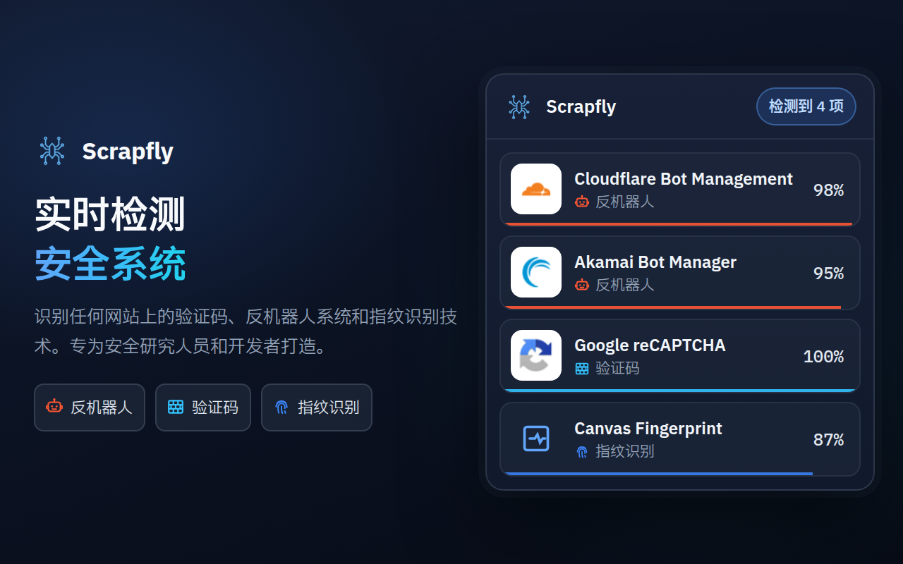
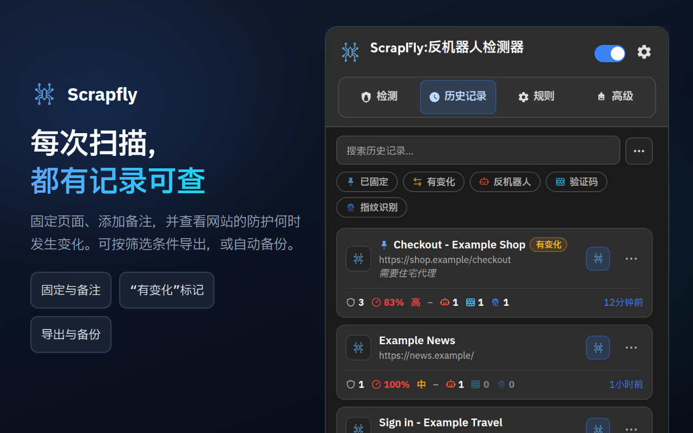
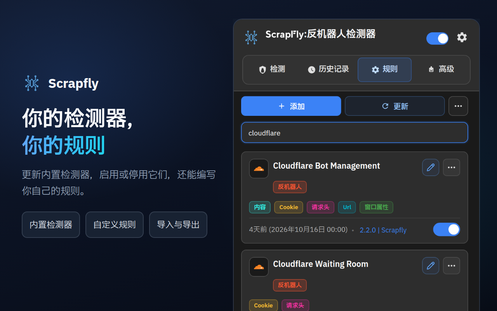
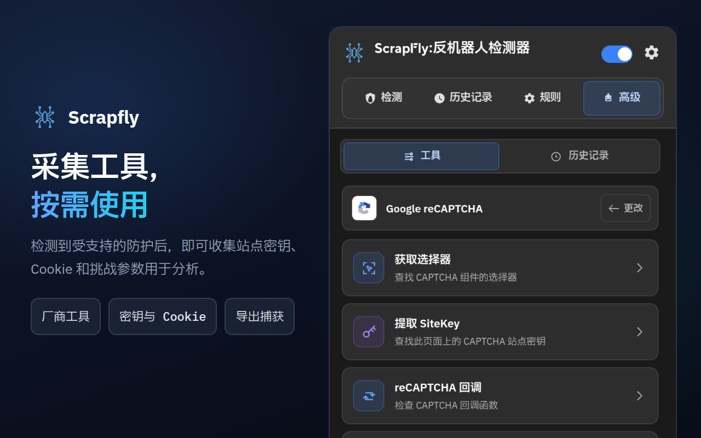
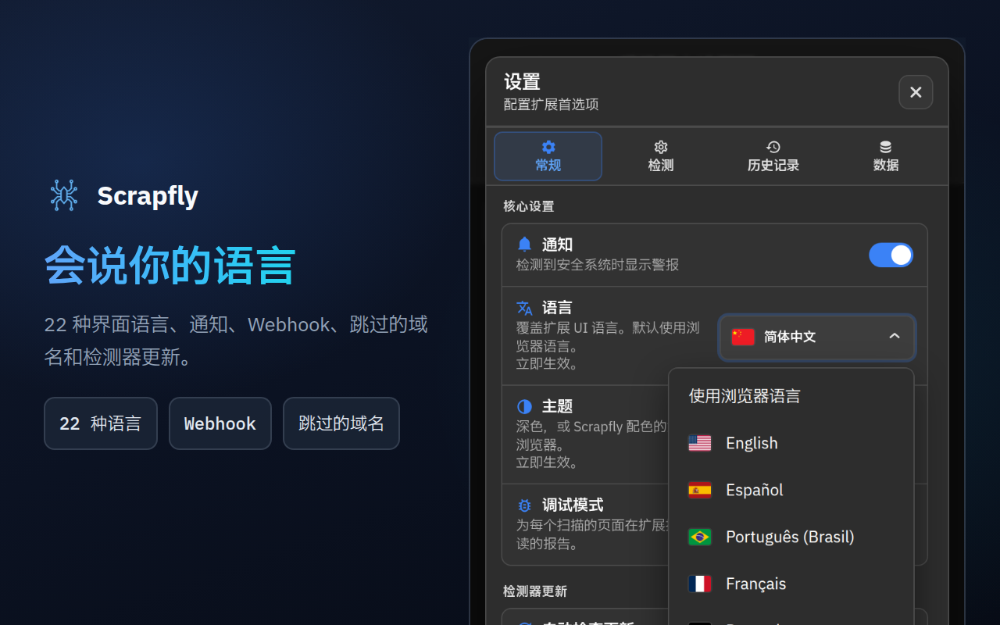

<div align="center">



# Scrapfly Anti-bot Detector

**看清网站如何抵御机器人：用了哪套反机器人系统、哪种验证码、哪些指纹识别脚本，以及每项匹配有多可靠。**

[](https://chromewebstore.google.com/detail/scrapfly-anti-bot-detecto/pdpakdgmjhkfimgaihlgaaiijlbilkca)
[](https://chromewebstore.google.com/detail/scrapfly-anti-bot-detecto/pdpakdgmjhkfimgaihlgaaiijlbilkca)
[](https://chromewebstore.google.com/detail/scrapfly-anti-bot-detecto/pdpakdgmjhkfimgaihlgaaiijlbilkca)
[](https://github.com/scrapfly/Antibot-Detector/actions/workflows/ci.yml)
[](../LICENSE)

[**添加到 Chrome**](https://chromewebstore.google.com/detail/scrapfly-anti-bot-detecto/pdpakdgmjhkfimgaihlgaaiijlbilkca) · [产品页面](https://scrapfly.io/products/antibot-detector) · [更新内容](../CHANGELOG.md) · [llms.txt](../llms.txt) · [报告问题](https://github.com/scrapfly/Antibot-Detector/issues)

[English](../README.md) · **简体中文** · [Español](README.es.md) · [Русский](README.ru.md)

</div>

---

Scrapfly Anti-bot Detector 是一款免费的 Chrome 扩展程序，用来查看网站如何防范自动化流量。照常浏览即可：工具栏图标上的数字告诉你当前页面用了多少种防护，弹出窗口则逐一列出每项防护的置信度、难度以及暴露它的信号。

它开箱即可识别 85 种技术：42 套反机器人系统、22 种验证码和 21 种浏览器指纹识别技术。每个检测器都是一个普通的 JSON 文件，你可以阅读、修改或扩展它；新规则会随本仓库的每次发布一起推出，因此在 Chrome 更新扩展本身之前，**规则 → 更新**就能把它们装好。

我们在 [Scrapfly](https://scrapfly.io) 开发这款工具，是因为每个爬虫项目都从同一个问题开始：这个页面由什么在保护？它同样适合从外部检查你自己网站的机器人防护效果，或用于安全研究。

## 目录

- [截图](#截图)
- [安装](#安装)
- [工作原理](#工作原理)
- [检测范围](#检测范围)
- [弹出窗口导览](#弹出窗口导览)
- [集成](#集成)
- [隐私与权限](#隐私与权限)
- [开发与贡献](#开发与贡献)
- [许可证](#许可证)

## 截图

点击图片可查看原尺寸。

<table>
  <tr>
    <td width="50%"><a href="../assets/store-screenshots/zh_CN/02-history-1280x800.png"></a></td>
    <td width="50%"><a href="../assets/store-screenshots/zh_CN/03-rules-1280x800.png"></a></td>
  </tr>
  <tr>
    <td width="50%"><a href="../assets/store-screenshots/zh_CN/04-advanced-tools-1280x800.png"></a></td>
    <td width="50%"><a href="../assets/store-screenshots/zh_CN/05-settings-1280x800.png"></a></td>
  </tr>
</table>

## 安装

### Chrome 应用商店

最简单的方式：[从 Chrome 应用商店安装](https://chromewebstore.google.com/detail/scrapfly-anti-bot-detecto/pdpakdgmjhkfimgaihlgaaiijlbilkca)。Chrome 会自动帮你保持更新。

### 从发布版安装

[Releases 页面](https://github.com/scrapfly/Antibot-Detector/releases)上的每个版本都附有一个可直接加载的 zip 包。

1. 下载 zip 包，并解压到一个新文件夹。
2. 打开 `chrome://extensions`，开启右上角的**开发者模式**。
3. 点击**加载已解压的扩展程序**，选择该文件夹。

### 从源码安装

无需构建。克隆仓库后直接加载该文件夹即可：

```bash
git clone https://github.com/scrapfly/Antibot-Detector.git
```

然后按上面的第 2、3 步操作，选择克隆下来的文件夹。修改文件后，在 `chrome://extensions` 中点击扩展卡片上的重新加载按钮，再刷新你正在测试的页面。

## 工作原理

页面加载时，扩展会收集页面暴露出的自身信息，并与每个已启用的检测器逐一比对。每个检测器最多结合八种方法：

| 方法 | 检查内容 | 示例信号 |
| --- | --- | --- |
| URL | 页面地址、脚本来源以及所有网络请求 | `challenges.cloudflare.com/turnstile/v0/api.js` |
| Cookie | 网站设置或发送的 Cookie，包括 HttpOnly Cookie | `_abck` (Akamai), `datadome` |
| 请求头 | 响应头和请求头 | `x-kpsdk-ct` (Kasada) |
| 内容 | 页面的 HTML，以及内联脚本和外部加载脚本的代码 | `KPSDK.configure(` |
| DOM | 与 CSS 选择器匹配的元素 | `.cf-turnstile[data-sitekey]` |
| 窗口属性 | 脚本添加到 `window` 上的对象 | `grecaptcha.render` |
| JavaScript 钩子 | 对常用于指纹识别的浏览器 API 的调用 | `HTMLCanvasElement.prototype.toDataURL` |
| 负载 | POST、PUT 和 PATCH 请求的请求体（可按 URL 和方法筛选），以及规则指定的 URL 的响应 | `sensor_data` (Akamai), `"proofofwork":{"required":true` (OpenAI Sentinel) |

**置信度。** 每条规则都有自己的置信度，检测器还可以定义规则组合，多条规则同时命中时得分更高。仅提到厂商名称的脚本得分为 5–10%；只有该厂商产品才会产生的信号（它自己的脚本主机、Cookie 或挑战端点）本身就是确证，单独即可得 100%；厂商的完整接入（其脚本加上 Cookie、组件框架或挑战请求）同样如此。通用或多家共用的信号则保持在 15–90%。每个检测器显示的分数取其得分最高的单条规则或组合。页面还会得到一个难度评级（**低**、**中**或**高**），决定工具栏徽章的颜色。

**指纹识别。** API 钩子在页面自身脚本运行之前就已就位，同源 iframe 也在覆盖范围内，而指纹识别代码常常藏在那里。默认情况下，钩子至少监视 4 秒，之后持续到页面安静 2 秒为止，最长 8 秒。

**缓存。** 结果默认复用 7 天，因此再次访问页面时会立即显示。你可以在**设置 → 检测**中修改时长，以及结果是由整个域名共享、由相同路径的页面共享，还是只对应完全相同的 URL。**检测**标签页上的**清除缓存**会丢弃已存储的结果，页面下次加载时将重新扫描。

## 检测范围

下面列出的是扩展自带的检测器。你可以在**规则**标签页中关闭其中任何一个、编辑它们，或添加你自己的检测器。

<details>
<summary><b>反机器人系统（42）</b></summary>
<br>

Akamai Bot Manager · Alibaba Cloud WAF · Amazon Bot Protection · Anubis · AWS WAF · Azure Front Door · Castle · Cheq · Cloudflare Bot Management · Cloudflare Waiting Room · DataDome · DDoS-Guard · DeepSeek PoW · F5 BIG-IP ASM · Fastly Bot Management · FingerprintJS · Forter · Google BotGuard · HUMAN (PerimeterX) · Hunt · Incapsula (Imperva) · iovation (TransUnion TruValidate) · Jiasule (Chuangyu Shield) · Kasada · Kount · Meetrics Check · Netacea · Ocule · OpenAI Sentinel · Queue-it · Radware Bot Manager · Reblaze · Riskified · Ruishu · SEON · Shape Security · Sift · Sucuri WAF · ThreatMetrix · Vercel Firewall · Wordfence · Yundun Cloud WAF

</details>

<details>
<summary><b>验证码（22）</b></summary>
<br>

AliExpress CAPTCHA · Aliyun Captcha 2.0 · ALTCHA · Basilisk Captcha · Binance Captcha · Cap · Captcha.eu · Capy Puzzle Captcha · Cloudflare Turnstile · Dingxiang Captcha · Friendly Captcha · FunCaptcha (Arkose Labs) · GeeTest · Google reCAPTCHA · hCaptcha · Lemin Cropped Captcha · MTCaptcha · NetEase Yidun · Prosopo Procaptcha · QCloud Captcha · Shumei Captcha · Yandex SmartCaptcha

</details>

<details>
<summary><b>指纹识别技术（21）</b></summary>
<br>

Audio · Battery API · Canvas · Clipboard API · Crypto · CSS · Device Orientation · Font · Gamepads API · Geolocation · Hardware · IndexedDB · Media · Navigator · Performance · Screen · Timezone/Intl · USB API · Web Storage · WebGL · WebRTC

</details>

## 弹出窗口导览

### 检测

当前页面上发现的防护措施，每项都附有置信度、难度和匹配到的方法。点击卡片可以查看背后的具体信号。将鼠标悬停在工具栏图标上，无需打开弹出窗口就能看到它们的名称；按 **Alt+Shift+S**（Mac 上为 Control+Shift+S，可在浏览器的快捷键设置中修改）可重新扫描当前页面。顶部的按钮可以：

- **上传检测结果**，获取可分享的链接（默认使用 dpaste.com；见[分享链接](#分享链接)）
- **清除缓存**，让页面在下次加载时重新扫描
- **复制**，一个菜单：与上传内容相同的摘要、适合贴到工单或聊天里的 Markdown 表格，或 JSON（都不包含 Cookie 或请求头的值）
- **屏蔽此域名**，让扩展不再扫描该域名

### 历史记录

所有有检测结果的页面，连同其防护措施和难度。你可以搜索、打开条目查看详情、导入 JSON 导出文件，也可以先选好防护措施、时间段、站点和已固定页面，再导出为 JSON、CSV、纯文本或 Markdown。通过条目的 **⋯** 菜单可以固定条目（清理历史记录时会保留）、添加备注、打开页面，或立即重新扫描。点击“防护措施已变化”通知会打开对应页面。**有变化**标记表示该页面的防护措施与上次扫描时不同。**设置 → 数据 → 打开统计**会打开一个统计页面（活动、防护措施、域名、置信度、信号、组合、规则和高级工具），数据完全在本地根据你的历史记录计算。

### 规则

所有检测器，包括内置的和你自己的。你可以逐个开启或关闭，打开编辑器修改其模式，或用**添加**新建自己的检测器。**更多操作**菜单（⋯）可以以 JSON 格式导入和导出检测器。每个模式都有自己的设置：在哪里查找（页面、脚本或所有请求；对 Cookie 和请求头而言是请求还是响应）、是否为正则表达式、是否全词匹配或区分大小写，以及置信度。编辑器还能处理组合和检测器图标，自带的正则助手可以用示例文本测试模式。**用历史记录检查**会显示每个模式和组合在你已保存的页面中命中了多少个；**在此页面上测试**则在弹出窗口所在的页面上运行规则的当前状态（包括未保存的修改）：每个 Cookie、URL、内容和 DOM 模式在页面上找到了什么，以及规则及其组合是否匹配。请求头、JS 钩子、窗口和负载模式只有真实扫描才能给出结果，因此测试会将它们单独列出，而不是标为“未匹配”。整个过程不会保存或发送任何内容。

**更新**会下载本仓库最新发布版中的官方检测器。你编辑过的内置检测器绝不会在未经询问的情况下被替换：由你在自己的版本和新版本之间选择。如果你删除了某个内置检测器，同一菜单中的**恢复官方检测器**可以把它找回来。检测器更新也可以按计划自动运行（**设置 → 常规**）。

### 高级

针对页面所用防护措施的实操工具。某项防护的检测置信度超过 50% 时，就会获得对应的工具；你可以在**设置 → 检测 → 高级工具**中修改这一阈值。如果页面上没有符合条件的防护，该标签页会说明情况，给出这个最低值（或指出低于阈值的那项防护），并列出支持的 25 种防护措施。

| 防护措施 | 工具 |
| --- | --- |
| Akamai Bot Manager | 检查 Cookie · 分析脚本 · 提取传感器信息 · 开始捕获 |
| AWS WAF | 检查 Cookie · 分析脚本 |
| Cloudflare Bot Management | 检查 Cookie · 分析脚本 |
| Cloudflare Turnstile | 提取 SiteKey · 分析脚本 |
| DataDome | 检查 Cookie · 分析脚本 |
| FunCaptcha (Arkose Labs) | 提取公钥 · 分析脚本 · 开始捕获 |
| GeeTest | 检查版本 · 分析脚本 |
| Google reCAPTCHA | 获取选择器 · 提取 SiteKey · reCAPTCHA 回调 · 开始捕获 |
| hCaptcha | 提取 SiteKey · 检查版本 · 分析脚本 · 开始捕获 |
| Incapsula (Imperva) | 检查 Cookie · 分析脚本 · 开始捕获 |
| Shape Security | 检查版本 · 检查 Cookie · 分析脚本 · 开始捕获 |
| Aliyun Captcha 2.0, Captcha.eu, Capy Puzzle Captcha, Dingxiang Captcha, Friendly Captcha, MTCaptcha, NetEase Yidun, Prosopo Procaptcha, QCloud Captcha, Shumei Captcha, Yandex SmartCaptcha | 提取 SiteKey · 分析脚本 |
| AliExpress CAPTCHA, Basilisk Captcha, Binance Captcha | 分析脚本 |

结果和捕获内容会在**高级 → 历史记录**中保留 30 分钟，你可以按站点、厂商和工具筛选，重新打开并导出它们。

### 设置

- **常规：** 界面语言（22 种，默认跟随浏览器）、主题（**深色**、**浅色**或**跟随系统**）、通知、调试模式、检测器定时更新，以及徽章、类别和标签的颜色。
- **检测：** 缓存时长和范围、结果中各类别的顺序、高级工具的置信度阈值、扫描哪些网站（除你跳过的网站外全部扫描，或只扫描你选定的网站）、JS API 事件、Webhook 和分享链接。
- **历史记录：** 记录哪些内容（暂停历史记录、跳过隐私窗口、忽略的网站、最低置信度、跳过仅含指纹识别的页面）、保留多少条目（最多 10,000 条；设为 0 则保留最新的 1,000 条）、在若干天后或关闭浏览器时删除条目、跳过或更新重复扫描、页面防护措施变化时发出通知、默认导出格式、带警告的存储用量条，以及自动备份到“下载”文件夹。

  历史记录的上限约为 6 MB；如果在**设置 → 历史记录**中选择更大的容量，则为 12 MB 或 25 MB。存满后会删除最旧的未固定条目，**设置 → 历史记录**会显示删除了多少条。带有高难度防护或你指定防护的页面可以自动固定（最多 50 个），仅含指纹识别的页面可以按单独设定的天数删除；最多可以监视 10 个已固定的页面：每天或每周在后台标签页中重新扫描，防护措施发生变化时将条目标记为**有变化**（每次检查都是带着你的 Cookie 的真实访问）。
- **数据：** 打开统计页面；查看扩展各部分占用的空间，并清除检测缓存、工具捕获、日志或历史记录；将设置、你自己的规则和历史记录备份到一个文件并恢复；导出或导入设置和历史记录；应用**隐私**或**开发者**预设，或重置所有设置；复制诊断摘要用于报告 bug（不含网站、地址或密钥）。

## 集成

### JavaScript 事件

扩展会在页面的 `window` 上派发事件，因此你自己的脚本（或测试框架）可以对其结果作出响应：

| 事件 | 触发时机 |
| --- | --- |
| `scrapfly:ready` | 扩展已在页面上加载 |
| `scrapfly:onStart` | 扫描开始（没有缓存结果，或手动扫描） |
| `scrapfly:onProgress` | 某一种检测方法已完成 |
| `scrapfly:onHooksComplete` | JavaScript 钩子停止监视 |
| `scrapfly:onWindowPropsComplete` | 窗口属性检查已完成 |
| `scrapfly:onDetection` | 结果已就绪，包括来自缓存的结果 |
| `scrapfly:onError` | 扫描失败 |

```js
const on = (ev, cb) =>
  addEventListener(`scrapfly:${ev}`, cb);

on('onDetection', (e) => {
  const { url, detections } = e.detail;
  console.log(url, detections);
});
```

由于这些事件会传到页面本身，你访问的任何网站都可以监听它们，从而得知你安装了这款扩展。因此它们默认关闭；可在**设置 → 检测 → JS API 事件**中开启。

### Webhook

扫描发现防护措施时，扩展可以把结果发送到你自己的端点。你可以选择 HTTP 方法、添加请求头，并用模板编写请求体，模板中可使用 `<SITEURL>`、`<HOSTNAME>`、`<TITLE>`、`<DETECTIONS>`、`<DETECTION_COUNT>`、`<CATEGORIES>` 和 `<TIMESTAMP>` 等变量。Webhook 只会发往公共主机上的 HTTPS 地址，默认关闭，并带有**测试**按钮。可在**设置 → 检测 → Webhook 集成**中配置。

**最近发送记录与重试。** **设置 → 检测 → Webhook** 会列出最近 20 次发送尝试（页面、状态、耗时；绝不包含地址、请求头或负载）。失败的发送可以用**重试**再次发送；开启**自动重试失败的发送**（默认开启）后，如果没有收到响应，或服务器返回 408、425、429 或 5xx，扩展还会在 1、5 和 15 分钟后自动重试；401、403 或 404 这类拒绝则会等你手动**重试**。为此，失败发送的页面数据会在内存中保留一小时（最多 20 条），绝不写入磁盘，浏览器关闭后即清除；重试时会按你当前的 Webhook 设置重新构建请求，因此修正后的地址或密钥会生效，也不会随之存储任何请求头或密钥。

**签名。** 设置一个签名密钥（或点击**生成**，再将其**复制**到你的服务器），每个带请求体的请求都会按 Scrapfly 自家 Webhook 的方式签名：`X-Scrapfly-Webhook-Signature` 中是原始请求体的 HMAC-SHA256，以大写十六进制表示，密钥按原样使用（即其 UTF-8 字节；生成的密钥不会按十六进制解码）；`X-Scrapfly-Webhook-Signature-Lowercase` 是同一个值的小写形式。请在解析请求体之前，用常量时间比较将签名与原始请求体核对。GET、HEAD 和 `multipart/form-data` 请求不签名，URL 也从不参与签名。没有时间戳请求头；默认模板会在请求体中发送 `<TIMESTAMP>`，以便你的服务器拒绝过期请求。密钥只保存在当前浏览器中：导出、备份和诊断信息都不包含它，**重置**时也会保留，除非你同时移除连接信息。

```js
// Node.js，原始请求体为 Buffer（例如 express.raw({ type: '*/*' })）
const crypto = require('node:crypto');
function isFromExtension(rawBody, signatureHeader, secret) {
  const expected = Buffer.from(crypto.createHmac('sha256', secret).update(rawBody).digest('hex'));
  const received = Buffer.from(String(signatureHeader || '').toLowerCase());
  return received.length === expected.length && crypto.timingSafeEqual(received, expected);
}
// isFromExtension(req.body, req.get('X-Scrapfly-Webhook-Signature'), process.env.WEBHOOK_SECRET)
```

```python
import hashlib, hmac
def is_from_extension(raw_body: bytes, signature_header: str, secret: str) -> bool:
    expected = hmac.new(secret.encode(), raw_body, hashlib.sha256).hexdigest()
    return hmac.compare_digest(expected, (signature_header or "").lower())
```

### 分享链接

**检测**标签页上的**上传检测结果**会发布页面结果的摘要，复制链接并在新标签页中打开。摘要包含去掉查询字符串和片段的页面地址、每项防护的名称、类别和置信度，以及匹配到的方法；绝不包含 Cookie 或请求头的值。在**设置 → 检测 → 分享上传**中可以选择上传到哪里，以及（在服务支持的情况下）何时删除：dpaste.com（默认）、dpaste.org、paste.rs、使用你的 API 密钥的 Pastebin、使用你的令牌的私密 GitHub Gist，或你自己的服务器。

## 隐私与权限

检测完全在你的浏览器中进行。没有账号，没有统计分析，你访问的页面的任何信息都不会发送给 Scrapfly。不过扩展确实会发出少量网络请求，你应当了解它们是什么：

- **脚本内容。** 为了读取脚本代码，扩展会通过浏览器缓存、在不带 Cookie 的情况下重新下载页面的脚本和样式表。
- **检测器更新。** **更新**或可选的定时更新会向 `api.github.com` 查询本仓库的最新发布版，然后从 `raw.githubusercontent.com` 读取该版本的检测器文件。
- **网站图标。** 历史记录和其他列表会显示网站自己的 favicon；网站没有 favicon 时，则向 Google 的 favicon 服务获取。
- **语言旗帜。** 设置中的语言选择器从 `flagcdn.com` 加载旗帜图标。
- **仅在你使用时：** Webhook 和分享链接，如上文所述。JS API 事件从不离开浏览器，但你访问的页面可以读取它们（见 [JavaScript 事件](#javascript-事件)）。

<details>
<summary><b>扩展为何需要各项权限</b></summary>
<br>

| 权限 | 用途 |
| --- | --- |
| 访问所有网站（`http://*/*`、`https://*/*`） | 扫描你打开的任何页面 |
| `storage` | 设置、检测器、历史记录和缓存结果 |
| `tabs`、`activeTab` | 确定弹出窗口对应的是哪个页面，并打开统计视图等页面 |
| `scripting` | 在页面内运行高级工具 |
| `webRequest` | 读取请求 URL、请求头和请求体，用于检测和捕获 |
| `webNavigation` | 得知页面或框架何时加载完毕 |
| `cookies` | 读取 Cookie（包括 HttpOnly Cookie）；部分分析工具会在重新加载页面前重置防护 Cookie |
| `notifications` | 捕获工具的状态消息 |
| `downloads` | 保存导出的文件 |
| `alarms` | 检测器定时更新，以及清理旧的历史记录和缓存结果 |
| `unlimitedStorage` | 当你在**设置 → 历史记录**中选择 12 MB 或 25 MB 时，允许历史记录超出浏览器 10 MB 的配额；除非你选择更大的容量，历史记录保持在 6 MB |

</details>

## 开发与贡献

开发者文档（开发环境搭建、检查命令、编写检测器和贡献指南）只用英文维护，以免译文过时：请参阅[开发](../README.md#development)、[编写检测器](../README.md#writing-a-detector)和[贡献](../README.md#contributing)。欢迎在 [GitHub Issues](https://github.com/scrapfly/Antibot-Detector/issues) 中报告问题或提出建议。

## 许可证

本项目以 [Non-Profit Open Software License 3.0](../LICENSE)（NPOSL-3.0）发布。

Copyright © 2026 Scrapfly.
